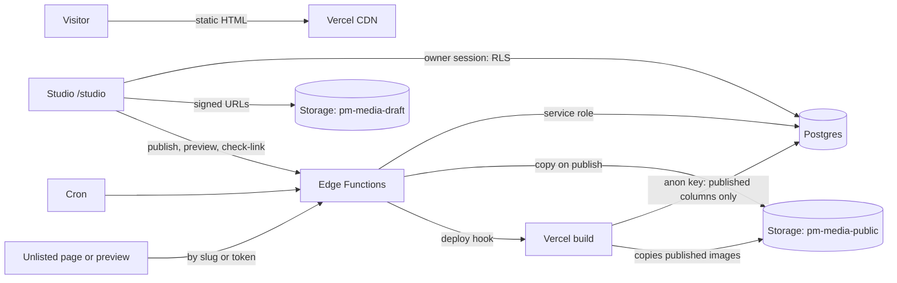

# 06 · Backend

Supabase holds everything: Postgres for content, Auth for the owner's sign-in, Storage for images and PDFs, Edge Functions for anything that needs a secret, and Cron for scheduled jobs. There's no server of our own.

**The Supabase project is shared with the owner's photography site, lumina-photography** ([09](09-decisions.md), D27). Everything here lives in its own namespace inside that project, and must never touch lumina's. Read [The shared project](#the-shared-project) before running anything against it.

The design-phase model is in [`docs/redesign/03`](../redesign/03-cms-architecture.md). This chapter is the build spec. Where they differ, this chapter wins, and each difference is called out.

## Shape



**Three rules hold everything together:**

1. **Visitors and the build only ever read published data,** through column grants and RLS. They can't select a `draft` column, even with a hand-written query.
2. **Only the owner writes,** and every write is checked in the database: RLS policies call `is_owner()`.
3. **Published JSON is self-contained.** At publish, every media reference is resolved to its public URLs, sizes and alt text, and private fields are stripped. The build needs nothing but the published columns.

## The shared project

The free plan allows two active projects, and the owner's are both in use. The portfolio therefore lives inside the project that already runs lumina-photography. That site keeps its tables in `public`, its own `public.admin_users` and `public.is_admin()`, and a storage bucket called `portfolio`.

**The portfolio's namespace.** Everything the portfolio owns is named so it can't collide with lumina, and so anyone reading the project can tell the two apart:

| Thing | Portfolio name | Lumina's, never touched |
| --- | --- | --- |
| Database schema | `pm` | `public` |
| Owner table and check | `pm.owners`, `pm.is_owner()` | `public.admin_users`, `public.is_admin()` |
| Storage buckets | `pm-media-draft`, `pm-media-public` | `portfolio` |
| Edge Functions | `pm-publish`, `pm-preview`, `pm-project`, `pm-check-link`, `pm-post-scheduler`, `pm-purge` | lumina's own |
| Edge Function secrets | `PM_DEPLOY_HOOK_URL`, `PM_ALLOWED_ORIGINS`, `PM_SITE_URL` | lumina's own |
| Cron jobs and Vault secrets | `pm-…` and `pm_…` | lumina's own |
| Migrations | `supabase/pm/migrations/`, tracked in `pm.schema_migrations` | lumina's `supabase/migrations/` |

**Rules for working in the shared project:**

1. **Never run** `supabase db push`, `supabase db reset --linked`, `supabase db pull` or `supabase migration repair` against it. The Supabase CLI keeps one migration history per project, and lumina's migrations aren't in this repo, so these commands would fail or, worse, try to reconcile the two. Migrations go through `npm run db:migrate` instead (below).
2. **Every SQL statement names its schema** (`pm.projects`, never `projects`), and no statement grants, revokes or alters anything in `public`.
3. **Storage policies are scoped by bucket.** Every policy this repo creates on `storage.objects` starts with `bucket_id = 'pm-…'`. A test checks that every policy on `storage.objects`, lumina's included, has a `bucket_id` condition. A policy without one would expose the portfolio's draft files.
4. **Auth settings are project-wide.** Any change in Authentication changes lumina's sign-in too. The settings this site needs, and what each means for lumina, are in [Auth](#auth). Change nothing else there.
5. **Deploying functions** uses `supabase functions deploy pm-<name> --project-ref <ref>`, one function at a time. Never `supabase functions deploy` with no name, and never delete a function whose name doesn't start with `pm-`.

**What the two sites share, and what that means:**

| Shared | Effect | Mitigation |
| --- | --- | --- |
| Free quotas: 500 MB database, 1 GB storage, egress, function calls | The photography site is the heavy user, especially of egress | The portfolio stores text and small WebP images, and visitors never download from Supabase: the build copies published images into the site ([Storage](#storage)) |
| Auth: users, settings, email templates, SMTP sender, rate limits | One sign-in system for both | The portfolio uses only the Magic Link template, which lumina doesn't use. Each site's data is guarded by its own owner check |
| The service-role key | A leak in either repo exposes both sites' data | It lives only in Edge Function secrets and the owner's local shell, in both repos |
| Pausing | Free projects pause after a week with no activity | Lumina's traffic keeps the project awake. If it ever pauses, the public portfolio still works (it's static); only Studio and publishing wait until it's restored |
| Outages and upgrades | Both sites are affected together | Accepted |

**The owner may be the same person on both sites.** If the Studio address is also a lumina admin, it's one auth user with a row in both `public.admin_users` and `pm.owners`. Neither check grants anything on the other site.

## Schema

The schema is `pm`. Migrations are plain SQL files in `supabase/pm/migrations/`, named `NNNN_what.sql` (`0001_init.sql`, `0002_…`). The first one creates everything below.

**Running migrations:** `npm run db:migrate` (`scripts/migrate.ts`):

- It connects with `PM_DATABASE_URL`, the project's session-pooler connection string. That value is set in the owner's local shell for the command only, never in a file.
- It applies, in order, each file not yet recorded in `pm.schema_migrations (version text primary key, applied_at timestamptz)`.
- Each file runs in one transaction with `set local search_path = pm, extensions`.
- It refuses to run a file that references `public.` (lumina's schema), alters anything in `auth`, or creates a `storage.objects` policy without `bucket_id = 'pm-`.
- Locally and in CI it runs against `supabase start`, the local stack, with the same files.

```sql
-- 0001_init.sql begins with
create schema if not exists pm;
grant usage on schema pm to anon, authenticated, service_role;
alter default privileges in schema pm revoke all on tables from anon, authenticated;
alter default privileges in schema pm revoke execute on functions from public, anon, authenticated;
create table pm.schema_migrations (version text primary key, applied_at timestamptz not null default now());
alter table pm.schema_migrations enable row level security;   -- no policies: only the migration script's connection touches it
revoke all on pm.schema_migrations from anon, authenticated;

-- Supabase gives service_role nothing in a custom schema. The Edge Functions, cron, setup:owner, seed:v0 and backup need it.
grant all on all tables in schema pm to service_role;
grant all on all sequences in schema pm to service_role;
grant execute on all functions in schema pm to service_role;
alter default privileges in schema pm grant all on tables to service_role;
alter default privileges in schema pm grant all on sequences to service_role;
alter default privileges in schema pm grant execute on functions to service_role;
```

**Expose the schema** once, in Project Settings › Data API › Exposed schemas: add `pm` next to `public`. Then supabase-js reaches it with `createClient(url, anonKey, { db: { schema: 'pm' } })`, and types are generated with `supabase gen types typescript --schema pm`.

The SQL below is written without the `pm.` prefix for readability. In the migration files, every table, function and policy name carries it.

### Tables

```sql
create extension if not exists pgcrypto;

-- Who may use Studio. Keyed by auth user id, not email (see the note below).
create table owners (
  user_id uuid primary key references auth.users on delete cascade,
  created_at timestamptz not null default now()
);

create table profile (           -- one row: facts and site copy
  id int primary key default 1 check (id = 1),
  draft jsonb not null,
  published jsonb,
  published_at timestamptz,
  version int not null default 1,
  updated_at timestamptz not null default now()
);

create table site_layout (       -- one row: sections, widgets, shelves, navigation
  id int primary key default 1 check (id = 1),
  draft jsonb not null,
  published jsonb,
  published_at timestamptz,
  version int not null default 1,
  updated_at timestamptz not null default now()
);

create table site_revisions (
  id bigserial primary key,
  profile jsonb not null,
  layout jsonb not null,
  changes jsonb not null default '[]',   -- the human-readable change list shown in the publish dialog
  published_at timestamptz not null default now()
);

create table projects (
  id uuid primary key default gen_random_uuid(),
  slug text unique not null check (slug ~ '^[a-z0-9]+(-[a-z0-9]+)*$' and length(slug) <= 80),   -- the draft address, edited in URL & SEO
  published_slug text unique,     -- the address of the live version; written only by pm-publish
  visibility text not null default 'public' check (visibility in ('public','unlisted')),
  index_allowed boolean not null default true,
  draft jsonb not null,
  published jsonb,
  published_at timestamptz,
  first_published_at timestamptz,
  version int not null default 1,
  updated_at timestamptz not null default now(),
  deleted_at timestamptz
);

create table project_revisions (
  id bigserial primary key,
  project_id uuid not null references projects on delete cascade,
  published jsonb not null,
  published_at timestamptz not null default now()
);

create table posts (
  id uuid primary key default gen_random_uuid(),
  slug text unique not null check (slug ~ '^[a-z0-9]+(-[a-z0-9]+)*$' and length(slug) <= 80),   -- the draft address
  published_slug text unique,     -- the address of the live version; written only by pm-publish
  draft jsonb not null,
  published jsonb,
  published_at timestamptz,       -- first publish: the post's date
  scheduled_for timestamptz,
  schedule_error text,            -- why the scheduler couldn't publish, shown in Studio
  version int not null default 1,
  updated_at timestamptz not null default now(),
  deleted_at timestamptz
);

create table post_revisions (
  id bigserial primary key,
  post_id uuid not null references posts on delete cascade,
  published jsonb not null,
  published_at timestamptz not null default now()
);

create table media (
  id uuid primary key default gen_random_uuid(),
  rev int not null default 1,     -- bumped by "Replace file"; part of every file's key and URL
  key text not null unique,       -- the files' prefix, '<uuid>/r<rev>' in both buckets; each file is '<key>/<variant>.<ext>'
  kind text not null check (kind in ('image','document')),
  mime text not null,
  bytes int not null,
  width int, height int,
  variants int[] not null default '{}',   -- widths generated: 480, 960, 1600
  has_og boolean not null default false,  -- a 1200×630 crop exists
  focal jsonb,                            -- { x: 0..1, y: 0..1 }; the one focal point for every use of this image
  alt text,
  decorative boolean not null default false,
  dominant text,                          -- '#RRGGBB', the loading placeholder colour
  filename text not null,                 -- the original name, shown in Studio only
  published boolean not null default false,  -- copied to pm-media-public
  created_at timestamptz not null default now()
);

create table slug_redirects (
  old_path text primary key check (old_path ~ '^/(work|writing)/[a-z0-9-]+$'),
  project_id uuid references projects on delete cascade,
  post_id uuid references posts on delete cascade,
  created_at timestamptz not null default now(),
  check ((project_id is null) <> (post_id is null))
);

create table preview_links (
  token_hash text primary key,    -- hex sha-256 of a 32-byte random token; the token is never stored
  kind text not null check (kind in ('site','project','post')),
  project_id uuid references projects on delete cascade,
  post_id uuid references posts on delete cascade,
  created_at timestamptz not null default now(),
  expires_at timestamptz not null,           -- created_at + 7 days
  revoked_at timestamptz,
  check ((kind = 'project') = (project_id is not null) and (kind = 'post') = (post_id is not null))
);

create table link_checks (        -- the last result for every external link in drafts and published content
  url text primary key,
  status text not null check (status in ('ok','login','no-frame','not-shared','gone','error')),
  detail text,
  checked_at timestamptz not null default now()
);

create table deploys (            -- one row per deploy hook call, for the "Live in about a minute" status
  id bigserial primary key,
  reason text not null,           -- 'site' | 'project:<slug>' | 'post:<slug>' | 'schedule' | 'unpublish'
  requested_at timestamptz not null default now()
);

create index on projects (deleted_at) where deleted_at is not null;
create index on posts (scheduled_for) where scheduled_for is not null;
create index on preview_links (expires_at);
```

**Differences from the design-phase doc:**

- `owners` is keyed by `user_id`, not `email`. An email can change; a user id can't, and `auth.uid()` is cheaper to check than a JWT claim.
- `media` gains the variant, focal, dominant-colour and `published` columns that the upload and publish steps need.
- `link_checks`, `deploys`, `schedule_error`, `first_published_at`, `published_slug`, `media.rev` and `site_revisions.changes` are new.
- `slug` is the draft address; `published_slug` is the live one. Editing the address in URL & SEO never changes the live site until the next publish ([09](09-decisions.md), D40).

### Timestamps and versions

A trigger on `profile`, `site_layout`, `projects` and `posts` sets `updated_at = now()` on every update. `version` is bumped by the client's autosave statement, not by a trigger (see [Autosave](#autosave)).

### JSON documents

The TypeScript types live in `src/lib/types.ts`, and the matching Zod schemas in `src/lib/schemas.ts`. Studio, the Edge Functions (`supabase/functions/_shared/schemas.ts`, a copy kept in sync by a unit test) and the build all validate with them. Every document carries `schemaVersion: 1`. New documents and blocks are created by the factories in `src/lib/defaults.ts` ([10 · Default values](10-execution-plan.md#default-values)), and the V0 documents by `buildV0Documents()` in `src/lib/v0.ts`.

```ts
type ResultType = 'achieved' | 'target' | 'projected' | 'baseline' | 'output';
type Accent = 'teal' | 'amber' | 'sky' | 'violet' | 'coral' | 'slate' | 'green' | 'yellow' | 'lime';
type Inline = string;   // sanitised inline HTML: <strong>, <em>, <a href> only
type Rich = string;     // sanitised block HTML, see Rich text
type Source = 'current-site' | 'resume' | 'owner';

// Draft documents reference media by id. Published documents carry a resolved Img instead.
type MediaRef = { mediaId: string; alt?: string; decorative?: boolean };
type Img = { src: string; srcset: string; width: number; height: number; alt: string; dominant: string; og?: string };
```

#### Profile

```ts
type Profile = {
  schemaVersion: 1;
  name: string;                       // max 60
  title: string;                      // job title, max 60
  availability?: string;              // the hero chip, max 60; empty hides the chip
  location?: string;                  // max 40
  positioning: Inline;                // the hero's main line; Studio's counter warns over 100, Zod rejects over 220 (D39). <strong> marks the brighter phrases
  intro?: Inline;                     // max 320
  heroButtons: { primary?: { label: string; href: string }; resume?: boolean };  // label max 24; resume: show "Résumé (PDF)" from contact.resume
  about: { body: Inline[]; photo?: MediaRef; points?: { id: string; title: string; text: Inline }[] };   // the heading is the section header
  proof: { id: string; value: string; unit?: string; label: string; source?: string; type?: ResultType }[];  // no type for tenure and counts
  spaces?: { label: string; items: string[] };        // the chips under the proof strip
  experience: {
    id: string; company: string; role: string; location?: string; dates: string;  // dates as displayed: 'May 2025 — Present'
    summary?: Inline;
    highlights: { id: string; group?: string; items: { id: string; text: Inline; hidden?: boolean }[] }[];
  }[];
  education?: { id: string; school: string; degree: string; dates?: string }[];
  skills: { id: string; title: string; subtitle?: string; items: { id: string; text: string; size: 'xl' | 'l' | 'm' | 's' }[] }[];
  testimonials: { id: string; quote: string; name: string; initials: string; role: string; tone: Accent; tag?: string; linkedin?: string }[];
  offDuty: {
    id: string; label: string; title: string; text: string; tag?: string;
    accent: Accent; art: 'kunai' | 'pencil' | 'paddle' | 'pan' | 'plane' | 'camera';
    picks?: { id: string; title: string; note?: string }[];
  }[];
  contact: {
    email?: string; linkedin?: string; github?: string;
    phone?: string; showPhone: boolean;              // the phone number is shown only when showPhone is on
    resume?: { mediaId?: string; url?: string };     // an uploaded PDF, or a link (V0: a Google Drive link)
    letsTalk: 'contact' | 'email' | 'linkedin' | 'booking';   // where "Let's Talk" goes; 'contact' scrolls to Contact
    booking?: string;                                // https booking page, for letsTalk: 'booking'
  };
  footer: { credit?: string };
  facts: Record<string, { source: Source; alternative?: { value: string; source: Source } }>;
  unconfirmed: string[];              // fact keys listed under "Worth a check" until the owner confirms them
};
```

**Differences from the design-phase doc:** section headers moved to the layout (below), so `about` loses its title and `contact` keeps only the links. `heroButtons`, `about.points`, `spaces`, `education`, the contact phone and "Let's Talk" settings, and the `id`s on highlight groups and items are new. The contact phone and "Let's Talk" settings are on `StudioProfile`. `heroButtons`, `about.points`, `spaces`, `education` and the testimonial fields (quote, name, initials, role, tone, tag, LinkedIn) have no board editor: Studio gives each a plain form in Profile & facts, in the boards' field styles ([05 · More fields](05-studio.md#more-fields); [09](09-decisions.md), D38).

**Fact keys** are JSON paths into the profile, for example `proof.p-users.value` or `experience.e-sugarfit.highlights.h1.items.i2.text`. Studio's "Worth a check" list reads `unconfirmed`, and shows `facts[key].alternative` next to the live value.

#### Site layout

```ts
type SiteLayout = {
  schemaVersion: 1;
  sections: Section[];                // page order: the hero is always first, the footer always last
};

type Section = {
  id: string;                         // also the DOM anchor. Built-in sections use their kind ('hero', 'about', …). Shelves and text sections get a
                                      // unique slug of their name when created ('strategy'), and it never changes after that
  kind: 'hero' | 'proof' | 'shelf' | 'writing' | 'about' | 'experience' | 'skills'
      | 'testimonials' | 'offduty' | 'contact' | 'text' | 'footer';
  visible: boolean;                   // the hero and footer are always true
  nav?: { label: string };            // set = linked in the pill nav, max 14 characters
  header?: { kicker?: string; title?: string; titleMuted?: string; intro?: Inline };   // titleMuted: the grey second half. A kicker-only header is allowed (Contact)
  items: { id: string; visible: boolean }[];
  shelf?: { name: string; rows: 1 | 2 | 3 };   // name: used in /work filters and Studio. The lead is derived: the first visible, published project in `items` (D37)
  writing?: { latest: 2 | 3 | 4; rss: boolean };
  text?: { body: Rich };
  hero?: { motion: boolean; floaters: { items: string[]; atOnce: 1 | 2 | 3 } };
  contact?: { closing: string; closingAccent?: string };   // the big closing line, e.g. "Let's build something" + "impactful"
};
```

**Differences:** `header` holds every section's kicker, two-tone title and intro, so the shelf's `title` and `intro` moved there, and the shelf keeps a short `name` for filters. `hero.motion` is the owner's motion switch ([04 · Ground rules](04-motion.md#ground-rules)). There's no stored lead: Studio's Star moves the project to the top of the shelf's `items`, and the lead is the first visible, published one ([09](09-decisions.md), D37). `header.title` is optional, so Contact can have a kicker only.

Items per section kind are as in the design-phase doc, except that `hero` drops the `motion` and `floaters` items (use `hero.motion` and `hero.floaters`) and `writing` has no items (use `writing.latest` and `writing.rss`). Plus `proof` → also `spaces`, and `about` → `points`.

#### Project

```ts
type Project = {
  schemaVersion: 1;
  overview: {
    title: string;                    // required; Studio's counter warns over 60, Zod rejects over 80 (D39)
    company: string;                  // required, max 60
    sector?: string;                  // max 40: the case study's mono line after the company ("Sri Mandir · Devotional consumer app"); empty shows the company alone
    cardLabel?: string;               // max 40, e.g. 'Strategy + prototype'
    summary: string;                  // required, max 140 (publish check)
    problem?: Inline;                 // max 280: the case study's "The problem" column
    proposal?: Inline;                // max 280: "What I proposed"
    kind: 'shipped' | 'study' | 'prototype';   // labels: "Shipped", "Strategy study", "Prototype". The case study's Type fact shows this label
    topics: string[];                 // max 8
    role?: string; timeline?: string; team?: string;   // max 80 each
    prdUrl?: string;                  // https only
  };
  visuals: {
    accent: Accent;                   // the project's colour, --pa
    hero:
      | { type: 'image' }
      | { type: 'video'; url: string; title?: string }      // title: max 80, shown on the poster
      | { type: 'prototype'; url: string; poster?: MediaRef; frame: 'phone' | 'tablet' | 'desktop' | 'none'; start: 'click' | 'visible';
          title?: string;                                   // max 80: "Seven screens from the PRD, built to be clicked."
          note?: string;                                    // max 120: the small line under the frame
          screens?: { label: string; startPath: string }[] }; // max 8, label max 30: the screen shortcuts on the laptop case study,
                                                              // and the choices for a prototype block's "Opens on"
    cover?: MediaRef;                 // none = the generated cover (C7). The focal point is the media row's (`media.focal`)
    gallery: (MediaRef & { caption?: string })[];
  };
  story: { id: string; title: string; hidden: boolean; blocks: Block[];
    prompts?: string[];               // Studio-only "Questions to answer" for an empty chapter; never published
  }[];
  outcomes: {
    id: string; value: string; label: string; type: ResultType;
    credit?: 'mine' | 'team' | 'business';
    evidence?: string;                // PRIVATE: never copied to `published`
    inStrip: boolean;                 // shown under "Success measures"
  }[];
  headlineOutcomeId?: string;         // the number on cards, /work rows and floating previews
  seo: { title?: string; description?: string; ogImage?: 'cover' | MediaRef };
  settings: { redirectOldSlug: boolean };   // "Redirect the old address here"; on by default once the project has been published (D40)
  todo?: string[];                    // PRIVATE: "Needs input" notes for the dashboard, e.g. 'prototype-link'; never copied to `published`
};

type Block =
  | { id: string; type: 'text'; body: Rich; style: 'body' | 'lead' }
  | { id: string; type: 'heading'; body: string }
  | { id: string; type: 'list'; body: Rich }                     // one <ul> or <ol>
  | { id: string; type: 'quote'; body: string; cite?: string }
  | { id: string; type: 'callout'; body: Rich; tone: 'neutral' | 'accent' }
  | { id: string; type: 'metrics'; outcomeIds?: string[] }      // empty: the outcomes marked inStrip; set: just these, e.g. one inline stat
  | { id: string; type: 'table'; columns: string[]; rows: string[][]; formula?: 'rice';
      checkFormula: boolean; sortByScore: boolean; highlightTop: 0 | 3; phoneCards: boolean; reviewed?: string[] }   // highlightTop: the board's switch
  | { id: string; type: 'image'; media: MediaRef & { caption?: string } }
  | { id: string; type: 'gallery' | 'beforeafter'; media: (MediaRef & { caption?: string })[] }
  | { id: string; type: 'video'; url: string; title?: string }
  | { id: string; type: 'prototype'; startPath?: string }
  | { id: string; type: 'journey'; stages: { title: string; note?: string }[] }
  | { id: string; type: 'ownership'; mine: Inline; team?: Inline; business?: Inline; decision?: Inline }
  | { id: string; type: 'cards'; columns: 2 | 3 | 4; style?: 'cards' | 'chips'; items: { kicker?: string; title: string; note?: string }[] }   // chips: titles only, as pills
  | { id: string; type: 'divider' };
```

**Differences:** every block has an `id` (for drag, links and the change list). `visuals.accent`, `overview.problem` and `overview.proposal` are new ([09](09-decisions.md), D25 and D26). The table gains the four switches from `EditorCaseStudy`'s table panel (check the formula, sort by score, highlight the top rows, cards on phones), plus `reviewed`: rows the owner marked as checked. Cards gain an optional `kicker`, as on the case-study board's priority cards. `ownership` gains the "Key decision and trade-off" row (`decision`); its four fields are "I owned" (`mine`), "I partnered on" (`team`), "Team or business" (`business`) and `decision`. `metrics` can name its outcomes (`outcomeIds`), for a single stat inside a chapter like the case study's "60s". Cards can render as pills (`style: 'chips'`), for the segment chips. `overview.sector`, `settings`, `todo`, chapter `prompts` and the hero video's `title` are new. The cover's focal point moved to the media row, so every use of an image shares one crop.

**RICE tables.** With `formula: 'rice'`, the columns are `#`, the item name, `Reach`, `Impact`, `Conf.`, `Effort`, `RICE`. Cells hold text exactly as entered ("85%", "2 mo"). The score check parses the numbers: `reach × impact × (confidence / 100) ÷ effort`, rounded to one decimal, compared with the shown score. A row that differs by more than 0.05, and isn't in `reviewed`, is flagged in Studio ("1 row needs a look"). The site always shows the scores as entered.

**Card notes** are plain text. A line break in a note renders as a new line.

#### Post

As in the design-phase doc, plus `schemaVersion`, an `id` on each block, and `cover?: MediaRef`. Topics: max 8 per post.

### Published shape

Publishing turns a draft document into its published shape:

- every `MediaRef` becomes an `Img`, using the media row's alt text unless the reference overrides it;
- outcome `evidence`, `todo`, `settings` and chapter `prompts` are removed, and so is any outcome or block the owner hid;
- a video hero or `video` block gets `poster: Img` (the host's thumbnail, stored as a media row at publish; for Drive, the cover) and `duration?: string` ('3:24', when the host's oEmbed gives it);
- chapters that are hidden or empty are removed;
- rich text is sanitised again, server-side;
- a post gets `readingMinutes`, `excerpt` (its own, or its first 160 characters) and `modifiedAt` (this publish's time, for `article:modified_time`).

`src/lib/types.ts` exports both shapes: `ProjectDraft` and `ProjectPublished`, and so on. Public components only accept the published types, so a draft field can't be rendered by accident.

## Topics

Topics aren't a table. The vocabulary is computed from the drafts, which only the owner can read:

```sql
create function topic_counts(kind text)
returns table (topic text, uses int)
language sql stable security invoker set search_path = '' as $$
  select min(t) as topic, count(*)::int as uses
  from (
    select jsonb_array_elements_text(p.draft -> 'topics') as t from pm.posts p
      where kind = 'post' and p.deleted_at is null
    union all
    select jsonb_array_elements_text(p.draft -> 'overview' -> 'topics') from pm.projects p
      where kind = 'project' and p.deleted_at is null
  ) x
  group by lower(t)
  order by lower(min(t));
$$;
revoke all on function topic_counts(text) from public;
grant execute on function topic_counts(text) to authenticated;
```

It runs as the caller, so RLS applies and visitors get nothing. Studio's topic picker ([02 · S1](02-tokens-and-components.md#s1--topic-picker)) calls it through `supabase.rpc('topic_counts', { kind })`. A topic used by nothing disappears by itself.

## Row-level security

Every table has RLS on. One function decides who the owner is:

```sql
create function is_owner() returns boolean
language sql stable security definer set search_path = '' as $$
  select exists (select 1 from pm.owners where user_id = auth.uid());
$$;
revoke all on function is_owner() from public;
grant execute on function is_owner() to authenticated;
```

**Owner policies.** On every table except `owners` and `schema_migrations`, which have RLS on and no policies:

```sql
alter table projects enable row level security;
create policy owner_all on projects for all to authenticated
  using (is_owner()) with check (is_owner());
```

**`pm.owners`** has RLS on and no policies at all: only the service role (the setup script) touches it. `is_owner()` reads it as definer.

**Visitor reads.** Column grants first, then a row policy:

```sql
-- The owner works through RLS, and writes drafts only (D55): published columns, revisions, redirects,
-- previews, link checks and deploys are written by the pm- functions. 0001_init.sql has the full list.
grant select on pm.profile, pm.site_layout, pm.projects, pm.posts, pm.media /* …every Studio table */ to authenticated;
grant update (draft, version) on profile, site_layout to authenticated;
grant insert (slug, draft), update (slug, draft, version) on projects, posts to authenticated;

grant select (id, published_slug, published, published_at, first_published_at, index_allowed) on projects to anon;   -- id: D56; index_allowed: 0004, for noindex and the sitemap
create policy public_read on projects for select to anon
  using (published is not null and deleted_at is null and visibility = 'public');

grant select (id, published_slug, published, published_at) on posts to anon;
create policy public_read on posts for select to anon
  using (published is not null and deleted_at is null);

grant select (published, published_at) on profile, site_layout to anon;
create policy public_read on profile for select to anon using (published is not null);
create policy public_read on site_layout for select to anon using (published is not null);
```

Every later migration that creates a table adds, for that table, its grants to `authenticated` (select, and writes on draft columns only), `enable row level security` and `owner_all`, in the same migration; `npm run db:lint` fails otherwise. `db:migrate` also records each file's SHA-256 (from `0003`) and refuses to run when an applied file has changed: a change always goes in a new migration.

Nothing else is granted to `anon`: no media table, revisions, previews, link checks or deploys. Every function is created with `revoke all … from public` and an explicit grant, as below. Nothing here touches the `public` schema.

**Redirects** reach the build through a function, so visitors never see old slugs of things that aren't live:

```sql
create function public_redirects()
returns table (old_path text, new_path text)
language sql stable security definer set search_path = '' as $$
  select r.old_path, '/work/' || p.published_slug from pm.slug_redirects r join pm.projects p on p.id = r.project_id
    where p.published is not null and p.deleted_at is null and p.visibility = 'public'
  union all
  select r.old_path, '/writing/' || p.published_slug from pm.slug_redirects r join pm.posts p on p.id = r.post_id
    where p.published is not null and p.deleted_at is null
  union all   -- pages that were public once and aren't any more: the "moved" note
  select '/work/' || p.published_slug, '/work?moved=1' from pm.projects p
    where p.first_published_at is not null and (p.published is null or p.deleted_at is not null) and p.visibility = 'public'
  union all
  select '/writing/' || p.published_slug, '/writing?moved=1' from pm.posts p
    where p.published_at is not null and (p.published is null or p.deleted_at is not null);
$$;
revoke all on function public_redirects() from public;
grant execute on function public_redirects() to anon, authenticated;
```

**Signed-in users who aren't the owner** match no policy, so RLS returns zero rows and rejects every write, even though `authenticated` holds table privileges. This includes lumina's admins.

**Tests.** `tests/rls.test.ts` runs against a local Supabase (`supabase start`) and must pass in CI:

- as `anon`: selecting `draft` from every table fails; selecting a draft, scheduled, deleted or unlisted row returns nothing; every write fails;
- as a signed-in non-owner: every select returns zero rows and every write fails;
- as the owner: every operation works;
- `public_redirects()` never returns a path for a project or post that was never published.

## Auth

Studio signs in with an **8-digit code sent by email**. Decided 13 Oct 2026 ([09](09-decisions.md), D8), with 8 digits from 15 Oct 2026 (D66). The screens and every state are in [05 · Sign-in](05-studio.md#sign-in). This section is the plumbing.

### Supabase settings

Set in the dashboard. **Every one of these is project-wide, so it also applies to lumina-photography**, which signs its admins in with email and password, with SMS codes, and resets passwords by email link. The last column says what each setting means for lumina. None of these values are secrets, except the SMTP password and the Turnstile secret key, and those never leave the dashboard.

| Where | Setting | Effect on lumina |
| --- | --- | --- |
| Authentication › Sign In / Providers › Email | Email provider on. Confirm email on | None: lumina already needs both |
| Same page | **Allow new users to sign up: off** | Lumina's admins are created by hand, so nothing breaks. It also stops anyone creating an account through lumina's password or SMS forms. Confirm with the owner before switching it |
| Same page | Email OTP length: 8 ([09](09-decisions.md), D66) | None: lumina doesn't use email codes |
| Same page | Email OTP expiration: 600 seconds | Lumina's password-reset links also expire after 10 minutes instead of an hour |
| Authentication › Sign In / Providers › Phone | Leave as it is | Lumina's SMS codes (Twilio) keep working |
| Same page | No other providers. Anonymous sign-ins off | None |
| Authentication › Emails › Templates › Magic Link | Subject "Your Studio sign-in code". The body below: the code, no link | None: lumina uses the Reset Password template, which isn't changed |
| Authentication › Emails › SMTP | Custom SMTP (Resend by default). If lumina already has a sender set up, keep it. Otherwise use `no-reply@<domain>`, with the owner's name as the sender name | Lumina's reset emails use the same sender |
| Authentication › Rate Limits | Emails sent: 30 an hour. Token verifications: 30 per 5 minutes per IP. Keep the default 60-second gap between codes for one address | The email budget is shared by both sites. 30 an hour is plenty for two owners |
| Authentication › Attack Protection | CAPTCHA protection on, with Cloudflare Turnstile and the Turnstile secret key. **Only after lumina sends Turnstile tokens** (below) | Once on, Supabase rejects lumina's password sign-in, SMS code request and password reset without a CAPTCHA token |
| Authentication › URL Configuration | No change. Code sign-in doesn't use redirects | None |
| Authentication › Sessions | No change: refresh token rotation stays on | None |

**Turning on CAPTCHA protection** needs a small change in lumina-photography first: its login and forgot-password pages must render Turnstile and pass `options: { captchaToken }`. That's a change to another repository, so it needs the owner's go-ahead ([09](09-decisions.md), Q8). Until then:

- CAPTCHA protection stays off;
- Studio still renders Turnstile and sends the token, which Supabase ignores while protection is off, so nothing changes in Studio when it's switched on;
- sign-in is protected by the rate limits alone.

The email body, as HTML with a plain-text part:

```
Your Studio sign-in code

  {{ .Token }}

It works once and expires in 10 minutes.
Only enter it at https://<domain>/studio. Nobody from the site will ever ask you for it.
If you didn't ask for a code, you can ignore this email.
```

In the dashboard's template editor, `{{ .Token }}` is typed as is. (On the boards it's escaped, because the board format uses the same braces.)

**DNS for the sender domain:** SPF, DKIM and a DMARC record (`p=quarantine` to start) as the email provider describes. Codes landing in spam is the main way this flow fails.

### Turnstile

- Create one Turnstile widget in Cloudflare, mode **Managed**, with every hostname that signs in to the shared project: the portfolio's domain, lumina's domain and `localhost`. Supabase holds a single Turnstile secret for the whole project, so both sites must use the same widget.
- The site key goes in `VITE_TURNSTILE_SITE_KEY` (public). The secret key goes only in Supabase › Attack Protection.
- Studio renders the widget on the sign-in page only, with `@marsidev/react-turnstile` or the plain script from `https://challenges.cloudflare.com/turnstile/v0/api.js?render=explicit`. It's invisible unless Cloudflare wants a check, which is the board's "bot check" state.
- A token is single-use. Get a fresh one before each `signInWithOtp` and each `verifyOtp`: call `turnstile.reset()` after every request.

### The owner

`scripts/setup-owner.ts`, run once as `npm run setup:owner`:

1. Reads `SUPABASE_URL`, `SUPABASE_SERVICE_ROLE_KEY` and `OWNER_EMAIL` from the environment. It refuses to run if any is missing, and never reads a `.env` file inside the repo.
2. Lower-cases and trims the email.
3. Finds the user with that email, or creates it with `auth.admin.createUser({ email, email_confirm: true })`.
4. Inserts `pm.owners (user_id)`, if it isn't there. If the address already belongs to a lumina admin, it reuses that user: being a lumina admin grants nothing here, and being the Studio owner grants nothing on lumina.
5. Prints "Owner ready" and the user id. It never prints the key, and only prints the email masked (`a•••••••0@gmail.com`).

Run it from a shell where the variables are set for that command only, for example `OWNER_EMAIL=… SUPABASE_SERVICE_ROLE_KEY=… npm run setup:owner`. **The owner's address never appears in code, migrations, seeds or tests.** Tests use `owner@example.test` against a local Supabase.

To change the owner's address later: change it in Supabase › Authentication › Users. The `owners` row follows the user id, so nothing else changes.

### Client code

`src/lib/auth.ts` wraps every call, so the screens never touch supabase-js directly:

```ts
export async function sendCode(email: string, captchaToken: string) {
  const { error } = await supabase.auth.signInWithOtp({
    email: email.trim().toLowerCase(),
    options: { shouldCreateUser: false, captchaToken },
  });
  // Never reveal whether the address has an account.
  if (error && !isUserNotFound(error)) return classify(error);   // 'rate' | 'captcha' | 'offline' | 'unknown'
  return 'sent';
}

export async function checkCode(email: string, token: string, captchaToken: string, sentAt: number) {
  const { data, error } = await supabase.auth.verifyOtp({ email, token, type: 'email', options: { captchaToken } });
  if (error) return Date.now() - sentAt > 10 * 60_000 ? 'expired' : classify(error);   // 'wrong' | 'rate' | …
  const { data: owner } = await supabase.rpc('is_owner');
  if (!owner) { await supabase.auth.signOut(); return 'not-owner'; }
  return 'signed-in';
}
```

- **"Wrong" or "expired".** Supabase returns the same error for both, so the client decides by time since the code was sent. `sentAt` is kept in `sessionStorage`, with the email.
- **Five wrong codes** lock the code boxes on that device for 15 minutes ("too many tries"). The lock is kept in `localStorage` per address. The server-side limits are the real defence; the lock just stops a person from guessing.
- **Remembered address.** After a successful sign-in, the email is kept in `localStorage` (`studio.email`) so the next sign-in is one tap. "Use a different email" clears it.
- **Sessions.** supabase-js with `persistSession: true` and `autoRefreshToken: true`, stored in `localStorage` under the default key. Studio never puts tokens in URLs.
- **Signing out.** "Sign out" calls `signOut({ scope: 'local' })`. "Sign out on all devices" calls `signOut({ scope: 'global' })`. Both clear the Studio query cache and IndexedDB drafts that have synced. Unsynced drafts stay, and Studio says so in the confirm dialog.
- **Deep links.** A signed-out visit to `/studio/projects/abc` redirects to `/studio/login?next=%2Fstudio%2Fprojects%2Fabc`. After sign-in, `next` is followed only if it matches `^/studio(/[A-Za-z0-9\-_/]*)?$`. Anything else goes to `/studio`.
- **Back/forward cache.** Studio pages are `Cache-Control: no-store`. A `pageshow` listener reloads when `event.persisted` is true, so a page restored after sign-out never shows content. This is the SessionGuard pattern from the owner's lumina-photography admin.

### Abuse limits, all together

| Limit | Where it's enforced |
| --- | --- |
| One code per address per 60 seconds | Supabase Auth |
| 30 emails an hour, for the whole project | Supabase Auth |
| 30 code checks per 5 minutes per IP | Supabase Auth |
| A Turnstile token on every code request, once CAPTCHA protection is on. Studio sends one on code checks too, but don't count on Supabase checking it there | Supabase Auth, with Cloudflare |
| Codes expire after 10 minutes, work once, and a new code replaces the old | Supabase Auth |
| No sign-ups, ever | Supabase Auth setting, plus `shouldCreateUser: false` |
| Owner-only data | RLS with `is_owner()` |
| 5 wrong codes lock that device for 15 minutes | Studio (convenience, not security) |

**What's left.** Supabase limits code checks per IP address, not per email address, and doesn't lock a code after wrong guesses. An attacker with many IP addresses could request a fresh code every minute and spread guesses across addresses. With 8 digits (D66) and CAPTCHA off (D54), it stays impractical even for a sustained attack: 100 million codes, a fresh one each minute. It would also flood the owner's inbox with a code a minute, which is easy to notice.

The owner chose 8 digits over the boards' 6 (Q9, D66): one dashboard setting that makes guessing 100 times harder. The code input shows 8 boxes.

## Storage

Two buckets. Images are resized in the browser before upload, because Supabase's image transformations aren't on the free plan.

| Bucket | Public | Holds | Who writes |
| --- | --- | --- | --- |
| `pm-media-draft` | No | Every upload, all variants | The owner, through RLS on `storage.objects` |
| `pm-media-public` | Yes, read-only | Copies of media used by published content | The `pm-publish` Edge Function only |

```sql
create policy pm_owner_draft on storage.objects for all to authenticated
  using (bucket_id = 'pm-media-draft' and pm.is_owner())
  with check (bucket_id = 'pm-media-draft' and pm.is_owner());
-- pm-media-public: no policies for anon or authenticated. Public read comes from the bucket's public flag.
```

**Why two buckets:** a draft's images must never be reachable, even by a guessed URL. Studio shows draft images through signed URLs that last an hour. Publishing copies the files a document uses into `pm-media-public` and records `media.published = true`.

**Upload pipeline** (Studio, `src/lib/media.ts`):

1. **Accept** PNG, JPG, WebP, GIF and HEIC up to 10 MB, and PDF up to 10 MB. Anything else is refused with the message on `StudioMedia`.
2. **Convert** HEIC to JPG with `heic2any`.
3. **Measure** width and height, and compute the dominant colour from a 16×16 downscale.
4. **Resize** with `createImageBitmap` and `OffscreenCanvas` to 480, 960 and 1600 wide (never upscaled), encoded as WebP at quality 0.82. GIFs keep their original file and get a WebP poster only.
5. **Crop** a 1200×630 Open Graph image around the focal point when the image is used as a cover, and again whenever the focal point moves.
6. **Upload** with the resumable (TUS) endpoint, so a lost connection pauses rather than fails.
7. **Key** every file as `<media id>/r<rev>/<variant>.<ext>`: `orig.jpg`, `480.webp`, `960.webp`, `1600.webp`, `og.jpg`. Ids are random UUIDs; filenames never appear in URLs.
8. **Strip metadata.** Re-encoding drops EXIF, including location. The original is re-encoded too (JPG quality 0.9) rather than uploaded as is.

**Visitors never load images from Supabase.** The published JSON stores each image's storage key. At build, `scripts/fetch-media.ts` downloads every image the published content uses from `pm-media-public` into `build/client/media/<id>/r<rev>/<variant>.webp`, and `Img.src` and `Img.srcset` point at `/media/…` on the site itself. That keeps the shared egress quota for lumina, and lets Vercel's CDN cache the files.

- Only the draft preview and Studio load images from Supabase, through signed URLs.
- The build caches downloads by key between deploys, so an unchanged image isn't fetched again.

**Deleting.** A media row that any draft or published document uses can't be deleted; Studio shows where it's used ([05 · Media](05-studio.md#media)). "Replace file" uploads a new set of files under the same media id and bumps `media.rev`, so the new files get new URLs and no cache serves the old ones. Drafts and Studio show the new file at once. Live pages show it after each document that uses it is published again: Studio lists those documents and offers "Publish all n", which calls `pm-publish` for each ([09](09-decisions.md), D41). The old revision's files leave both buckets in the nightly purge once nothing published uses them. Other unused files leave `pm-media-public` in the nightly purge.

## Rich text

Rich text is stored as HTML from a small allowlist, and sanitised twice: in Studio when saved, and in the `pm-publish` function. The build renders it with `dangerouslySetInnerHTML` only from published documents.

| Kind | Tags | Attributes |
| --- | --- | --- |
| `Inline` | `strong`, `em`, `a` | `href` |
| `Rich` | `p`, `strong`, `em`, `a`, `ul`, `ol`, `li`, `br` | `href` |

- **Links:** `https:` and `mailto:` only, and relative links starting with `/`. Every external link gets `rel="noopener noreferrer"` and `target="_blank"` at render.
- **The sanitiser:** DOMPurify with `ALLOWED_TAGS`, `ALLOWED_ATTR: ['href']` and a hook that drops any other URL scheme. In Edge Functions, the same config with `isomorphic-dompurify`. `src/lib/rich-text.ts` exports one `sanitize(kind, html)` used everywhere.
- **TipTap** in Studio is configured with only the matching extensions (StarterKit with headings, code, blockquote, strike and horizontal rule off; Link with `protocols: ['https', 'mailto']`), so the editor can't produce anything the sanitiser would remove.
- **Code blocks** in posts are plain text, escaped at render.
- **The legacy content** uses `<strong>` and plain text only, so it passes the allowlist unchanged ([07](07-v0-content.md#extraction)).

## Autosave

Studio saves a draft 800ms after the last edit:

```sql
update projects set draft = $1, version = version + 1
where id = $2 and version = $3          -- $3: the version Studio last saw
returning version;
```

- **Zero rows** means another tab or device saved first. Studio shows the conflict dialog from `StudioStates` ("This changed in another tab"), with "Load latest" and "Keep mine". "Keep mine" re-reads the version and saves again.
- **Offline**, edits queue in IndexedDB (`idb-keyval`), one entry per document, newest wins. They sync in order on reconnect, with the same version check.
- The same pattern applies to `profile`, `site_layout` and `posts`.

## Edge Functions

All in `supabase/functions/`, each folder named for its function (`pm-publish/` and so on), in Deno and TypeScript. Shared code is in `_shared/`: the owner check, Zod schemas, the sanitiser, CORS (allowing only `PM_ALLOWED_ORIGINS`) and the deploy-hook call. Every function name starts with `pm-`, because the project's functions are shared with lumina.

Every function that Studio calls:

1. reads the `Authorization: Bearer <jwt>` header and gets the user with `supabase.auth.getUser(jwt)`;
2. checks `owners` with the service-role client;
3. answers `401` or `403` with no detail otherwise.

| Function | Called by | Does |
| --- | --- | --- |
| `pm-publish` | Studio | Publishes, unpublishes or deletes: `{ action: 'publish' \| 'unpublish' \| 'delete' \| 'restore' \| 'settings', kind: 'site' \| 'project' \| 'post', id?, confirmUnconfirmed?: boolean, visibility?, indexAllowed? }`. `settings` (projects only) writes `visibility` and `index_allowed` and calls the deploy hook, because URL & SEO's "Who can find it" applies without a publish |
| `pm-preview` | Visitors with a link; Studio to create links | `GET ?token=` returns the draft rendered data. `POST { kind, id }` (owner) creates a link and returns the token once. `DELETE { tokenHash }` revokes |
| `pm-project` | The unlisted-page shell | `GET ?slug=` matches `published_slug` and returns the published JSON of that project if it's published and not deleted. `404` otherwise |
| `pm-check-link` | Studio, when a link is pasted; `pm-publish`; the nightly cron | `{ url, kind: 'video' \| 'prototype' \| 'prd' }` → `{ status, detail }`. Writes `link_checks` |
| `pm-post-scheduler` | Cron, every 5 minutes | Publishes posts whose `scheduled_for` has passed |
| `pm-purge` | Cron, nightly at 03:17 UTC | Removes soft-deleted rows older than 30 days, expired preview links older than 30 days, and files in either bucket that nothing uses |

### pm-publish

For `kind: 'project'`, `action: 'publish'`:

1. Load the draft and validate it with the Zod schema.
2. **Run the checks.** Each failure is returned as `{ field, message }`, with the messages from the `Editor*` boards' publish dialogs:
   - title, company, summary or slug missing; summary over 140 characters;
   - an image without alt text that isn't marked decorative;
   - an Achieved outcome without evidence;
   - a video link from an unsupported host, or a Drive video that isn't shared (`pm-check-link`);
   - a prototype link that asks for a login (`pm-check-link`);
   - a RICE table with a flagged row that isn't marked reviewed is a **warning**, not a failure ([09](09-decisions.md), D61): the publish goes ahead and the response is `{ ok: true, …, warnings: [{ field, message, code: "rice-row" }] }`.
3. Build the published shape (above), copying any media not yet in `pm-media-public`.
4. In one transaction:
   - write `published`, `published_at = now()`, `published_slug = slug`, and `first_published_at` if it's null;
   - insert a `project_revisions` row;
   - on the first publish, place the project in the **published** layout, right after the nearest project before it in the draft layout that's already live, and insert a `site_revisions` row;
   - if `published_slug` was set and differs from `slug`, and `draft.settings.redirectOldSlug` is true, insert `slug_redirects ('/work/' || old published_slug)` before overwriting it. Posts do the same with `/writing/` (posts redirect always).
5. Call the deploy hook and insert a `deploys` row. If the hook fails, the publish still stands; Studio shows "Published. The site will update on the next deploy" and offers "Try again".

For `kind: 'site'`, step 2 drops unknown ids, and returns `needsConfirm: [...]` if unconfirmed facts are visible and `confirmUnconfirmed` isn't true. Step 4 writes both `profile` and `site_layout` with one `site_revisions` row, whose `changes` lists the moves and switches computed with the longest-increasing-subsequence diff ([`docs/redesign/03`](../redesign/03-cms-architecture.md#website-builder)).

For posts, step 2 runs the Writing checks and step 3 adds `readingMinutes = ceil(words / 220)`.

`unpublish` sets `published = null`, keeps the layout spot, and rebuilds. `delete` sets `deleted_at`; Studio offers Undo for 7 seconds, which calls `restore`.

### pm-preview

- `POST` creates 32 random bytes, stores the SHA-256 hex in `preview_links` with `expires_at = now() + 7 days`, and returns `https://<domain>/preview/<base64url token>`. The raw token is never stored or logged.
- `GET` hashes the token and looks it up. Expired or revoked returns `410`. Otherwise it returns the draft in its published shape, with signed URLs (1 hour) for draft images, and `Cache-Control: no-store`, `X-Robots-Tag: noindex, nofollow`.
- A site preview returns the draft profile and layout, with published projects and posts only.

### pm-check-link

Fetches the URL from the function, with no cookies and a 10-second timeout, following up to 5 redirects:

| Result | When |
| --- | --- |
| `ok` | 2xx, framable if it's a prototype |
| `login` | A redirect to a login page: `vercel.com/login`, `accounts.google.com`, `figma.com/login`, or any 401/403 |
| `no-frame` | A prototype that sends `X-Frame-Options` or a CSP `frame-ancestors` that excludes the site's domain. The site then shows "Open prototype ↗" |
| `not-shared` | A Google Drive file whose `/preview` URL redirects to sign-in |
| `gone` | 404 or 410 |
| `error` | Anything else, including timeouts |

Supported video hosts: `youtube.com`, `youtu.be`, `vimeo.com`, `loom.com`, `drive.google.com`. YouTube embeds use `youtube-nocookie.com`.

### Cron

Set with `pg_cron` and `pg_net` in a migration, calling the functions with the service-role key from Vault (secret `pm_service_role_key`). Job names start with `pm-`, so they're easy to tell from lumina's in `cron.job`:

| Job | Schedule | Calls |
| --- | --- | --- |
| `pm-scheduled-posts` | `*/5 * * * *` | `pm-post-scheduler` |
| `pm-link-check` | `23 2 * * *` | `pm-check-link` for every URL in published content; failures appear on the Studio dashboard |
| `pm-purge` | `17 3 * * *` | `pm-purge` |

## Build-time data

`src/lib/content.server.ts` is the only module the prerender loaders use. It creates a supabase-js client with the **anon** key and `db: { schema: 'pm' }`, and reads:

- `profile.published` and `site_layout.published`;
- `projects`: `published_slug, published, published_at, first_published_at`, and `posts`: `published_slug, published, published_at` (RLS returns public, live rows only). Pages are built at `published_slug`, never at the draft `slug`;
- `public_redirects()`.

If any read fails, the build fails. It never falls back to stale or local data in production.

From that data, the build:

- prerenders every public route ([01 · Routes](01-architecture.md#routes));
- writes `sitemap.xml`, `robots.txt` and `/writing/rss.xml` (`scripts/build-feeds.ts`);
- downloads the published images into `/media/` (`scripts/fetch-media.ts`);
- writes `vercel.json` with redirects, the legacy `?open=` redirects and headers (`scripts/write-vercel-config.ts`).

**Deploys.** The deploy hook builds the `main` branch. Several publishes within a minute each call the hook; Vercel cancels superseded builds, so the last one wins.

## SEO

| Page | Title | Description | Canonical | Open Graph image |
| --- | --- | --- | --- | --- |
| `/` | `{name} · {title}` | The positioning line, as plain text, cut at 160 | `SITE_URL/` | `public/og-default.png` (1200×630, from the hero) |
| `/work` | `Work · {name}` | "Every project, with labelled results." | `/work` | Default |
| `/work/:slug` | `seo.title` or `{title} · {name}` | `seo.description` or `summary` | `/work/:slug` | `seo.ogImage`, else the cover's `og` crop, else default |
| `/writing` | `Writing · {name}` | "Notes on product, data and building." | `/writing` | Default |
| `/writing/:slug` | `seo.title` or `{title} · {name}` | `seo.description` or the excerpt | `canonicalUrl` or `/writing/:slug` | The cover's crop, else default |

- **Posts** add `article:published_time`, `article:modified_time` and `BlogPosting` JSON-LD.
- **The home page** adds `Person` JSON-LD with the name, job title and `sameAs` links (LinkedIn, GitHub when set).
- **`noindex`:** `/preview/*`, the unlisted shell, `/studio/*`, and any project with `index_allowed = false`.
- **`robots.txt`:** allow all, disallow `/studio` and `/preview`, and list the sitemap.
- **`og-default.png`** is generated once from `Home.dc.html`'s hero at 1200×630 and committed to `public/`. It shows only content that's already public.

## Backups

The free plan has no downloadable backups, and a public repo can't hold them. So:

- **`npm run backup`** (`scripts/backup.ts`) exports every `pm` table as JSON and every file in the two `pm-` buckets into `backups/<date>/`, which `.gitignore` excludes. It never reads lumina's data. It runs on the owner's machine with the service-role key in the shell, like `setup:owner`.
- Revisions tables keep every published version, so a bad publish can be rolled back from Studio without a backup.

## Security

The full checklist is in [`SECURITY.md`](../../SECURITY.md) and [`docs/redesign/03`](../redesign/03-cms-architecture.md#security-checklist). What this chapter adds:

- **What a visitor can reach:** static files; `pm-media-public`; `public_redirects()`; published columns through RLS; the `pm-project` function for exact slugs; the `pm-preview` function for valid tokens. Nothing else.
- **What a non-owner account can reach:** nothing more than a visitor, and it can't be created anyway: sign-ups are off.
- **Drafts never leak.** Tested end to end in `tests/e2e/no-leaks.spec.ts`: create a draft project, a scheduled post and an unlisted project with known marker strings, build, then assert the markers appear in no built file, no sitemap, no RSS, no `vercel.json`, and no anon query result.
- **Secrets stay in dashboards.** The build checks that no `VITE_` variable holds a service-role JWT, and CI runs gitleaks on every push.
- **Edge Functions** never log request bodies, tokens or email addresses.
- **The shared project** ([above](#the-shared-project)): the RLS test also asserts that no policy in `pm` refers to `public`, and that every policy on `storage.objects` names a bucket. The lumina admin role, signed in, must read zero rows from `pm` unless that user is also in `pm.owners`.
- **Errors** shown to visitors never include stack traces or Supabase messages.
