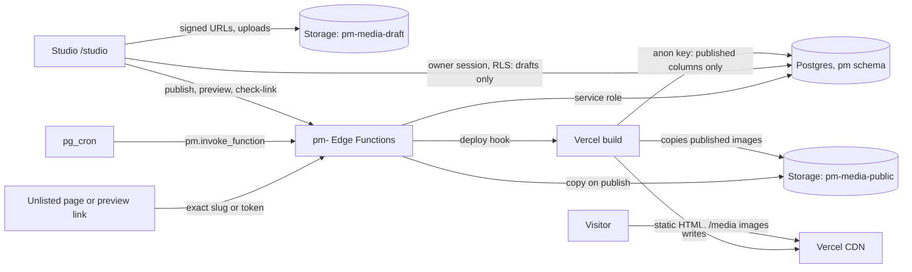

# Architecture

The portfolio is a static site that rebuilds itself when the owner publishes. Public pages are prerendered to HTML at build time from published content only. Studio, the private CMS, is a client-only app at `/studio` that talks straight to Supabase as the signed-in owner. Publishing goes through one Edge Function, `pm-publish`, which writes the published copy and calls a Vercel deploy hook, and Vercel rebuilds the site. There is no server of our own. Status as of 15 Oct 2026: the site isn't launched yet (M6 is pending), and `main` still serves the old site ([D46](../handover/09-decisions.md)). The backend is built and tested locally, but its migrations haven't been applied to the shared Supabase project yet. The owner does that at go-live.

## The system

Three rules hold it together ([06 · Shape](../handover/06-backend.md#shape)):

1. **Visitors and the build only read published data.** Column grants and row-level security stop the `anon` role selecting a `draft` column at all ([0001_init.sql](../../supabase/pm/migrations/0001_init.sql)).
2. **Only the owner writes, and the owner writes drafts only.** The owner's session can't write `published`, `published_slug`, `visibility`, `index_allowed`, `deleted_at`, `scheduled_for` or any revision, redirect, preview, link-check or deploy row. `pm-publish` runs as the service role and is the only writer, so the publish checks and the server-side sanitiser can't be skipped ([D55](../handover/09-decisions.md)).
3. **Published JSON is self-contained.** At publish, media references become resolved images and private fields are removed, so the build needs nothing but the published columns ([src/lib/published.ts](../../src/lib/published.ts)).

## Stack

| Layer | Choice | Why |
| --- | --- | --- |
| Language | TypeScript, strict | [D2](../handover/09-decisions.md) |
| UI and routing | React 18, React Router 7 in framework mode, Vite 6 | Prerendered public routes and a client-only `/studio` from one codebase ([D2](../handover/09-decisions.md)) |
| Styling | Plain CSS with the board tokens as CSS variables, a CSS Module per component | The design boards are plain CSS, so values are copied directly |
| Validation | Zod schemas for every JSON document | One definition shared by Studio, the seed, the build and the Edge Functions ([src/lib/schemas.ts](../../src/lib/schemas.ts)) |
| Backend | Supabase: Postgres, Auth (email code), Storage, Edge Functions, Cron | [D2](../handover/09-decisions.md), shared with another site ([D27](../handover/09-decisions.md)) |
| Hosting | Vercel, static output plus a deploy hook | [D2](../handover/09-decisions.md), the owner's existing account ([D49](../handover/09-decisions.md)) |
| Studio data layer | Its own small query cache and IndexedDB wrapper | Fewer dependencies than TanStack Query and idb-keyval ([D65](../handover/09-decisions.md)) |
| Studio reorder and rich text | Its own, not dnd-kit and TipTap | Provisional, the owner to confirm ([D69](../handover/09-decisions.md)) |
| Uploads | `tus-js-client` for resumable uploads; no `heic2any` | [D80](../handover/09-decisions.md) |

The exact versions are pinned in [package.json](../../package.json). The reasoning behind the bigger choices is in [02 · Decisions: Architecture](../story/02-decisions.md#architecture).

## Rendering

**Public routes are prerendered.** [react-router.config.ts](../../react-router.config.ts) sets `ssr: false` and prerenders `/`, `/work`, `/writing`, `/404`, every listed `/work/<slug>` and every `/writing/<slug>`. Every page is readable without JavaScript, and crawlers and link previews get real HTML. Hydration adds the interactive parts: the nav, the hero's motion, "Load more", the `/work` filters and media embeds ([01 · Rendering](../handover/01-architecture.md#rendering)).

**Content comes through one loader.** [src/lib/content.server.ts](../../src/lib/content.server.ts) is the only module the prerender loaders use. `loadPublicContent()` picks a source with `CONTENT_SOURCE` ([src/lib/content-source.ts](../../src/lib/content-source.ts)):

| `CONTENT_SOURCE` | Source | Used for |
| --- | --- | --- |
| `local-v0` (the default) | [src/lib/sources/local-v0.ts](../../src/lib/sources/local-v0.ts): the current site's content, built by `buildV0Documents()` in [src/lib/v0.ts](../../src/lib/v0.ts) | Development, and every build until go-live |
| `fixture:boards` | The boards' illustrative copy in `tests/fixtures/board-content.ts` | Pixel-parity checks only. [scripts/check-env.ts](../../scripts/check-env.ts) fails any Vercel build that sets it |
| `supabase` | [src/lib/sources/supabase.ts](../../src/lib/sources/supabase.ts), reading as `anon` with `VITE_SUPABASE_URL` and `VITE_SUPABASE_ANON_KEY` | The live build, once the owner's project is set up |

With the `supabase` source, any failed read throws and fails the build. It never falls back to stale or local content ([06 · Build-time data](../handover/06-backend.md#build-time-data)).

**Public views remove what visitors mustn't see.** Prerendering writes each loader's whole return value into the page. So the loaders return views from [src/lib/site.ts](../../src/lib/site.ts), never raw documents, and that's where hidden sections, hidden items and unpublished or unlisted project ids are removed ([10 · Security gates](../handover/10-execution-plan.md#security-gates)).

**Studio is client-only.** The `/studio/*` routes in [src/routes.ts](../../src/routes.ts) use `clientLoader`s and ship in their own lazy route chunks. ESLint stops public code importing Studio, and [scripts/check-build.ts](../../scripts/check-build.ts) fails the build if a public page loads a Studio chunk or the dev catalogue ([02 · Prerendered public site, client-only Studio](../story/02-decisions.md#prerendered-public-site-client-only-studio)).

**Previews are client-rendered.** `/preview/:token` ([src/routes/preview.$token.tsx](../../src/routes/preview.$token.tsx)) fetches the draft through the `pm-preview` function and renders it with the same page components, with `noindex` and `no-store`.

**Unlisted projects are client-rendered too.** They're published but never listed, so the build never sees them: RLS only returns `visibility = 'public'` rows to `anon`. A `/work/<slug>` with no prerendered page is meant to load a `noindex` shell that asks `pm-project` for that exact slug, and shows the project or the 404 page ([D24](../handover/09-decisions.md); [src/lib/unlisted.ts](../../src/lib/unlisted.ts)). The shell exists. The host rewrite that sends those paths to it is part of the Vercel config, which isn't written yet (see [Hosting](#hosting)).

## How publishing rebuilds the site

1. The owner publishes in Studio, which calls `pm-publish` ([supabase/functions/\_shared/publish.ts](../../supabase/functions/_shared/publish.ts)).
2. `pm-publish` runs the checks, builds the published shape, copies the images it uses to `pm-media-public`, and writes the published copy and a revision in one transaction.
3. It calls the deploy hook (`PM_DEPLOY_HOOK_URL`) and records a row in `pm.deploys`. A failed hook never undoes the publish.
4. Vercel builds `main`. The build reads published content as `anon`, prerenders every page, writes the feeds and copies the images into `/media/`.

The boards' promise is "It updates within a minute". Several publishes close together each call the hook; Vercel cancels superseded builds, so the last one wins ([06 · Build-time data](../handover/06-backend.md#build-time-data)). The full flow, with a diagram, is on [Publishing](Publishing.md).

**Why rebuild instead of rendering on request.** The public site stays static: fast, cheap, crawlable, and still up if Supabase pauses or has an outage. The cost is a delay of about a minute between publish and live ([02 · Prerendered public site, client-only Studio](../story/02-decisions.md#prerendered-public-site-client-only-studio)).

**Why images are copied into the build.** Visitors never load images from Supabase. [scripts/fetch-media.ts](../../scripts/fetch-media.ts) downloads every published image from `pm-media-public` into `build/client/media/`, with a cache keyed by path. That keeps the shared egress quota for the other site, and lets Vercel's CDN cache the files ([D29](../handover/09-decisions.md)).

## The shared Supabase project

The free plan allows two active projects, and the owner's are both in use, so the portfolio lives inside the project that runs the owner's photography site, lumina-photography ([D27](../handover/09-decisions.md)). Everything the portfolio owns is namespaced ([06 · The shared project](../handover/06-backend.md#the-shared-project)):

| Thing | Portfolio name |
| --- | --- |
| Database schema | `pm` |
| Owner table and check | `pm.owners`, `pm.is_owner()`, keyed by auth user id ([D28](../handover/09-decisions.md)) |
| Storage buckets | `pm-media-draft`, `pm-media-public` |
| Edge Functions | `pm-publish`, `pm-preview`, `pm-project`, `pm-check-link`, `pm-post-scheduler`, `pm-purge` |
| Function secrets | `PM_DEPLOY_HOOK_URL`, `PM_ALLOWED_ORIGINS`, `PM_SITE_URL` |
| Cron jobs and Vault secrets | `pm-…` and `pm_…` |
| Migrations | [supabase/pm/migrations/](../../supabase/pm/migrations), tracked in `pm.schema_migrations`, not the Supabase CLI's history ([D36](../handover/09-decisions.md)) |

[scripts/migration-lint.ts](../../scripts/migration-lint.ts) (`npm run db:lint`) fails any migration that references `public.`, creates an extension, writes to `auth`, or creates a storage policy without a `pm-` bucket condition. The two sites share Auth settings, the email sender, quotas, the service-role key and outages; [02 · Share one Supabase project](../story/02-decisions.md#share-one-supabase-project-with-the-photography-site) explains the trade-off.

## Edge Functions

All six are Deno functions in [supabase/functions/](../../supabase/functions), one `index.ts` each, with the logic in `_shared/`. They reach Postgres through `SUPABASE_DB_URL`, so publishing runs in one transaction, and Auth and Storage through supabase-js ([D59](../handover/09-decisions.md); [\_shared/runtime.ts](../../supabase/functions/_shared/runtime.ts)).

| Function | Called by | JWT verification |
| --- | --- | --- |
| `pm-publish` | Studio (owner) | On |
| `pm-check-link` | Studio (owner), the nightly cron | On |
| `pm-post-scheduler` | Cron, every 5 minutes | On |
| `pm-purge` | Cron, nightly | On |
| `pm-preview` | Anyone with a preview link; Studio to create and revoke | Off (`--no-verify-jwt`); it checks its own token |
| `pm-project` | The unlisted-page shell | Off (`--no-verify-jwt`); it matches an exact slug |

[\_shared/http.ts](../../supabase/functions/_shared/http.ts) holds what they share: CORS that allows only `PM_ALLOWED_ORIGINS`, the owner check (`requireOwner`: a valid session whose user is in `pm.owners`, otherwise 401 or 403 with no detail), the service-key check for cron calls, a 256 KB JSON body limit, and `no-store` on every response. Errors never include stack traces or database messages.

**One copy of the shared code.** Deno can't import from outside `supabase/functions`, so [scripts/sync-functions-lib.ts](../../scripts/sync-functions-lib.ts) copies `schemas`, `types`, `published`, `rich-text` and `links` from `src/lib` into `_shared/lib/`. CI runs it with `--check`, so the browser and the server can't disagree.

## Hosting

**Vercel** hosts the site, from the owner's existing account, together with a separate project for the prototypes ([D49](../handover/09-decisions.md), [D11](../handover/09-decisions.md)). The site lives at `https://akarshan-pm.vercel.app`, with no custom domain ([D53](../handover/09-decisions.md)). `SITE_URL`, `PM_SITE_URL`, canonical URLs, the sitemap and RSS use that origin.

**Routing and headers** ship as Vercel's Build Output config (`.vercel/output/config.json`), not a `vercel.json` ([D83](../handover/09-decisions.md)). Vercel reads `vercel.json` before the build runs, so a file written during the build would never apply. [`scripts/write-vercel-config.ts`](../../scripts/write-vercel-config.ts) runs as `npm run build:vercel`, part of `npm run build`, and writes ([01 · Headers](../handover/01-architecture.md#headers)):

- the redirects: renamed projects and posts, the "moved" notes and the old `?open=<id>` links. [src/lib/redirects.ts](../../src/lib/redirects.ts) supplies them: `readRedirects()` reads `pm.public_redirects()`, and `vercelRedirects()` turns the rows into Vercel redirects;
- the rewrite of unknown `/work/<slug>` paths to the unlisted shell, and 404s for every other unknown path;
- the headers: a Content-Security-Policy with per-page script hashes, HSTS, `Referrer-Policy`, `X-Robots-Tag` for `/studio`, `/preview` and the unlisted shell, and `Cache-Control`.

They take effect once the site deploys at launch.

## Environments

| Environment | What runs | Content |
| --- | --- | --- |
| Local development | `npm run dev`, with `.env.local` (git-ignored) | `local-v0` by default |
| Parity builds | `npm run parity`, one build per width (`PM_FIXTURE_WIDTH` 1440, 834, 390), into their own `PM_BUILD_DIR` ([D70](../handover/09-decisions.md)) | `fixture:boards` |
| Database tests | `npm run test:db`: the migrations, RLS and every function on PGlite, with Supabase's roles, auth, storage, Vault and cron stubbed ([supabase/tests/](../../supabase/tests)) | Test data, owner `owner@example.test` |
| Local Supabase stack | `supabase start` with [supabase/config.toml](../../supabase/config.toml) (local only), then `npm run seed:leaks` for the build-level no-leaks suite | The V0 seed plus leak markers |
| CI | GitHub Actions ([.github/workflows/ci.yml](../../.github/workflows/ci.yml)): checks, end-to-end, a Deno type-check of the functions, gitleaks, and a no-leaks job that starts a local Supabase stack, seeds the markers, builds with `CONTENT_SOURCE=supabase` and runs `tests/e2e/no-leaks.spec.ts`. That job is marked `continue-on-error` for now, until a seeding issue is fixed | `local-v0`; `supabase` (local stack) in the no-leaks job |
| Production | Vercel, building `main`, with Supabase's shared project | `supabase`, once the go-live steps are done |

Pulling Supabase's Docker images failed in the build sandbox, which is why the database tests run on PGlite, and the full local stack runs in GitHub Actions instead ([01 · Evolution: M3](../story/01-evolution.md#m3--supabase-built-locally-15-oct)).

## Costs on free tiers

Every service runs on a free plan. What the sources state:

| Service | Plan | Limits that matter |
| --- | --- | --- |
| Supabase | Free, shared with lumina-photography | 500 MB database and 1 GB storage for both sites together, plus shared egress and function calls. Free projects pause after a week with no activity; lumina's traffic keeps the project awake. If it ever pauses, the public site keeps working (it's static); only Studio and publishing wait ([06 · The shared project](../handover/06-backend.md#the-shared-project)) |
| Vercel | Free, the owner's existing account | The site and the prototypes projects fit the free plan alongside lumina ([Q3, D49](../handover/09-decisions.md)) |
| Email for sign-in codes | Resend's free plan was chosen ([D50](../handover/09-decisions.md)) | With no custom domain the sender is still open: lumina's existing SMTP setting, or Supabase's built-in sender in development only ([D53](../handover/09-decisions.md)) |
| Cloudflare Turnstile | The owner's free Cloudflare account is the recommendation ([Q7](../handover/09-decisions.md)) | Still an open question |

Keeping costs at zero shaped several choices: images are resized in the browser because Supabase's image transformations aren't on the free plan, prototypes and videos are links rather than uploads, and published images are served from Vercel rather than Supabase ([06 · Storage](../handover/06-backend.md#storage), [D11](../handover/09-decisions.md)). Free-plan quotas change, so check Supabase's current limits before launch ([redesign/03](../redesign/03-cms-architecture.md)).

## Code

- [react-router.config.ts](../../react-router.config.ts), [src/routes.ts](../../src/routes.ts): prerendering and the route table
- [src/lib/content.server.ts](../../src/lib/content.server.ts), [src/lib/content-source.ts](../../src/lib/content-source.ts), [src/lib/sources/](../../src/lib/sources): content sources
- [src/lib/site.ts](../../src/lib/site.ts): public views, where drafts and hidden parts are removed
- [src/lib/unlisted.ts](../../src/lib/unlisted.ts), [src/lib/redirects.ts](../../src/lib/redirects.ts): the unlisted shell and redirect data
- [src/routes/studio/](../../src/routes/studio), [src/lib/studio/](../../src/lib/studio): Studio
- [supabase/pm/migrations/](../../supabase/pm/migrations): the `pm` schema
- [supabase/functions/](../../supabase/functions): the six `pm-` Edge Functions
- [scripts/check-env.ts](../../scripts/check-env.ts), [scripts/check-build.ts](../../scripts/check-build.ts), [scripts/fetch-media.ts](../../scripts/fetch-media.ts), [scripts/build-feeds.ts](../../scripts/build-feeds.ts): the build steps in `npm run build`
- [docs/handover/01-architecture.md](../handover/01-architecture.md), [docs/handover/06-backend.md](../handover/06-backend.md): the full specs
