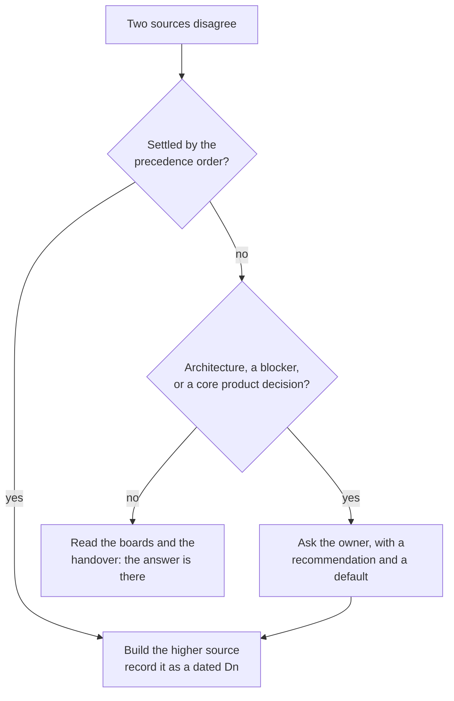

# Decisions and trade-offs

This page is the decision log, organised by theme. For each decision it says what was chosen, what was given up, and how it played out in the build. Two documents hold the detail. [09 · Decisions](../handover/09-decisions.md) is the binding, dated list (D1–D82, plus the open questions Q1–Q10), and it outranks every other document except the owner's own instructions. [02 · Decisions](../story/02-decisions.md) keeps the reasoning: the context, the options considered, and the "In the build" notes. Status is as of 15 Oct 2026, before launch ([D46](../handover/09-decisions.md)).

## How decisions are made and recorded

- **Precedence.** When sources disagree, the higher one wins: the owner's instructions in the conversation, then 09, then the design boards, then the handover chapters, then the design-phase docs ([`CLAUDE.md`](../../CLAUDE.md)). Board copy is illustrative; content comes from the current site.
- **Never edited silently.** A new decision gets the next number and a date. A changed decision is marked "Replaced by Dn".
- **Open questions** carry a recommendation and a default. Work that doesn't depend on the answer carries on, and the default applies when the milestone arrives unanswered. Q1 was answered at its default ([D47](../handover/09-decisions.md)), and so was Q8 for now ([D54](../handover/09-decisions.md)).
- **In the build,** this worked as planned. Five agents asked the owner only about accounts, the domain and the shared project. Every other disagreement was settled by the precedence order and written down as D46–D82.

## Product

### A platform, not a bigger page

- **Chosen.** A purpose-built CMS, Studio, on Supabase, rather than tidying the single file or wiring up a hosted headless CMS. The editing experience is the product: labelled results with private evidence, a homepage built from widgets, publish checks, and drafts that never leak.
- **Trade-off.** More to build than a hosted CMS. In return, the editor fits exactly one user.
- **In the build.** Studio's screens were all built in M4. The shared content core (Zod schemas, defaults and the V0 mapping) was pulled forward into M0, so the site, Studio, the seed and the Edge Functions share one implementation ([01 · M0](../story/01-evolution.md#m0--foundation-14-oct)).

### Honest numbers

- **Chosen.** Five result labels, Achieved, Target, Projected, Baseline and Output. An Achieved result needs a private evidence note to publish. Tenure and counts carry no label ([D7](../handover/09-decisions.md)).
- **Trade-off.** Some numbers look less impressive with a Target label. Trust is worth more to a hiring manager.
- **In the build.** The labels are component C5. `publishProject` drops every outcome's evidence before anything reaches a page, and a test checks that published views never carry `evidence`, `todo` or `facts`. Studio's honesty check runs as the owner edits.

### V0: new design, current content, published

- **Chosen.** Publish the current site's content at launch, instead of importing everything as drafts. Disputed facts keep their live values and are listed in Studio as "Worth a check" ([D5](../handover/09-decisions.md)). D5 also overrides the Profile board's publish copy ([D42](../handover/09-decisions.md)).
- **Trade-off.** Some figures the audit questioned stay live until the owner decides. The site is never half-empty.
- **In the build.** Where the boards didn't say what "Use the résumé figure" does, it was decided rather than guessed: it opens an edit pre-filled with the résumé's wording, and doesn't overwrite ([D76](../handover/09-decisions.md)). Proof rows got an Edit button, because nothing else edits them ([D77](../handover/09-decisions.md)). Arcana's 143-character summary is published as is, for the owner to trim ([D51](../handover/09-decisions.md)).

### Never invent

- **Chosen.** No personal facts, numbers, dates or outcomes are made up. Missing content leaves the field empty, and it hides ([D6](../handover/09-decisions.md)). That's why the skill sizes start at M ([D21](../handover/09-decisions.md)), why the SugarFit projects are drafts with titles only ([D17](../handover/09-decisions.md)), why the Wipro "$XXXK" bullet is kept but hidden ([D18](../handover/09-decisions.md)), and why Writing starts empty ([D19](../handover/09-decisions.md)).
- **Trade-off.** Some parts of the site start sparse, and the owner has a list of things to fill in ([07 · After launch](../handover/07-v0-content.md#after-launch-the-owners-list)).
- **In the build.** The rule held under pressure from pixel parity. The boards' illustrative copy lives only in a test fixture, never in V0. Where boards drew content V0 doesn't have, the site hides it and the difference is accepted ([D60](../handover/09-decisions.md)).

## Design

### Volumes, with Ink & Depth for the hero only

- **Chosen.** Round 1's Volumes everywhere, with Round 3's Ink & Depth hero redrawn in Round 1's tokens ([D3](../handover/09-decisions.md)).
- **Trade-off.** A stronger aesthetic than a neutral template, and less spectacle below the fold. The personality lives in one place and the content stays easy to read.
- **In the build.** The laptop floaters start at 1101px, as the Home boards say, not at the 1280px laptop breakpoint ([D67](../handover/09-decisions.md)). V0 ships the dark theme only; the light tokens stay defined ([D12](../handover/09-decisions.md)).

### Keep the live nav exactly

- **Chosen.** The glass pill, rotating ring and red Let's Talk, copied from the live CSS, on every device. Phones get Menu plus Let's Talk ([D4](../handover/09-decisions.md)). iPad keeps all five links at 834 ([D9](../handover/09-decisions.md)).
- **Trade-off.** Three of the live reds miss WCAG AA for small text. Keeping them honours "copy the nav exactly" but fails the accessibility rule. That's open question Q5, needed before M6, with "keep the exact values and list them as exceptions" as the default.
- **In the build.** Copied from `src/legacy/portfolio.css`, which stays read-only ([D47](../handover/09-decisions.md)). Let's Talk stays 10px on phones, an exception to the build's 11px minimum ([D74](../handover/09-decisions.md)).

### Shelves that cap, and a list that scales

- **Chosen.** Each shelf shows a lead card plus one to three rows, then "See all". `/work` lists everything, with filters, search and paging. The lead is simply the first visible, published project; nothing stores it separately ([D37](../handover/09-decisions.md)).
- **Trade-off.** The homepage never shows everything. It stays fast and curated at 9 or 90 projects.
- **In the build.** The ghost numeral shows the real range, "01—05" in V0, not the board's illustrative "01—09" ([D48](../handover/09-decisions.md)). /work's search reads "Search N volumes" ([D72](../handover/09-decisions.md)).

### Skills as a word cloud

- **Chosen.** One cloud, fully set in Studio: label, title, intro, groups, skills, order and sizes ([D21](../handover/09-decisions.md)). Phones show the same content as laptops ([D15](../handover/09-decisions.md)).
- **Trade-off.** Clouds can be hard to scan, and size implies importance. Groups light up on demand, the markup stays grouped for screen readers, and the owner chooses the sizes.
- **In the build.** The motion audit found that the skills entrance's held end frame broke the group highlight, and fixed it.

### Off duty as a manga page

- **Chosen.** Ink panels with art presets, caption boxes, tags, and favourites as volume spines ([D22](../handover/09-decisions.md)).
- **Trade-off.** A taller section with more visual weight. It's the most personal part of the site, and it explains the Volumes idea.

### One motion system

- **Chosen.** One easing curve, a small set of durations, an 80ms stagger, transform and opacity only, and full reduced-motion parity. The Motion board wins for animations it specifies; page boards win for the rest and for layout ([D20](../handover/09-decisions.md)).
- **Trade-off.** Less freedom per animation, in exchange for consistency and a predictable performance budget.
- **In the build.** Every motion ID was audited against the code before M2 closed. The audit found four real gaps, including a phone hero entrance that replayed on every visit. The Experience accordion rotates a plus, as the boards draw it, and 04 was corrected ([D68](../handover/09-decisions.md)). The body-scan cover animation isn't built ([D16](../handover/09-decisions.md)).

### Accents, labels and topics

- **Chosen.** Each project stores its accent, `visuals.accent`, chosen in Studio ([D13](../handover/09-decisions.md), [D26](../handover/09-decisions.md)). Topics use one picker for posts and projects, up to 8 ([D23](../handover/09-decisions.md), [D44](../handover/09-decisions.md)). Every switched-on testimonial shows in the carousel, with no limit ([D14](../handover/09-decisions.md)).
- **In the build.** Tints are mixed from `--pa`, replacing the fixed red tints the laptop and iPad case-study boards draw. Text on an accent fill is `#0B0B0E`.

## When the boards and the chapters disagreed

These are the build's smaller calls, where a board's detail beat a written chapter or two boards drew the same thing differently.

| Decision | What was chosen |
| --- | --- |
| [D60](../handover/09-decisions.md) | Accepted content differences after M2's QA pass, such as "Add in Studio" cells hiding on the site |
| [D61](../handover/09-decisions.md) | A flagged RICE row is a publish warning, not a blocker, as the board draws it |
| [D63](../handover/09-decisions.md), [D64](../handover/09-decisions.md) | The undrawn "More actions" menu isn't built; a first publish gets its own dialog title |
| [D70](../handover/09-decisions.md) | Parity builds once per width, because the boards condense their copy on iPad and phone |
| [D71](../handover/09-decisions.md)–[D73](../handover/09-decisions.md) | Plain list bullets, "Search N volumes", 16:9 post covers |
| [D75](../handover/09-decisions.md) | Where two boards draw illustrative content differently, parity masks it; layout and type are still compared |
| [D78](../handover/09-decisions.md), [D79](../handover/09-decisions.md) | No back link in the phone case-study footer; the prototype note on laptop only |

**The trade-off** is that the written chapters were sometimes wrong. Each correction is a dated entry, so nobody has to rediscover it. By 15 Oct, about 65 of 80 compared sections passed pixel parity, and most of the rest differed by under 2% ([01 · M2](../story/01-evolution.md#m2--the-public-site-on-local-data-1415-oct)).

## Architecture

### Prerendered public site, client-only Studio

- **Chosen.** React Router 7 in framework mode: public routes are prerendered at build, and `/studio` is a single-page app. A publish triggers a rebuild through a Vercel deploy hook ([D2](../handover/09-decisions.md)).
- **Trade-off.** Edits take about a minute to go live. In return there's no server to run, pages load fast, and real HTML reaches search engines and link previews.
- **In the build.** With nothing rendered on a server, two gaps were closed in the client. A `/work/<slug>` with no prerendered page asks the `pm-project` function for an unlisted project, or shows the 404 ([D24](../handover/09-decisions.md)). The fallback page got a default title, so Studio is never untitled before JavaScript runs. If the deploy hook fails, the publish still stands, and a "deploy only" action exists for trying again ([D81](../handover/09-decisions.md)).

### Draft and published copies on the same row

- **Chosen.** Each content row has a `draft` and a `published` JSON column, plus revisions. Publishing is one transaction. Addresses change only on publish: `slug` is the draft address and `published_slug` the live one ([D40](../handover/09-decisions.md)).
- **Trade-off.** JSON documents need validation in code, but the model stays small and publishing is atomic.
- **In the build.** The owner's session writes drafts only. Column grants stop it writing anything published, so `pm-publish` is the only writer and its checks and sanitising can't be bypassed ([D55](../handover/09-decisions.md)).

### The layout is data

- **Chosen.** The homepage is a list of typed sections, each a widget with its own settings and items. Navigation is derived from it. Section headers live in the layout ([D31](../handover/09-decisions.md)).
- **Trade-off.** It needs careful schema versioning. In return, any section can be reordered, hidden or added without code. See [Widgets](Widgets.md).
- **In the build.** A security review found that the homepage's data once carried hidden profile items, even though the page didn't render them. `homeProfile()` in [`src/lib/site.ts`](../../src/lib/site.ts) now cuts the profile down to what the visible sections show.

### Prototypes, videos and media

- **Chosen.** Prototypes and videos are links. Prototypes are deployed separately, never served from the site's origin ([D11](../handover/09-decisions.md)). Images are resized in the browser, kept in a draft and a public bucket, and copied into the site at build, so visitors never load from Supabase ([D29](../handover/09-decisions.md)).
- **Trade-off.** It relies on other hosts, and Drive videos can't autoplay. In return the site stays light, there are no storage costs, and nothing a prototype runs can read the site.
- **In the build.** Video posters are made at publish from the host's thumbnail, fetched only from fixed endpoints ([D81](../handover/09-decisions.md)). "Replace file" bumps a revision number in the file's URL ([D41](../handover/09-decisions.md)). The V0 seed uploads covers at one size only ([D58](../handover/09-decisions.md)).

## Backend and the shared Supabase project

### Share one Supabase project with the photography site

- **Chosen.** The free plan's two projects were both in use, so the portfolio lives in the photography site's project, in a `pm` schema with `pm-` buckets, functions, secrets and cron jobs ([D27](../handover/09-decisions.md)). Owners are keyed by auth user id, not email ([D28](../handover/09-decisions.md)).
- **Trade-off.** The two sites share sign-in settings, the email sender, quotas, the service-role key and outages. The Supabase CLI's migration history can't be used. In return there's no new account and no cost.
- **In the build.** Migrations run through the portfolio's own `npm run db:migrate`, recorded in `pm.schema_migrations` ([D36](../handover/09-decisions.md)). Everything was built and tested on PGlite with Supabase's roles stubbed, and a lint fails any migration that reaches outside `pm`. Nothing has touched the shared project yet. The shared Auth settings were agreed with the owner ([D52](../handover/09-decisions.md)), and the cron jobs need a second Vault secret ([D57](../handover/09-decisions.md)).

### What visitors can read

- **Chosen.** Visitors get column-level grants on published data only.
- **Trade-off.** Each column a visitor needs has to be granted on purpose.
- **In the build.** Two columns were added beyond 06's list: `id` on live projects and posts, because published layouts name projects by id ([D56](../handover/09-decisions.md)), and `index_allowed`, so the build can write `noindex` and leave those pages out of the sitemap ([D82](../handover/09-decisions.md)). Edge Functions reach Postgres through one connection, so publishing runs in one transaction ([D59](../handover/09-decisions.md)).

## Sign-in and security

### From Google to an email code, and from 6 digits to 8

- **Chosen.** A one-time code by email to the owner's account. Sign-ups are off, and the owner is created once from `OWNER_EMAIL` ([D8](../handover/09-decisions.md)).
- **Trade-off.** It depends on email delivery, a code can be phished, and guessing is the main risk. In return there's no Google Cloud project, no consent screen, and no window where anyone could sign up.
- **In the build.** Turnstile is enforced by Supabase's CAPTCHA protection, which is project-wide ([D35](../handover/09-decisions.md)). It stays off until the photography site's login sends tokens too ([D54](../handover/09-decisions.md)). To make guessing harder without it, codes are 8 digits, not 6: 100 times harder ([D66](../handover/09-decisions.md)). The email sender is still the owner's pick, because a `vercel.app` domain can't be verified in Resend ([D50](../handover/09-decisions.md), [D53](../handover/09-decisions.md)).

### A public repository with nothing to steal

- **Chosen.** No secrets in code or history, gitleaks in CI, public keys only in the browser, and the owner's address supplied at setup ([D10](../handover/09-decisions.md)).
- **Trade-off.** Setup needs a few manual steps in dashboards, which the launch checklist documents.
- **In the build.** Every phase ended with a security review of its diff. Besides the hidden profile items above, it found a few content links that skipped the safe-link check; both were fixed before merging.

## Studio's build choices

| Decision | What was chosen | The trade-off |
| --- | --- | --- |
| [D65](../handover/09-decisions.md) | Studio's own small query cache and IndexedDB wrapper instead of TanStack Query and idb-keyval | Fewer dependencies; Studio owns that code |
| [D69](../handover/09-decisions.md) | Provisional, for the owner to confirm: Studio's own reorder and rich-text field instead of dnd-kit and TipTap | Fewer dependencies; Studio owns paste, undo and screen-reader behaviour a library would bring. Swapping TipTap in later stays contained |
| [D80](../handover/09-decisions.md) | No `heic2any`; resumable uploads with `tus-js-client` | heic2any is unmaintained and ships LGPL code without a notice. Outside Safari, HEIC photos need a JPG export |
| [D38](../handover/09-decisions.md), [D45](../handover/09-decisions.md) | Plain forms in the boards' styles for fields no board edits, and a few small additions | Not drawn by the boards; the owner may revisit them |
| [D43](../handover/09-decisions.md) | Deleting from the Projects list is soft, with Undo; only URL & SEO deletes for good | An accidental delete can be undone; a permanent one needs the address typed |
| [D62](../handover/09-decisions.md) | Undo after Unpublish restores the last live version without re-running the checks | Undo is instant; the checks aren't run again |
| [D39](../handover/09-decisions.md) | Soft and hard limits on the project title and the positioning line | Studio warns before it refuses |

## Process and hosting

- **An AI-agent-ready handover.** The boards are HTML and CSS with exact values, every animation has an ID, and there's a list of what to ask the owner. It was a large up-front writing effort, which bought a build that didn't stall on questions ([02 · Process](../story/02-decisions.md#process)).
- **`main` stays the live site until launch** ([D46](../handover/09-decisions.md)). The rebuild lives on its own branch and is merged at M6.
- **Hosting.** The owner's existing Vercel account hosts the site and the prototypes ([D49](../handover/09-decisions.md)). The site lives at the Vercel address, with no custom domain ([D53](../handover/09-decisions.md)).
- **Parallel agents in worktrees** were fast, but a container reset once destroyed three tracks' unpushed work, and usage limits stopped agents midway. The handoff now recommends pushing after every commit ([`HANDOFF.md`](../../HANDOFF.md)).

## Still open

As of 15 Oct 2026, Q5 (the nav's reds) and Q7 (which Cloudflare account holds the Turnstile widget) are unanswered, D69 awaits the owner's confirmation, and D53 leaves the email sender to the owner. See [09 · Open questions](../handover/09-decisions.md#open-questions).
