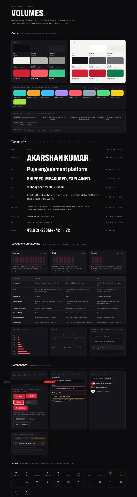
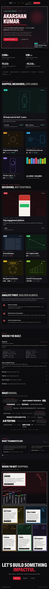
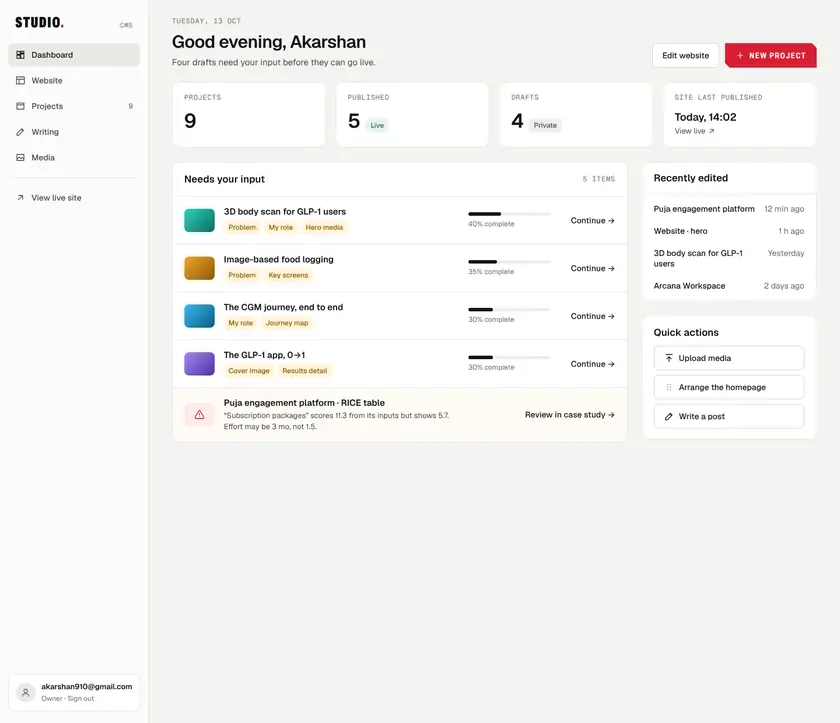
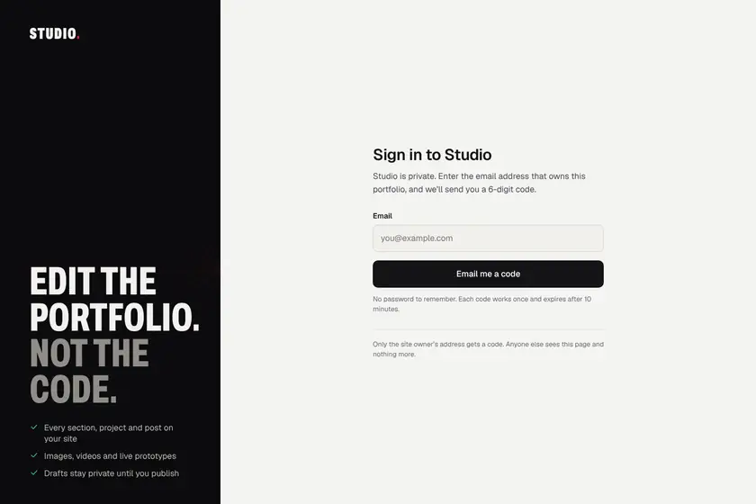
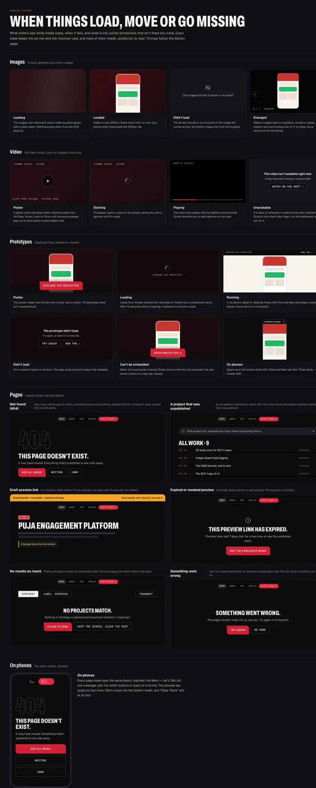
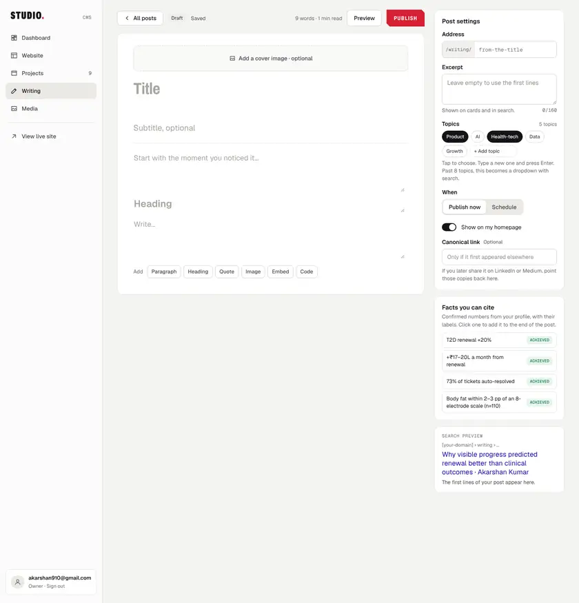

# Design system

The site's design is **Volumes with the Ink & Depth hero** ([D3](../handover/09-decisions.md)). Every project is a numbered volume with its own accent, and the hero is a manga ink panel that tilts toward the pointer. The design system behind it is small: one dark theme, three typefaces, one easing curve, nine project accents, five result labels and 22 public components, plus two shared Studio components. All of it is copied from the boards in [`design/boards/`](../../design/boards/), which are plain HTML and CSS with every value written out. The build's rule is to copy those values, never to eyeball new ones. This page summarises the tokens, type, grid and components, and where each lives in the code. The full specification is [02 · Tokens and components](../handover/02-tokens-and-components.md). Written as of 15 Oct 2026, before launch.



## Where the values come from

- **The boards are the source.** When two sources disagree, the order is: the owner's instructions, then [09 · Decisions](../handover/09-decisions.md), then the boards, then the handover chapters ([`CLAUDE.md`](../../CLAUDE.md#sources-of-truth-in-order)). So when a chapter and a board differ, the board wins unless a decision says otherwise. [D67](../handover/09-decisions.md) and [D71](../handover/09-decisions.md)–[D74](../handover/09-decisions.md) are examples.
- **Board names are kept.** CSS custom properties are named exactly as the boards name them (`--bg`, `--tx2`, `--eo` and so on). Board CSS can then be pasted into a component's CSS module unchanged. That's the cheapest way to stay pixel-exact.
- **The live nav is the exception.** The pill nav is copied from the old site's stylesheet, kept read-only at [`src/legacy/portfolio.css`](../../src/legacy/portfolio.css) ([D4](../handover/09-decisions.md), [D47](../handover/09-decisions.md)). Nothing imports that file; it's a reference.
- **Board copy is illustrative.** Content comes from the current site ([D5](../handover/09-decisions.md)), and nothing is invented ([D6](../handover/09-decisions.md)).

How to read a board is explained in [`design/README.md`](../../design/README.md).

| | | |
| --- | --- | --- |
|  |  |  |
| Home at 1440 | Home at 834 | Home at 390 |

## Colour

[`src/styles/tokens.css`](../../src/styles/tokens.css) holds the board's `.va` block as `:root`, and its `.va.light` block as `:root[data-theme="light"]`.

**V0 ships the dark theme only** ([D12](../handover/09-decisions.md)). The light values stay defined so the theme can be switched on later without new tokens. But an accent used as text is under 3:1 on the light background for all nine accents, so light needs darker accent variants first.

| Token | Dark | Used for |
| --- | --- | --- |
| `--bg` | `#0B0B0E` | Page background |
| `--bg2` | `#111116` | Banded sections, card fill, row hover |
| `--sf` | `#16161C` | Floating cards, popovers, menus |
| `--sf2` | `#1D1D24` | Baseline label, skeleton base |
| `--ln` | `rgba(242,241,238,.09)` | Hairlines, resting card borders |
| `--ln2` | `rgba(242,241,238,.18)` | Strong lines, secondary-button border, card hover border |
| `--tx` | `#F2F1EE` (17.4:1) | Text |
| `--tx2` | `#B9B7B1` (9.8:1) | Secondary text, body copy |
| `--tx3` | `#8F8D87` (5.9:1) | Captions, meta, mono labels |
| `--ac` | `#D61F33` | Accent fill: primary CTA, brush, the name's period. White text on it is 5.1:1 |
| `--act` | `#FF5A67` (6.5:1) | Accent as text: kickers, the focus ring |
| `--ok` / `--okt` | `#3CCB8B` / `#9BE7C4` | Positive fill and text: availability, Achieved |
| `--nav` | `rgba(11,11,14,.94)` | Sticky bars |
| `--tone` | `rgba(242,241,238,.14)` | Screentone dots in the ink panel |

Contrast ratios are measured against `--bg`. A few fixed colours aren't themed: the CTA hover `#E42A3F`, the live nav's Let's Talk `#E8273A` and its hover `#FF4D5E`, the warning ambers, and the destructive button's text and border. Three of the reds miss AA for small text, and the owner decides whether to adjust them ([Q5](../handover/09-decisions.md#open-questions)). Until then the exact live values are built.

### The nine accents

Each project has an accent, chosen in Studio and stored as `visuals.accent` ([D26](../handover/09-decisions.md)). In CSS it's `--pa` ([D13](../handover/09-decisions.md)). Accents colour covers, volume tags, chapter and step numbers, and the floating-preview tag. They're never used for body text.

| Name | Accent `--pa` | Cover ground `--pg` | Dark ink on the accent |
| --- | --- | --- | --- |
| Teal | `#2DD4BF` | `#0D1918` | 10.6:1 |
| Amber | `#F5A524` | `#1A140A` | 9.6:1 |
| Sky | `#38BDF8` | `#0A1620` | 9.2:1 |
| Violet | `#A78BFA` | `#130F1F` | 7.2:1 |
| Coral | `#FF5A67` | `#1C0C0F` | 6.5:1 |
| Slate | `#94A3B8` | `#121826` | 7.7:1 |
| Green | `#4ADE80` | `#0E1F14` | 11.3:1 |
| Yellow | `#FACC15` | `#1F1A06` | 12.8:1 |
| Lime | `#A3E635` | `#141F06` | 13.0:1 |

- **Text on an accent fill** is always `#0B0B0E` (`ON_ACCENT`). Some early boards tint it per accent; the build uses one ink everywhere ([D13](../handover/09-decisions.md)).
- **The cover ground** is the dark background behind a cover's artwork. It's also the placeholder colour while a cover loads.
- **Tints are mixed from `--pa`** with `color-mix()`: 8% for highlighted RICE rows, 35% for priority-card borders and the outlined cover number. This replaces the `#E8273A` tints hard-coded on the early case-study boards.

The accent list is `ACCENTS` in [`src/lib/schemas.ts`](../../src/lib/schemas.ts), and the colours are `ACCENT_COLOURS` in [`src/lib/accents.ts`](../../src/lib/accents.ts).

### Studio's tokens

Studio is a light interface with its own token set, scoped to the `.st` root in [`src/styles/studio.css`](../../src/styles/studio.css), so it never loads on the public site. It reuses the same token names with light values (`--bg` `#F4F4F2`, `--sf` white, text `#141416`), the same fonts and the same accent. It adds status pairs: `--ok`/`--okbg`, `--warn`/`--warnbg` and `--err`/`--errbg`.

| | |
| --- | --- |
|  |  |
| `StudioDashboard` | `StudioLogin` |

## Type

Three families, all self-hosted WOFF2 variable fonts, copied into `public/fonts/` by [`scripts/copy-fonts.ts`](../../scripts/copy-fonts.ts) and declared in [`src/styles/fonts.css`](../../src/styles/fonts.css):

| Token | Family | Use |
| --- | --- | --- |
| `--fd` | Archivo, variable width and weight | Display: the name, titles, numerals. Always set `font-stretch` (62%, 68%, 70% or 75%), as the board does |
| `--fu` | Geist | Interface and reading |
| `--fm` | Geist Mono | Labels, data, kickers |
| — | JetBrains Mono | The pill nav only, copied from the live site |

The scale, as laptop / iPad / phone:

| Role | Size | Face |
| --- | --- | --- |
| Hero name | Page: `clamp(64px, 8.4vw, 126px)`, 100px, 66px | `--fd` 62% 800, uppercase, line height .86 |
| h1, case-study title | Page: `clamp(52px, 6.4vw, 92px)` / 64 / 44 | `--fd` 75% 700 |
| h2, section title | Page: `clamp(40px, 5vw, 64px)` / 48 / 38 | `--fd` 68% 800, uppercase |
| h3, card title | 40 / 32 / 28 (standard card 28px) | `--fd` 75% 700 |
| Lead, hero positioning | Page: `clamp(22px, 2.2vw, 30px)`, 25px, 20px | `--fu` 400 |
| Reading | 19 / 18 / 17, measure 680px, line height 1.65 | `--fu` |
| Meta and mono labels | 12px, uppercase, `letter-spacing: .08em` | `--fm`, `--tx3` |
| Numeral | 52 / 46 / 38 | `--fd` 62% 800 |

Where a page board uses a fluid `clamp()`, the build uses the `clamp()`. Type is never under 12px (11px on phones), except Let's Talk on phones, which stays 10px as the board and the live nav draw it ([D74](../handover/09-decisions.md)).

## Grid and layout

| Device | Width | Grid |
| --- | --- | --- |
| Laptop | ≥ 1280, designed at 1440 | 12 columns, 24 gutter. `.wrap` is `max-width: 1312px` with `padding-inline: clamp(20px, 4vw, 56px)` |
| iPad | 768–1279, designed at 834 | Portrait: 8 columns, 20 gutter, 32 margin. Landscape (1024+) uses the laptop grid |
| Phone | 360–767, designed at 390 | 4 columns, 16 gutter, 20 margin. One column, full-width primary actions, bottom sheets instead of popovers |

```css
/* phone */   @media (max-width: 767px) { … }
/* iPad */    @media (min-width: 768px) and (max-width: 1279px) { … }
/* laptop */  @media (min-width: 1280px) { … }
```

- **iPad keeps all five nav links at 834** ([D9](../handover/09-decisions.md)). The live site's 900px rule doesn't carry over.
- **The hero's laptop floaters start at 1101px**, not at the 1280px laptop breakpoint, because the Home boards hide them at `max-width: 1100px` ([D67](../handover/09-decisions.md)). See [Motion](Motion.md#hero).
- **Phones show the same content as laptop** ([D15](../handover/09-decisions.md)). Shorter lists on phone boards are illustrative.
- **Input decides hover, not width.** Hover adds detail on laptop, but nothing is hover-only. Hover rules sit inside `@media (hover: hover)`.

**Spacing** uses a 4px base: 4, 8, 12, 16, 24, 32, 48, 64, 96, 128. Inside components the boards sometimes use 10, 14, 18, 20, 22, 28 or 36, and those are copied as written.

**Radius:** 4 for labels and tags, 6 for the volume tag, 8 for controls, 10–14 for tiles and covers, 16–18 for panels, 20–22 for card shells, 999 for chips, and 2 for the angled CTAs.

**Elevation:** lines first, and shadows only for overlays. At rest a card has a hairline. On hover it lifts 4px and its border goes to `--ln2`. Floating previews, dialogs, sheets and toasts have shadows.

**Focus:** `outline: 2px solid var(--act); outline-offset: 3px` on links and buttons ([`src/styles/base.css`](../../src/styles/base.css)). The angled CTA uses an inner ring instead, because its cut corners would clip an outline.

## Icons

One set for the site and Studio, in [`src/components/icons.tsx`](../../src/components/icons.tsx), as one component with a `name` prop. Icons are drawn on a 24px grid with `stroke-width: 1.75`, round caps and joins, and `stroke: currentColor`. The `.ico` class sizes them at 18px. The 24 icons from `System.dc.html` are there, plus the extra ones the boards use (arrow-left, mail, the chevrons, image-off, alert-circle, clock, rss, more), and a few more, such as cloud-off and lock. Decorative icons get `aria-hidden="true"`.

## Result labels

Every number on the site carries a label that says what kind of number it is. Tenure and counts don't ([D7](../handover/09-decisions.md)). This is one of the product's core ideas: a target must never read like a result.

| Label | Meaning (read to screen readers) | Style |
| --- | --- | --- |
| ACHIEVED | Measured after launch | Green tint fill, `--okt` text |
| TARGET | A goal set in the plan, not yet measured | 1px solid `--ln2`, `--tx2` text |
| PROJECTED | A modelled estimate | 1px dashed `--ln2`, `--tx2` text |
| BASELINE | The starting point before the work | `--sf2` fill, `--tx2` text |
| OUTPUT | What was produced | Accent tint fill, `--act` text |

All five share `padding: 3px 8px` (`2px 7px` on phones), radius 4, and `600 11px` Geist Mono with `letter-spacing: .08em`. The visible word is `aria-hidden`, and a visually hidden span carries the meaning, so a screen reader hears "Achieved: measured after launch". **Achieved needs a private evidence note to publish** ([D7](../handover/09-decisions.md)): `pm-publish`'s checks refuse an Achieved result without one ([`supabase/functions/_shared/checks.ts`](../../supabase/functions/_shared/checks.ts)). The note itself is private, and the no-leaks tests check it never reaches a visitor ([Security](Security.md#drafts-never-leak)).

Code: [`src/components/labels/ResultLabel.tsx`](../../src/components/labels/ResultLabel.tsx) (`RESULT_LABELS`), and the list `RESULT_TYPES` in [`src/lib/schemas.ts`](../../src/lib/schemas.ts).

## Components

Every component is built under [`src/components/`](../../src/components/), one folder per area, with a CSS module copied from its board. Every variant and state is shown on the dev-only catalogue at `/dev/components` ([`src/routes/dev/`](../../src/routes/dev/)). The catalogue never ships: [`scripts/check-build.ts`](../../scripts/check-build.ts) fails a build that contains it.

| ID | Component | Board | Code | Notes |
| --- | --- | --- | --- | --- |
| C1 | Pill nav | Live CSS, `Home*` | [`nav/PillNav.tsx`](../../src/components/nav/PillNav.tsx), [`nav/scrollSpy.ts`](../../src/components/nav/scrollSpy.ts) | Copied exactly from the live site: glass, rotating ring, Let's Talk, on every device ([D4](../handover/09-decisions.md)). The board's link order. Let's Talk goes to Contact by default ([D34](../handover/09-decisions.md)) |
| C2 | Phone menu | `HomeMobile`, `CaseStudyMobile` | [`nav/PhoneMenu.tsx`](../../src/components/nav/PhoneMenu.tsx) | A full-screen dialog under the pill. Focus is trapped, and returns to Menu on close |
| C3 | Buttons | `System`, `Home` | [`buttons/Button.tsx`](../../src/components/buttons/Button.tsx), [`buttons/TextLink.tsx`](../../src/components/buttons/TextLink.tsx) | The angled primary CTA, secondary, compact, ghost, destructive, icon and round arrow buttons |
| C4 | Section header | `Home*` | [`labels/SectionHeader.tsx`](../../src/components/labels/SectionHeader.tsx) | Kicker, a two-tone title and an intro. The two halves are stored separately (`title`, `titleMuted`) and never split automatically |
| C5 | Result label | `System`, `Home` | [`labels/ResultLabel.tsx`](../../src/components/labels/ResultLabel.tsx) | [Above](#result-labels) |
| C6 | Tags, badges and chips | `System`, `Home` | [`labels/Tags.tsx`](../../src/components/labels/Tags.tsx) | Volume tag, status badge, chip, availability chip, filter chip |
| C7 | Project card | `Home*`, `WorkScale` | [`cards/ProjectCard.tsx`](../../src/components/cards/ProjectCard.tsx), [`cards/Cover.tsx`](../../src/components/cards/Cover.tsx), [`cards/ClosingTile.tsx`](../../src/components/cards/ClosingTile.tsx) | Lead, standard, compact row, "See all N", "All work · N" and the phone closing row. The whole card is one link |
| C8 | Shelf | `Home*`, `WorkScale` | [`shelf/Shelf.tsx`](../../src/components/shelf/Shelf.tsx), [`src/lib/shelf.ts`](../../src/lib/shelf.ts) | The lead is the first visible, published project in the shelf's order ([D37](../handover/09-decisions.md)). The cap logic is copied from `WorkScale`. An empty shelf hides completely |
| C9 | Volume numbering | — | [`src/lib/volumes.ts`](../../src/lib/volumes.ts) | Published projects on listed shelves are numbered at build time and never stored. Links use the slug, so renumbering never breaks one. The shelf's ghost numeral shows the real range ([D48](../handover/09-decisions.md)) |
| C10 | Hero ink panel | `Home*` | [`hero/InkPanel.tsx`](../../src/components/hero/InkPanel.tsx), [`hero/Brush.tsx`](../../src/components/hero/Brush.tsx) | Four layers (screentone, outlined numerals, speed lines, red halftone disc) and the brush underline. The `01—09` numerals are decorative |
| C11 | Floating preview card | `Home`, `HomeTablet` | [`hero/FloatingPreview.tsx`](../../src/components/hero/FloatingPreview.tsx) | `aria-hidden` and `tabindex="-1"`, because the same projects are in the shelves |
| C12 | Proof strip | `Home*` | [`proof/ProofStrip.tsx`](../../src/components/proof/ProofStrip.tsx) | V0's strip is the live hero's four stats ([D30](../handover/09-decisions.md)) |
| C13 | Experience entry | `Home*` | [`experience/ExperienceEntry.tsx`](../../src/components/experience/ExperienceEntry.tsx), [`experience/ExperienceList.tsx`](../../src/components/experience/ExperienceList.tsx) | Featured, standard, compact and education. The kind follows position |
| C14 | Accordion row | `HomeTablet`, `HomeMobile` | [`accordion/AccordionRow.tsx`](../../src/components/accordion/AccordionRow.tsx) | A plus that rotates 45° while open ([D68](../handover/09-decisions.md)) |
| C15 | Skills cloud | `Home*`, `StudioSite` | [`skills/SkillsCloud.tsx`](../../src/components/skills/SkillsCloud.tsx), [`src/lib/skills-order.ts`](../../src/lib/skills-order.ts) | One word cloud, set entirely in Studio ([D21](../handover/09-decisions.md)). Grouped in the DOM, interleaved on screen. V0 starts every skill at size M |
| C16 | Testimonial card | `Home*` | [`testimonials/TestimonialCard.tsx`](../../src/components/testimonials/TestimonialCard.tsx), [`testimonials/Testimonials.tsx`](../../src/components/testimonials/Testimonials.tsx) | Every switched-on testimonial shows in the carousel; there's no limit of three ([D14](../handover/09-decisions.md)) |
| C17 | Off duty page | `Home*`, `StudioSite` | [`offduty/OffDutyPage.tsx`](../../src/components/offduty/OffDutyPage.tsx), [`offduty/layout.ts`](../../src/components/offduty/layout.ts), [`offduty/art.tsx`](../../src/components/offduty/art.tsx) | A manga page: ink panels with six art presets, caption boxes, tags, and favourites as volume spines ([D22](../handover/09-decisions.md)) |
| C18 | Contact block | `Home*` | [`contact/ContactBlock.tsx`](../../src/components/contact/ContactBlock.tsx) | "Copy email" announces "Copied" through a polite live region. Any link without a URL hides |
| C19 | Footer | `Home*` | [`footer/SiteFooter.tsx`](../../src/components/footer/SiteFooter.tsx) | "Last updated" is the date of the last site publish |
| C20 | Media | `PublicStates` | [`media/Image.tsx`](../../src/components/media/Image.tsx), [`Lightbox.tsx`](../../src/components/media/Lightbox.tsx), [`VideoEmbed.tsx`](../../src/components/media/VideoEmbed.tsx), [`PrototypeEmbed.tsx`](../../src/components/media/PrototypeEmbed.tsx) | Image, lightbox, video and prototype embeds, with every loading and error state. Prototypes and videos are links, loaded only on click ([D11](../handover/09-decisions.md)) |
| C21 | Page states | `PublicStates` | [`states/`](../../src/components/states/) | 404, the moved-project note, the preview bar, an expired preview, no results, error |
| C22 | Form controls | `System`, Studio boards | [`studio/Field.tsx`](../../src/components/studio/Field.tsx), [`studio/Controls.tsx`](../../src/components/studio/Controls.tsx) | Text field, segmented control, switch, checkbox and status pills, plus [`studio/Toast.tsx`](../../src/components/studio/Toast.tsx). In Studio the switch and fields follow the Studio boards over C22 ([`HANDOFF.md`](../../HANDOFF.md#decisions-made-during-the-build)) |



### Studio's shared components

Most Studio pieces are copied straight from their board's CSS. Two carry more behaviour, so they're specified in 02:

| ID | Component | Board | Code | Notes |
| --- | --- | --- | --- | --- |
| S1 | Topic picker | `StudioWriting`, `EditorOverview` | [`studio/TopicPicker.tsx`](../../src/components/studio/TopicPicker.tsx) | One picker for posts and projects ([D23](../handover/09-decisions.md)). Chips while the vocabulary has up to 8 topics; past 8, a multi-select dropdown with search and create. Up to 8 topics per post or project: at the cap, the unselected options are disabled and a polite live region says so ([D44](../handover/09-decisions.md)) |
| S2 | Code input | `StudioLogin`, `StudioAuthFlow` | [`studio/CodeInput.tsx`](../../src/components/studio/CodeInput.tsx) | One real input over visual boxes, so paste, autofill and screen readers see a normal field. Eight boxes, because codes are 8 digits ([D66](../handover/09-decisions.md)) |



## Code

- [`src/styles/tokens.css`](../../src/styles/tokens.css), [`src/styles/base.css`](../../src/styles/base.css), [`src/styles/fonts.css`](../../src/styles/fonts.css), [`src/styles/studio.css`](../../src/styles/studio.css)
- [`src/lib/accents.ts`](../../src/lib/accents.ts), [`src/lib/schemas.ts`](../../src/lib/schemas.ts) (`ACCENTS`, `RESULT_TYPES`)
- [`src/components/`](../../src/components/), [`src/components/icons.tsx`](../../src/components/icons.tsx), [`src/components/cx.ts`](../../src/components/cx.ts)
- [`src/lib/shelf.ts`](../../src/lib/shelf.ts), [`src/lib/volumes.ts`](../../src/lib/volumes.ts), [`src/lib/skills-order.ts`](../../src/lib/skills-order.ts)
- [`src/routes/dev/`](../../src/routes/dev/): the component catalogue at `/dev/components`
- [`src/legacy/portfolio.css`](../../src/legacy/portfolio.css): the live nav's stylesheet, read-only
- [`scripts/copy-fonts.ts`](../../scripts/copy-fonts.ts)
- [`design/boards/`](../../design/boards/), [`design/previews/`](../../design/previews/), [`design/README.md`](../../design/README.md)
