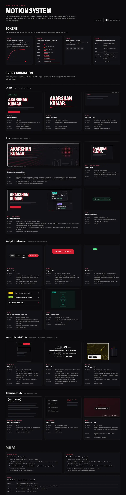

# Motion

Motion on this site is specified as exactly as layout. Every animation has an ID, a trigger, a duration, an easing, a delay, and a line saying what happens under reduced motion. The full specification is [04 · Motion](../handover/04-motion.md), and the live reference is the `Motion.dc.html` board. This page lists the tokens, every motion ID with a one-line summary, the ground rules every animation follows, and the guards that keep the hero smooth on slow machines. The rules are short. One easing curve is used for every movement. Only transform and opacity move, with listed exceptions. Nothing is hover-only. Reduced motion is always respected. Nothing is hidden from visitors without JavaScript. Written as of 15 Oct 2026, before launch.

## Which source wins

Several boards show the same animation, and a few disagree. The order is binding ([D20](../handover/09-decisions.md)):

1. **`Motion.dc.html` wins** for any animation it specifies.
2. **Page boards win** for animations only they show, such as the phone chapter sheet, and for anything about layout.
3. **Device-specific values on a page board win** for that device, such as the iPad floating-preview timings.

The conflicts found are resolved in 04's [table](../handover/04-motion.md#resolved-conflicts). Two later decisions corrected 04 itself:

- **[D67](../handover/09-decisions.md): the laptop floaters start at 1101px.** The Home boards hide them at `max-width: 1100px`, and boards outrank 02's 1280px laptop breakpoint. From 1101 to 1279px the laptop set shows. The media queries are `LAPTOP_QUERY` and `IPAD_QUERY` in [`HeroFloaters.tsx`](../../src/components/sections/HeroFloaters.tsx), and a test pins them.
- **[D68](../handover/09-decisions.md): the Experience accordion rotates a plus 45°**, as 02 · C14 and `HomeMobile` draw it. 04 had said a chevron turning 180°.

## Tokens

| Token | Value | Use |
| --- | --- | --- |
| `--eo` | `cubic-bezier(.2,.8,.2,1)` | Every movement: fast start, soft landing. Defined in [`tokens.css`](../../src/styles/tokens.css) |
| `linear` | — | Only drift, rotation (spinners, the nav ring) and progress (sheens, bars) |
| `ease-in-out` | — | Only breathing loops: touch drift, availability pulse |
| `ease` | — | Only the floating-preview fade and the live nav's own transitions, copied verbatim |
| `ease-out` | — | Only the Studio flash and ring |
| `steps(1)` | — | Only the Studio code-box caret |
| Spring | `cubic-bezier(.34,1.26,.64,1)` | Only the nav's sliding highlight, copied from the live site |

**Durations** run from 120ms (press) to 9s (touch drift). The common ones: 200ms for colour, hover and focus; 320ms for card and row lifts; 560ms for entrances and reveals; 600ms for the hero tilt and cover zoom. 04's [duration table](../handover/04-motion.md#tokens) lists every one.

**Stagger:** 80ms between siblings, at most five steps (0, 80, 160, 240, 320ms). The sixth sibling onwards uses 320ms. The skills cloud is the exception: it wraps every five words.

**Distances:** a 16px rise on entrances, a 4px card lift and arrow nudge, a 2px button lift. The hero tilts ±4° left–right and ±3° up–down. Touch drift sways ±2° and ±1.5°.

All keyframes the boards name live in one file, [`src/motion/keyframes.css`](../../src/motion/keyframes.css). Studio's flash and ring keyframes are in [`src/styles/studio.css`](../../src/styles/studio.css).

## Ground rules

These apply to every animation ([04 · Ground rules](../handover/04-motion.md#ground-rules)).

| Rule | What it means | Code |
| --- | --- | --- |
| Reduced motion | Under `prefers-reduced-motion: reduce`, `<html>` gets the class `still`, and each animation does what its "Reduced" line says. Colour and border changes on hover and focus stay, because they carry meaning. The reading-progress bar stays. Nothing flashes, with or without the setting | [`reduced-motion.ts`](../../src/motion/reduced-motion.ts) (`useReducedMotion()`, `prefersReducedMotion()`) |
| Set before first paint | A one-line inline script in `<head>` adds `js` to `<html>`, `still` under reduced motion, and `no-intro` once the hero entrance has played this session. It's a constant, so its CSP hash is stable | [`src/lib/bootstrap.ts`](../../src/lib/bootstrap.ts), [`src/root.tsx`](../../src/root.tsx) |
| Live updates | If the visitor changes the setting while the page is open, `still` follows it, and anything rendered from `useReducedMotion()` re-renders | [`reduced-motion.ts`](../../src/motion/reduced-motion.ts) |
| The owner's switches | Studio › Website › Hero. **Hero motion off** removes the tilt and the drift for every visitor. **Floating previews hidden** removes the floaters. The visitor's reduced-motion setting always wins over both | [`Hero.tsx`](../../src/components/sections/Hero.tsx) |
| Transform and opacity | Anything that moves uses `transform` and `opacity`. The listed exceptions are copied as they are: the pulse's `box-shadow`, the nav ring's custom property, the nav pill's `left` and `width`, hover shadows, Studio flashes, sheens and a few Studio controls | — |
| Pointer reads | The pointer is read once per frame, inside `requestAnimationFrame`, and written to CSS custom properties on the hero. React re-renders nothing while the pointer moves | [`tilt.ts`](../../src/motion/tilt.ts) |
| Pause off screen | An `IntersectionObserver` on the hero, plus `visibilitychange`, pauses the hero when it's off screen or the tab is hidden. `.paused` sets `animation-play-state: paused` on the drift, pulse and brush, and the floater timers are cleared. It resumes from the rest pose | [`pause.ts`](../../src/motion/pause.ts) (`watchVisibility()`) |
| Frame-rate guard | While the pointer moves over the hero, a rolling average of the last 60 frame intervals is kept. If it rises above 22.2ms (under 45fps), the speed lines stop re-aiming for the rest of the page view. Tilt and layers carry on, because they're compositor-only. Pauses in movement don't count as slow frames | [`tilt.ts`](../../src/motion/tilt.ts) (`FrameGuard`, `GUARD_MS`, `GUARD_FRAMES`) |
| No JavaScript, no hiding | Content is readable with JavaScript off and for crawlers. Initial hidden states, such as reveals, apply only under `html.js` | [`reveal.css`](../../src/motion/reveal.css) |
| Input, not width | `(hover: hover) and (pointer: fine)` gets the tilt; everything else gets the drift. Width still decides the layout | [`Hero.tsx`](../../src/components/sections/Hero.tsx) |

**Why the guards.** The speed lines are an SVG path of 130 triangles, rebuilt every frame from the pointer. That's the one part of the hero that costs main-thread time, so it's the one part that gives up on a slow machine. The rest pose is prerendered into the HTML, so the first paint matches the board without JavaScript, and motion attaches after hydration so it can't delay LCP.

## Every animation

"Reduced" says what happens under `prefers-reduced-motion: reduce`.

### On load

| ID | Trigger and motion | Timing | Reduced |
| --- | --- | --- | --- |
| M-HERO-RISE | First page view of a session. Each visible hero line fades in and rises 16px: availability row, name, positioning, intro, buttons | `vaRise .56s --eo`, 80ms apart. Once per session (`sessionStorage['va:intro']`) | Shown in place |
| M-HERO-BRUSH | Page load, after the name. The red stroke under the name draws left to right | `vaInkDraw 1.4s --eo`, 400ms delay. Once per session | Drawn from the start |

### Scroll

| ID | Trigger and motion | Timing | Reduced |
| --- | --- | --- | --- |
| M-REVEAL | A section's top passes 85% of the viewport (once). The section fades in and rises 16px; its blocks follow with the stagger, at most five steps | `.56s --eo`, `step × 80ms` | Visible from the start, no transition |

### Hero

| ID | Trigger and motion | Timing | Reduced |
| --- | --- | --- | --- |
| M-HERO-TILT | `pointermove` over the hero, on fine pointers that hover. The panel tilts toward the pointer, four layers shift by depth, and the speed lines re-aim. `pointerleave` returns to rest | Panel `transform .6s --eo`, layers `.5s --eo`, lines every frame (until the guard trips) | Flat panel, layers at 0, lines at rest. No listeners |
| M-HERO-DRIFT | Always, on touch and no-hover devices. The panel sways. No device-orientation permission is ever asked for | `vaInkDrift 9s ease-in-out infinite` | Still |
| M-HERO-FLOATERS | Laptop above 1100px: 1–3 project previews (set in Studio, default 3) fade in, drift and leave on a scheduler. iPad: one. Phones: none | Fade `.7s ease`, drift 10–18px linear, dwell 4.8–6.8s, gap 0.3–1.3s. iPad uses its own board's values. Hover holds a card | The first cards stand still at rest. Nothing is scheduled |
| M-AVAIL-PULSE | While availability is on. The green dot pulses | `vaPulse 2.4s ease-in-out infinite` | Dot only |

### Navigation and controls

| ID | Trigger and motion | Timing | Reduced |
| --- | --- | --- | --- |
| M-NAV-RING | Always. A light ring circles the glass pill | `navShimmer 3.5s linear infinite`, copied from the live CSS | The ring stands still |
| M-NAV-LINK | Hover on a nav link: colour and background | `all .22s`, verbatim | Unchanged (colour) |
| M-NAV-PILL | Scroll-spy or click. The highlight slides under the active link | `left` and `width` `.32s` spring. No transition on first paint or resize | Jumps |
| M-NAV-CONTACT | Hover, or while Contact is the current section. Let's Talk scales and glows | `.22s` background and transform, `.3s` glow | No scale; colour and glow stay |
| M-NAV-MENU | Phone Menu opens. The sheet fades in and the links rise in | Sheet `mmIn .24s --eo`; links `mmRise .56s --eo`, 0–320ms. Close is instant | No animation |
| M-CTA | Hover, press and focus on the angled CTA | Hover lift 2px `.2s --eo`; press `scale(.98)` `.12s`; focus ring without movement | Colour change only |
| M-BTN2 | Hover on a secondary button: border to `--tx3` | `.2s --eo` | Unchanged |
| M-ACCORDION | Open an Experience row on iPad or phone. The plus rotates 45° ([D68](../handover/09-decisions.md)); content fades in; height is never animated | `200ms --eo` | No rotation or fade |
| M-TESTI-PAGE | Laptop prev/next: the three cards cross-fade. iPad and phone: native scroll-snap, and the active dot changes width | Out 200ms, in 200ms with the stagger; dot 200ms `--eo` | Instant swaps, `scroll-behavior: auto` |

### Skills and Off duty

| ID | Trigger and motion | Timing | Reduced |
| --- | --- | --- | --- |
| M-SKILLS-REVEAL | The cloud scrolls into view (once). Every word rises 16px and fades in, in five waves | `vaRise .56s --eo`, `(index % 5) × 80ms` | In place from the start |
| M-SKILLS-FOCUS | Hover, focus, click or tap a group word. Other words dim; the group lights up | Colour and opacity `.2s --eo` | Unchanged (it carries information) |
| M-OFF-PANEL | Hover or focus inside an Off duty panel. It lifts 4px, the caption shadow grows, the art shifts and the speed lines scale | Lift and shadow `.32s --eo`; art and lines `.5s --eo` | No transitions or transforms |
| M-OFF-SPINE | Hover a favourites spine. It lifts 4px | `.32s --eo` | None |

### Cards and lists

| ID | Trigger and motion | Timing | Reduced |
| --- | --- | --- | --- |
| M-CARD | Hover or focus a project card. It lifts 4px, the border strengthens, the cover zooms inside its frame and the arrow nudges | Lift and border `.32s`, cover `.6s`, arrow `.24s`, all `--eo` | Border change only |
| M-ROW | Hover a row or the dashed "All work" tile. Rows fill; the tile's border and background change, with no lift | Rows 200ms, arrow 240ms, tile 320ms `--eo` | Colour change only |
| M-COVER-SCAN | A body-scan sweep on one cover illustration. **Not built in V0** ([D16](../handover/09-decisions.md)): covers are uploaded images, and that project is a hidden draft | — | — |

### Reading and media

| ID | Trigger and motion | Timing | Reduced |
| --- | --- | --- | --- |
| M-READ-PROGRESS | Scroll through a case study or post. A 3px bar at the top fills with `scaleX` | Every frame, no easing | The same: it carries information |
| M-CHAPTER-RAIL | Laptop case study. A 3px marker in the project accent slides to the current chapter | `translateY .24s --eo`; text colour `.2s --eo` | Marker jumps; colour stays |
| M-CHAPTER-SHEET | iPad and phone: the chapter bar opens a sheet; the chevron turns 180° | `csDown .26s --eo`; chevron `.2s --eo` | No animation |
| M-PROTO | Press "Explore the prototype". A spinner inside the device frame, then the iframe fades in. On phones and iPad portrait it opens as a sheet that rises | Spinner `0.8s linear`; fade `.32s --eo`; sheet `csUp .3s --eo`. 15s timeout to the error state | Spinner turns once every 2.4s; no fade or rise |
| M-VIDEO | Press play. The host's player swaps in at the same size; the spinner shows until it loads | As M-PROTO's spinner | The slower spinner |
| M-IMG-FADE | An image loads. Its box holds the aspect ratio in its dominant colour with a slow sheen, then the image fades in | Sheen `psShim 1.6s linear`; fade `.32s --eo`. Prerendered images already loaded skip the fade | No sheen, no fade |
| M-LIGHTBOX | Open a gallery image. The backdrop fades in; the image fades in from `scale(.98)` | Backdrop 200ms; image 320ms `--eo`; close 200ms | Instant |

### Studio

Studio uses the same curve, more quietly.

| ID | What | Timing | Reduced |
| --- | --- | --- | --- |
| M-ST-ENTER | Toasts, dialogs, menus and the sign-in card entering | `stUp .22s --eo`, every entrance the same ([D20](../handover/09-decisions.md)) | None |
| M-ST-FLASH | A moved row, section or chapter, or a changed block, flashes yellow once | 1s (rows) or 1.2s (blocks), `ease-out` | None |
| M-ST-RING | An item moved by keyboard gets an amber ring that fades | 1.1s `ease-out` | None |
| M-ST-SWITCH | Switches | `.15s` | None |
| M-ST-DRAG | A dragged row lifts with a shadow | `.18s` | None |
| M-ST-SPIN | Saving and upload spinners, sending a code, checking a code | `stSpin .8s linear infinite` | One turn every 2.4s |
| M-ST-SHIM | Loading skeletons | `stShim 1.3s linear infinite` | Static |
| M-ST-PULSE | **Not built.** "Saving…" uses a small M-ST-SPIN spinner instead | — | — |
| M-ST-ROW | Row hover | `.15s` | — |
| M-ST-TOPIC-ADD | The topic picker's "+ Add" field grows on focus | `width .2s --eo` | None |
| M-ST-BTN | Primary button hover | `.2s --eo` | None |
| M-ST-BLOCK | Story chapters and blocks while dragging or focused | `.15s`–`.18s` | None |
| M-ST-UPLOAD | Upload progress bar | `width .12s linear` | — |
| M-ST-CROP | The focal-point or crop handle | `.18s` | — |
| M-ST-FRAME | Device-frame preview resizing | `.2s` | — |
| M-ST-CARD | Outcome card border | `.18s` | — |
| M-ST-CHEV | Section expand chevron | `.15s` | — |
| M-ST-OTP | The sign-in code boxes: border and ring, and a blinking caret | `.2s --eo`; caret `stBlink 1s steps(1)` | No blink, no entrance |
| M-ST-POP | The topic picker's dropdown and other popovers | `msUp .22s --eo`; closes instantly | None |

Under reduced motion, Studio stops every animation but keeps spinners turning once every 2.4s, so a save in progress still looks alive. Skeletons go static.

## Testing motion

| What | Where |
| --- | --- |
| The speed-line path matches a snapshot of the board's own `speed()` function | [`speed-lines.test.ts`](../../src/motion/speed-lines.test.ts) |
| The tilt maths, the rest pose, touch pointers ignored, the frame-rate guard tripping under 45fps while the tilt carries on | [`tilt.test.ts`](../../src/motion/tilt.test.ts) |
| The floater schedulers with fake timers: the rest pose, the timings, no project in two slots at once, hover hold, clean stop, and the iPad's own values | [`floaters.test.ts`](../../src/motion/floaters.test.ts) |
| Reveal steps and the reveal observer | [`reveal.test.tsx`](../../src/motion/reveal.test.tsx) |
| The reduced-motion hook and the `still` class | [`reduced-motion.test.tsx`](../../src/motion/reduced-motion.test.tsx) |
| The floater breakpoints are the boards' 1100px ([D67](../handover/09-decisions.md)) | [`hero.test.tsx`](../../src/components/sections/hero.test.tsx) |
| Under reduced motion, every page has `html.still` and no running animation that moves anything | [`tests/e2e/a11y/reduced-motion.spec.ts`](../../tests/e2e/a11y/reduced-motion.spec.ts) |

Timings are also checked by hand against `Motion.dc.html`, as [08 · Motion](../handover/08-qa.md#motion) describes. During M2, an audit of every motion ID found and fixed four gaps: a skills entrance that broke the group highlight, the phone hero entrance replaying on every visit, the tilt's vanishing point, and chapter reveals ([The story](../story/01-evolution.md#m2--the-public-site-on-local-data-1415-oct)). More on the QA process is on [Testing and QA](Testing-and-QA.md#motion).

## Code

- [`src/motion/keyframes.css`](../../src/motion/keyframes.css): every keyframe the boards name
- [`src/motion/reduced-motion.ts`](../../src/motion/reduced-motion.ts), [`src/lib/bootstrap.ts`](../../src/lib/bootstrap.ts)
- [`src/motion/tilt.ts`](../../src/motion/tilt.ts) (`attachTilt`, `FrameGuard`), [`src/motion/speed-lines.ts`](../../src/motion/speed-lines.ts) (`speed`, `HERO_SPEED`)
- [`src/motion/floaters.ts`](../../src/motion/floaters.ts) (`laptopFloaters`, `ipadFloaters`), [`src/components/sections/HeroFloaters.tsx`](../../src/components/sections/HeroFloaters.tsx)
- [`src/motion/pause.ts`](../../src/motion/pause.ts) (`watchVisibility`)
- [`src/motion/reveal.ts`](../../src/motion/reveal.ts), [`src/motion/reveal.css`](../../src/motion/reveal.css)
- [`src/components/sections/Hero.tsx`](../../src/components/sections/Hero.tsx), [`src/components/hero/`](../../src/components/hero/)
- [`src/components/nav/`](../../src/components/nav/), [`src/components/case-study/ChapterNav.tsx`](../../src/components/case-study/ChapterNav.tsx), [`src/components/case-study/useChapterSpy.ts`](../../src/components/case-study/useChapterSpy.ts), [`src/components/writing/useReadingProgress.ts`](../../src/components/writing/useReadingProgress.ts)
- [`src/components/media/`](../../src/components/media/): image fade, lightbox, video and prototype
- [`src/styles/studio.css`](../../src/styles/studio.css) and the Studio components' CSS modules
