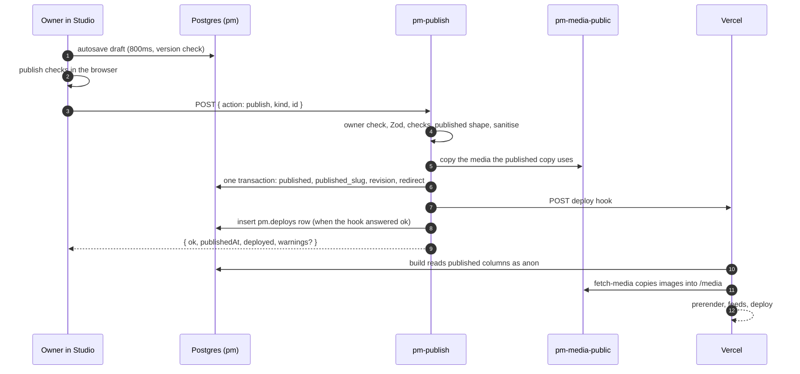

# Publishing

Editing and publishing are separate steps. Studio saves the owner's edits to the `draft` column within a second, with a version check against other tabs and a queue for when the connection drops. Nothing reaches the live site until the owner publishes. Publishing goes through one Edge Function, `pm-publish`, which runs the publish checks again on the server, writes the published copy and a revision in one transaction, and calls a Vercel deploy hook so the static site rebuilds. Unpublishing, deleting, restoring, scheduling and changing who can find a project go through the same function. As of 15 Oct 2026 this is all built and tested locally (on PGlite and in Studio's in-memory repo), but the site isn't launched yet: the functions aren't deployed to the shared Supabase project and the deploy hook isn't set up ([supabase/README.md](../../supabase/README.md)).

## The whole flow

## Autosave

Every editor saves through one hook, `useAutosave` ([src/components/studio/useAutosave.ts](../../src/components/studio/useAutosave.ts)):

- It saves 800ms after the last edit (`AUTOSAVE_DELAY`).
- Each save is `update … set draft = …, version = version + 1 where id = … and version = <the version Studio last saw>` ([src/lib/studio/supabase.ts](../../src/lib/studio/supabase.ts)).
- The save status is always visible: "All changes saved", "Saving…", "Offline · saved on this device" or "Couldn't save" with Retry ([05 · Shell](../handover/05-studio.md)).
- Before publishing, the hook flushes the last edit. If it doesn't save, nothing is published: "Your last change didn't save, so nothing was published. Try again once it's saved."

**Why a version number.** The owner may have Studio open on a laptop and a phone. Without the check, the slower device would silently overwrite the faster one ([06 · Autosave](../handover/06-backend.md#autosave)).

### Conflicts

If the update matches zero rows, another tab or device saved first. Studio shows the conflict dialog ("Edited somewhere else") with the newer row:

- **Keep mine** saves this tab's draft over the latest version;
- **Load latest** drops this tab's edits and loads the newer draft.

### The offline queue

When a save can't reach the database, the edit waits in IndexedDB ([src/lib/studio/offline.ts](../../src/lib/studio/offline.ts)), in the `pm-studio` database. There's one entry per document (`project:<id>`, `post:<id>`, `profile`, `layout`), and the newest edit wins. Studio retries every 4 seconds and when the browser fires `online`. When Studio opens again, `syncPending()` ([src/lib/studio/sync.ts](../../src/lib/studio/sync.ts)) saves what's queued with the same version check. A conflict stays queued until the owner opens that document and the conflict dialog takes over. Without IndexedDB (private modes, tests) the queue lives in memory for the tab's lifetime.

Publishing is paused while offline: "Reconnect to publish". Studio uses its own small IndexedDB wrapper rather than `idb-keyval` ([D65](../handover/09-decisions.md)).

## Publish checks

The checks run twice: in the browser as the owner edits, for instant feedback ([src/lib/studio/checks.ts](../../src/lib/studio/checks.ts)), and again in `pm-publish` ([supabase/functions/\_shared/checks.ts](../../supabase/functions/_shared/checks.ts)). The server's checks are the ones that count, because the owner's session can't write the published columns itself ([D55](../handover/09-decisions.md)).

| Kind | Blocks publishing | Warns only |
| --- | --- | --- |
| Project | Title, company, summary or address missing; summary over 140 characters; a missing image; an image without alt text that isn't decorative; an Achieved result with no evidence note ([D7](../handover/09-decisions.md)); an empty video block; a video from an unsupported host, or a Drive video that isn't shared; a prototype that asks visitors to sign in; an address another project already uses | A RICE row whose score doesn't match its inputs and isn't marked reviewed ([D61](../handover/09-decisions.md)) |
| Post | No title; no address; a missing cover or image; a cover or image without alt text; an address another post already uses | Studio's dialog also notes short posts and a missing excerpt |
| Website | Profile media that no longer exists | Unconfirmed facts that would be visible (see below) |

Link checks use `pm-check-link`'s logic, so a prototype or video link is fetched at publish time ([Operations · Link checks](Operations.md#link-checks)). A blocked publish answers `422` with `{ field, message }` for each issue, and Studio links each one to its tab and field.

**Unconfirmed facts.** For the website, if a visible section shows a fact that's still in "Worth a check", `pm-publish` answers `409 needs-confirm` with the list. The owner confirms and Studio publishes again with `confirmUnconfirmed: true`. Unconfirmed facts keep their live values when published; they aren't left off the site ([D5](../handover/09-decisions.md), [D42](../handover/09-decisions.md)).

## What a publish writes

For a project ([supabase/functions/\_shared/publish.ts](../../supabase/functions/_shared/publish.ts), `publishProjectRow`):

1. Load the draft and validate it with the Zod schema.
2. Run the checks.
3. Build the published shape (`publishProject`), add video posters ([D81](../handover/09-decisions.md)), sanitise, and copy the media it uses into `pm-media-public`.
4. In one transaction:
   - if the live address changes and "Redirect the old address here" (`settings.redirectOldSlug`) is on, insert a `slug_redirects` row for the old `/work/<slug>`;
   - remove any redirect away from the new live address;
   - write `published`, `published_at`, `published_slug = slug`, and `first_published_at` if it's the first publish;
   - insert a `project_revisions` row;
   - on the first publish, place the project in the published homepage layout, after the nearest live project before it in the draft layout, and insert a `site_revisions` row ("Added {title} to the homepage").
5. Call the deploy hook.

Posts follow the same steps with `post_revisions`, and always redirect an old `/writing/<slug>`. The website publish writes `profile` and `site_layout` together with one `site_revisions` row, whose `changes` lists the moves and switches ([supabase/functions/\_shared/site.ts](../../supabase/functions/_shared/site.ts)).

**Addresses change only on publish.** `slug` is the draft address, edited in URL & SEO; `published_slug` is the live one, and only `pm-publish` writes it ([D40](../handover/09-decisions.md)).

**Replacing an image.** "Replace file" uploads new files under the same media id and bumps `media.rev`. Drafts show the new file at once. Live pages pick it up when each document that uses it is published again, and Studio offers "Publish all n" for them ([D41](../handover/09-decisions.md)).

## Rebuilds

`deploy()` in [publish.ts](../../supabase/functions/_shared/publish.ts) posts to `PM_DEPLOY_HOOK_URL` with a 10-second timeout. When the hook answers OK it inserts a `pm.deploys` row with the reason (`site`, `project:<slug>`, `post:<slug>`, `schedule`, `unpublish` or `retry`) and returns `deployed: true`.

- **A failed hook never undoes a publish.** The published copy stands; Studio says the site will update on the next deploy and offers **Try again**.
- **Try again** calls `pm-publish` with `{ action: "deploy", kind: "site" }`, which calls the hook and publishes nothing ([D81](../handover/09-decisions.md)).
- **Several publishes in a row** each call the hook; Vercel cancels superseded builds, so the last one wins.
- The hook builds the `main` branch ([06 · Build-time data](../handover/06-backend.md#build-time-data)).

The build itself is described on [Architecture](Architecture.md#how-publishing-rebuilds-the-site).

## Revisions

Every publish keeps the published copy in a revisions table, so what was live is never lost when the next version replaces it. As of 15 Oct 2026, the one place Studio reads them is Undo after Unpublish: `restore` puts the latest revision back up without re-running the checks, since it was live moments before ([D62](../handover/09-decisions.md)). There is no screen yet for browsing or restoring older revisions.

## Unpublish, delete and restore

All three go through `pm-publish` (`changeState` in [publish.ts](../../supabase/functions/_shared/publish.ts)) and rebuild the site only if something live changed.

| Action | What it writes | In Studio |
| --- | --- | --- |
| `unpublish` | `published = null`. The project keeps its spot in the layout | Toast with Undo. Anyone opening the old link lands on the work index, through `pm.public_redirects()`'s "moved" rows |
| `delete` | `deleted_at = now()`: a soft delete | From the Projects list: a plain confirm with "Unpublish instead" and a 7-second Undo ([D43](../handover/09-decisions.md)). From URL & SEO: type the address to confirm |
| `restore` | Clears `deleted_at`; or, for an unpublished row, copies back its latest revision | Undo for either |

Soft-deleted rows are removed for good by the nightly purge 30 days later ([Operations · The purge job](Operations.md#the-purge-job)). Both delete paths call the same `delete` action; the difference is only how Studio asks.

## Who can find a project

URL & SEO's "Who can find it" (Public or Unlisted) and "Let search engines index this page" apply without a publish. Studio calls `{ action: "settings", kind: "project", visibility?, indexAllowed? }`, which writes `visibility` and `index_allowed` and rebuilds if the project is live ([D40](../handover/09-decisions.md)).

- **Unlisted** projects are published but never in the build. They're served by the `noindex` unlisted shell through `pm-project` ([D24](../handover/09-decisions.md)).
- **`index_allowed = false`** writes `noindex` on the page and leaves it out of the sitemap ([D82](../handover/09-decisions.md); `sitemapXml` in [src/lib/feeds.ts](../../src/lib/feeds.ts)).

## Scheduled posts

- **Schedule:** Studio calls `pm-publish` with `scheduleFor` set to a future time. The publish checks run then, so a scheduled post can't fail them later, and `scheduled_for` is stored. A time in the past is refused ("Pick a time in the future.").
- **Unschedule:** `scheduleFor: null` clears `scheduled_for` and returns the post to Drafts. This is a small addition beyond the boards ([D45](../handover/09-decisions.md)).
- **Publishing on time:** the `pm-scheduled-posts` cron job calls `pm-post-scheduler` every 5 minutes. It publishes each post whose `scheduled_for` has passed, then calls the deploy hook once if any were published ([supabase/functions/\_shared/jobs.ts](../../supabase/functions/_shared/jobs.ts)).
- **If one fails,** the scheduler clears `scheduled_for` and stores the reason in `schedule_error`. The post isn't retried. Studio shows "Couldn't publish" with the reason on the post and on the dashboard.

A post's `published_at` is its first publish and stays its date; `modifiedAt` in the published copy is the latest publish.

## Previews

Draft previews let the owner, or someone the owner shares a link with, see unpublished work ([supabase/functions/\_shared/preview.ts](../../supabase/functions/_shared/preview.ts)):

- **Create:** `POST` to `pm-preview` (owner only) makes 32 random bytes, stores only their SHA-256 in `preview_links` with a 7-day expiry, and returns the link once.
- **Open:** `/preview/<token>` calls `GET ?token=`. An unknown token is a 404; an expired or revoked one is a 410, which shows the expired-preview page. Otherwise it returns the draft in its published shape, with one-hour signed URLs for draft images.
- **Every answer** is `no-store`, `noindex, nofollow` and `Referrer-Policy: no-referrer`, so the token doesn't leave in a `Referer`.
- **Revoke:** `DELETE` with the token hash. Studio lists active links by date, never by token.

## Code

- [src/components/studio/useAutosave.ts](../../src/components/studio/useAutosave.ts): autosave, conflicts and retries
- [src/lib/studio/offline.ts](../../src/lib/studio/offline.ts), [src/lib/studio/sync.ts](../../src/lib/studio/sync.ts): the offline queue
- [src/lib/studio/checks.ts](../../src/lib/studio/checks.ts): the publish checks in the browser
- [src/lib/studio/supabase.ts](../../src/lib/studio/supabase.ts), [src/lib/studio/repo.ts](../../src/lib/studio/repo.ts): Studio's Supabase repo and its interface
- [supabase/functions/\_shared/publish.ts](../../supabase/functions/_shared/publish.ts): `pm-publish`
- [supabase/functions/\_shared/checks.ts](../../supabase/functions/_shared/checks.ts), [supabase/functions/\_shared/site.ts](../../supabase/functions/_shared/site.ts), [supabase/functions/\_shared/sanitize.ts](../../supabase/functions/_shared/sanitize.ts): the server checks, the website publish and sanitising
- [supabase/functions/\_shared/jobs.ts](../../supabase/functions/_shared/jobs.ts): `pm-post-scheduler`, `pm-purge`, `pm-check-link`, `pm-project`
- [supabase/functions/\_shared/preview.ts](../../supabase/functions/_shared/preview.ts): `pm-preview`
- [src/lib/published.ts](../../src/lib/published.ts): the published shape
- [docs/handover/05-studio.md](../handover/05-studio.md), [docs/handover/06-backend.md](../handover/06-backend.md#pm-publish): the full specs
