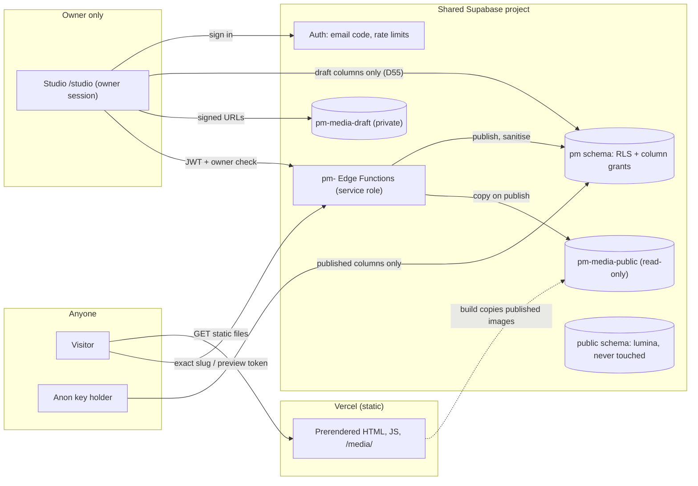

# Security

The repository is public. The site is static, and one person, the owner, can change it through Studio. So security comes down to four things. Only the owner can sign in. Only published content ever reaches a visitor. Rich text and links from content can't run code. And nothing secret is ever committed. This page covers the threat model and each of those defences: where it's enforced, why it was chosen, and the tests that hold it in place. It's written as of 15 Oct 2026. The site isn't launched yet (M6 is pending, [D46](../handover/09-decisions.md)), so some settings are specified and built but not yet switched on. The [status](#status-as-of-15-oct-2026) section lists which ones.

## Status as of 15 Oct 2026

| Part | State |
| --- | --- |
| `pm` schema, row-level security, column grants, buckets, the six `pm-` Edge Functions | Built and tested locally on PGlite. Nothing has touched the shared Supabase project yet: the owner applies the migrations at go-live ([`supabase/README.md`](../../supabase/README.md)) |
| Auth settings on the shared project (sign-ups off, 8-digit codes, 10-minute expiry, rate limits, SMTP sender, the Magic Link template) | Specified in [06 · Supabase settings](../handover/06-backend.md#supabase-settings). The owner applies them at go-live ([D52](../handover/09-decisions.md), [D66](../handover/09-decisions.md)). The email sender is still the owner's choice ([D53](../handover/09-decisions.md)) |
| CAPTCHA (Turnstile) | Off on the shared project for now ([D54](../handover/09-decisions.md)). Studio renders the widget, but Supabase doesn't check the token yet |
| Content Security Policy and other response headers | Built: every build writes them into Vercel's Build Output config ([D83](../handover/09-decisions.md)). They take effect on visitors when the site deploys at launch. A CSP check against `.vercel/output/config.json` is part of M6's security pass |
| The build-level no-leaks test | A CI job against a local Supabase stack exists, but is temporarily allowed to fail while a seeding problem is fixed (below) |
| Repository gates (gitleaks, the env check, the build check, the migration lint, `npm audit`) | Running in CI on every push |
| GitHub settings (secret scanning with push protection, Dependabot, private vulnerability reporting, branch protection) | The owner switches these on ([09 · Launch checklist](../handover/09-decisions.md#launch-checklist-owner), item 9) |

## Threat model

**What's worth protecting:**

- drafts, private evidence notes, unconfirmed facts and unpublished projects;
- the owner's ability to publish, which nobody else should have;
- visitors, who shouldn't be served script that someone injected through content;
- the shared Supabase project, which also runs the owner's photography site, lumina-photography ([D27](../handover/09-decisions.md));
- the service-role key, the deploy hook and the SMTP and Turnstile secrets.

**Who might attack:**

- a visitor reading the static site, its JSON and the public Supabase API with the anon key, which is public by design;
- someone trying to sign in to Studio by guessing codes, or by flooding the owner with them;
- a signed-in account that isn't the owner, such as one of lumina's admins;
- anyone reading the public repository and its history for secrets.

### Trust boundaries

Each arrow that crosses into Supabase is checked there, not in the browser. The browser only gets the three public variables: `VITE_SUPABASE_URL`, `VITE_SUPABASE_ANON_KEY` and `VITE_TURNSTILE_SITE_KEY`.

### Threats and defences

| Threat | Defence | Where |
| --- | --- | --- |
| A visitor reads a draft | Column grants hide `draft` from `anon`. Row policies hide unpublished, deleted and unlisted rows. Public loaders return only published views | [`0001_init.sql`](../../supabase/pm/migrations/0001_init.sql), [`src/lib/site.ts`](../../src/lib/site.ts) |
| A draft ends up in the static build | The build reads as `anon`. Prerendering serialises each loader's whole return value, so loaders return only published types. A no-leaks test searches the build for marker strings | [`tests/e2e/no-leaks.spec.ts`](../../tests/e2e/no-leaks.spec.ts), [`supabase/tests/no-leaks.test.ts`](../../supabase/tests/no-leaks.test.ts) |
| Someone guesses a sign-in code | 8-digit codes, a 10-minute expiry, one use, and Supabase's rate limits | [Sign-in](#sign-in-by-email-code) |
| A non-owner account signs in | RLS returns zero rows and refuses every write. Studio signs it out at once | `pm.is_owner()`, [`src/lib/studio/supabase.ts`](../../src/lib/studio/supabase.ts) |
| The owner's own session skips the publish checks | The session can write drafts only. Publishing goes through `pm-publish` | [D55](../handover/09-decisions.md) |
| Script injected through rich text or a link | An allowlist parser, run on save, at publish and at render. One link rule everywhere | [`src/lib/rich-text.ts`](../../src/lib/rich-text.ts), [`src/lib/links.ts`](../../src/lib/links.ts) |
| A portfolio rule exposes lumina's data, or the reverse | Everything lives in `pm`, the `pm-` buckets and the `pm-` functions. A migration lint and the RLS tests enforce the split | [`scripts/migration-lint.ts`](../../scripts/migration-lint.ts), [`supabase/tests/rls.test.ts`](../../supabase/tests/rls.test.ts) |
| A secret is committed | gitleaks in CI. A build check refuses a service-role key in any environment value the build loads | [`.github/workflows/ci.yml`](../../.github/workflows/ci.yml), [`scripts/check-env.ts`](../../scripts/check-env.ts) |
| A third-party frame or script takes over a page | Embeds load only on click, in sandboxed iframes, on an allowlist of hosts. A strict CSP with per-page script hashes | [`src/components/media/`](../../src/components/media/), [`scripts/vercel-config.ts`](../../scripts/vercel-config.ts) |

## Sign-in by email code

Studio signs in with a code sent by email. It used to be Google sign-in. The code replaced it because only one person ever signs in, and a code needs no third-party identity provider ([D8](../handover/09-decisions.md)).

- **8 digits, not the boards' 6** ([D66](../handover/09-decisions.md)). CAPTCHA protection stays off for now (below), so guessing had to be harder. 8 digits makes it 100 times harder. Every part of Studio reads the length from one constant, `CODE_LENGTH` in [`src/lib/studio/signin.ts`](../../src/lib/studio/signin.ts). The code input (S2) shows eight boxes.
- **Sign-ups are off.** Studio also asks for codes with `shouldCreateUser: false`, so a code request can never create an account. The response is the same whether or not the address has an account, so the screen never reveals which addresses exist.
- **Codes expire after 10 minutes and work once.** A new code replaces the old one.
- **Rate limits** (Supabase Auth, project-wide): one code per address per 60 seconds, 30 emails an hour for the whole project, and 30 code checks per 5 minutes per IP address.
- **A lock on the device.** Five wrong codes lock the code boxes on that device for 15 minutes (`MAX_WRONG` and `LOCK_MS` in `signin.ts`). This is a convenience that stops a person guessing. The server-side limits are the real defence.
- **The owner check runs on the server.** After a code is accepted, Studio calls `pm.is_owner()`. If the answer is no, it signs the session out at once. Being signed in grants nothing anyway: RLS checks `is_owner()` on every row.
- **Owners are keyed by user id,** not by email ([D28](../handover/09-decisions.md)). If the owner changes their address in Supabase, nothing else changes.
- **The owner is created once** by `npm run setup:owner` ([`scripts/setup-owner.ts`](../../scripts/setup-owner.ts)). It reads `SUPABASE_URL`, `SUPABASE_SERVICE_ROLE_KEY` and `OWNER_EMAIL` from the shell, prints the address masked, and never prints the key. The owner's address never appears in code, migrations, seeds or tests. Tests use `owner@example.test`.
- **Sessions after sign-out.** Studio reloads any page restored from the back/forward cache (a `pageshow` listener in [`src/routes/studio/shell.tsx`](../../src/routes/studio/shell.tsx)), so a page restored after sign-out never shows content. At launch, `/studio/*` is also served `no-store`.

### Turnstile and CAPTCHA

Supabase's CAPTCHA protection is one setting for the whole project. Switching it on would also reject lumina's sign-in, SMS codes and password resets, because lumina doesn't send Turnstile tokens yet ([D35](../handover/09-decisions.md)). So, for now, it stays off ([D54](../handover/09-decisions.md)):

- Studio renders the Turnstile widget on the sign-in page ([`src/components/studio/login/Turnstile.tsx`](../../src/components/studio/login/Turnstile.tsx)) and sends the token when it has one;
- Supabase ignores the token while protection is off, so nothing in Studio changes when it's switched on;
- until then, the rate limits and the 8-digit codes protect sign-in.

**What's left.** Supabase limits code checks per IP address, not per email address. An attacker with many IP addresses could spread guesses across them. With 8 digits there are 100 million possible codes, and at most one new code a minute, so even a sustained attack stays impractical. It would also fill the owner's inbox with codes, which is easy to notice ([06 · Abuse limits](../handover/06-backend.md#abuse-limits-all-together)). The owner's mailbox becomes the key to Studio, so the launch checklist asks for 2-Step Verification on it.

## The shared Supabase project

The free plan allows two projects, and both were already in use. So the portfolio lives inside the project that runs lumina-photography ([D27](../handover/09-decisions.md)). That decision shapes most of the database rules:

- **Its own namespace.** Everything is in the `pm` schema, the `pm-media-draft` and `pm-media-public` buckets, the `pm-` functions, and `pm_` Vault secrets and cron jobs. Lumina's `public` schema, `portfolio` bucket and admins are never touched.
- **Its own migrations.** The Supabase CLI keeps one migration history per project, and lumina's migrations aren't in this repo. So the portfolio doesn't use it. `npm run db:migrate` ([`scripts/migrate.ts`](../../scripts/migrate.ts)) applies `supabase/pm/migrations/` and records each file in `pm.schema_migrations` with its SHA-256. It refuses to run if an applied file has changed ([D36](../handover/09-decisions.md)). Commands that would reconcile histories (`supabase db push`, `db reset --linked`, `db pull`, `migration repair`) are never run against the project.
- **The migration lint** ([`scripts/migration-lint.ts`](../../scripts/migration-lint.ts), `npm run db:lint`) fails if a migration:
  - names `public` or creates an extension;
  - creates or changes anything in `auth`;
  - targets anything outside `pm`, except `pm-` buckets, `storage.objects` policies scoped to a `pm-` bucket, and `pm-` cron jobs;
  - leaves a function without `search_path = ''` and an explicit `revoke all … from public`;
  - creates a table without row-level security and a policy.

  `db:migrate` refuses any file the lint flags, and CI runs the lint on every push.
- **Extensions are the owner's step.** No migration creates an extension. The owner switches on `pg_cron` and `pg_net` in the dashboard ([D57](../handover/09-decisions.md)).

## Row-level security and column grants

Every table in `pm` has row-level security on. One function, `pm.is_owner()`, decides who the owner is. It's `security definer` with `search_path = ''`. Two tables have RLS on and no policies at all: `pm.owners` and `pm.schema_migrations`. Only the service role touches them.

**The owner writes drafts only** ([D55](../handover/09-decisions.md)). Column grants let the owner's session write `draft`, `version` and `slug`, plus the media rows. They stop it writing `published`, `published_slug`, `visibility`, `index_allowed`, `deleted_at`, `scheduled_for`, and every revision, redirect, preview, link-check and deploy row. Only `pm-publish`, running as the service role, writes those. So the publish checks and the server-side sanitiser can't be skipped, even with the owner's own session.

**Visitors (`anon`) read published columns only.** The grants are on four tables:

| Table | Columns `anon` can read | Rows it can see |
| --- | --- | --- |
| `pm.projects` | `id`, `published_slug`, `published`, `published_at`, `first_published_at`, `index_allowed` | Published, not deleted, `visibility = 'public'` |
| `pm.posts` | `id`, `published_slug`, `published`, `published_at` | Published, not deleted |
| `pm.profile`, `pm.site_layout` | `published`, `published_at` | Published |

Two columns go beyond 06's list, each with a decision. `id` is readable because published layouts name projects by id ([D56](../handover/09-decisions.md)). `index_allowed` is readable (migration [`0004_anon_index_allowed.sql`](../../supabase/pm/migrations/0004_anon_index_allowed.sql)) so the build can write `noindex` and leave those pages out of the sitemap ([D82](../handover/09-decisions.md)).

`anon` can call one function, `pm.public_redirects()`. It returns old addresses only for pages that are live and public, plus the "moved" note for pages that were public once. Nothing else is granted to `anon`: no media table, revisions, previews, link checks or deploys.

**A signed-in account that isn't the owner** holds table privileges as `authenticated`, but matches no policy. So it reads zero rows and every write fails. That includes lumina's admins.

The first migration starts by revoking everything from `public`, `anon` and `authenticated`, then grants exactly what's needed. The test harness ([`supabase/tests/harness.ts`](../../supabase/tests/harness.ts)) grants the API roles everything by default, the most permissive setup a project can have. So the migrations only pass if they revoke and grant explicitly.

## Storage

There are two buckets ([D29](../handover/09-decisions.md)):

| Bucket | Public | Who writes |
| --- | --- | --- |
| `pm-media-draft` | No. Studio reads it through signed URLs that last an hour | The owner, through a `storage.objects` policy scoped to this bucket |
| `pm-media-public` | Read-only | `pm-publish` only, when it copies the files a published document uses |

A draft's images are never reachable, even by a guessed URL. Visitors never load images from Supabase at all: the build copies published images into the site under `/media/` ([`scripts/fetch-media.ts`](../../scripts/fetch-media.ts)). File keys are random ids, so filenames never appear in URLs. Re-encoding in the browser drops EXIF data, including location. PDFs and GIFs keep their metadata, which is an open item in [`HANDOFF.md`](../../HANDOFF.md).

## Edge Functions

Six functions, all named `pm-…`, in [`supabase/functions/`](../../supabase/functions/). They share their checks in [`_shared/http.ts`](../../supabase/functions/_shared/http.ts):

- **Owner calls** carry the session's JWT. `requireOwner()` gets the user and checks `pm.owners`. Otherwise the answer is `401` or `403`, with no detail.
- **Cron calls** carry the service-role key from Vault (`pm_service_role_key`).
- **CORS** allows only the origins in `PM_ALLOWED_ORIGINS`. A preflight from any other origin gets `403`.
- **Bodies** are capped at 256 kB and validated with Zod.
- **Responses** are always `no-store`. Errors never include stack traces or database messages. Nothing logs request bodies, tokens or email addresses.

`pm-preview` and `pm-project` deploy without JWT verification ([D59](../handover/09-decisions.md)), because visitors call them. They return only what a token or an exact slug allows:

- **Preview links** are 32 random bytes. The function stores only their SHA-256 and returns the link once. An unknown token gets `404`, and an expired or revoked one gets `410`. Responses are `no-store`, `noindex` and `no-referrer` ([`_shared/preview.ts`](../../supabase/functions/_shared/preview.ts)).
- **Unlisted projects** are fetched by exact published slug and rendered by a `noindex` shell ([D24](../handover/09-decisions.md)).

Outbound fetches are limited too. Video posters are fetched only from the fixed oEmbed endpoints and thumbnail hosts, with no redirects, a 10-second limit and a size cap ([D81](../handover/09-decisions.md)). The link checker refuses links that resolve to private IP addresses (`isPrivateIp` in [`_shared/check-link.ts`](../../supabase/functions/_shared/check-link.ts)).

The functions validate and sanitise with the same code as the site. [`scripts/sync-functions-lib.ts`](../../scripts/sync-functions-lib.ts) copies the shared modules from `src/lib` into `supabase/functions/_shared/lib/`, and CI fails if a copy is out of date.

## Rich text and links

`Inline` and `Rich` strings are never rendered as raw HTML.

- **One parser.** [`parseRichText()`](../../src/lib/rich-text.ts) turns a string into a small tree of allowed nodes: `p`, `strong`, `em`, `a[href]`, `ul`, `ol` and `li`, or only `strong`, `em` and `a` for inline text. Every other tag is dropped and its text kept. Elements whose content is never text for a reader, such as `script`, `style`, `iframe` and `svg`, are dropped with their content. Every attribute is dropped except a link's `href`. It's plain TypeScript with no DOM, so the prerender and the browser build the same tree.
- **Three passes.** Studio's rich-text field sends every change through this parser ([D69](../handover/09-decisions.md)). `pm-publish` runs it again on every published field and stores what the renderer would keep ([`_shared/sanitize.ts`](../../supabase/functions/_shared/sanitize.ts)). The site renders the tree as React elements ([`src/components/rich/RichText.tsx`](../../src/components/rich/RichText.tsx)), so React escapes every text node. The only `dangerouslySetInnerHTML` in `src/` is the constant bootstrap script in [`src/root.tsx`](../../src/root.tsx).
- **One link rule.** [`isSafeLink()`](../../src/lib/schemas.ts) accepts `https:` URLs (with a host and no credentials), `mailto:`, a site path starting with a single `/`, or an in-page `#anchor`. It rejects `javascript:`, `data:` and `//host`. Every component that renders a link from props goes through [`safeHref()`](../../src/lib/links.ts), so a bad value can't reach the DOM even if it skipped schema validation.
- **Embeds.** Prototypes and videos are links, never served from the site's own origin ([D11](../handover/09-decisions.md)). They load only when a visitor presses play, in sandboxed iframes, on an allowlist of frame hosts (`FRAME_HOSTS` in `links.ts`). Prototype frames send no referrer. Video frames send `strict-origin-when-cross-origin`, because YouTube needs a referrer ([`HANDOFF.md`](../../HANDOFF.md)).

## Content Security Policy and headers

The headers are specified in [01 · Headers](../handover/01-architecture.md#headers). [`scripts/write-vercel-config.ts`](../../scripts/write-vercel-config.ts) (`npm run build:vercel`, part of `npm run build`) writes them, together with the redirects, into Vercel's Build Output config, `.vercel/output/config.json`. The pure parts, such as `publicCsp()`, `studioCsp()` and `buildRoutes()`, are in [`scripts/vercel-config.ts`](../../scripts/vercel-config.ts) and tested in [`tests/unit/vercel-config.test.ts`](../../tests/unit/vercel-config.test.ts).

**Why not `vercel.json`.** Vercel reads `vercel.json` before the build runs, so a file written during the build would never apply. The Build Output config is read after the build, so it can carry what only the build knows: each page's script hashes, the prototype hosts and the redirects ([D83](../handover/09-decisions.md)). The headers reach visitors once the site deploys at launch.

As specified:

| Header | Public pages | `/studio/*` |
| --- | --- | --- |
| `Content-Security-Policy` | `default-src 'self'`; `script-src 'self'` plus page-by-page hashes; `style-src 'self' 'unsafe-inline'`; `frame-src` the video and prototype hosts; `frame-ancestors 'none'`; `base-uri 'self'`; `form-action 'self'` | The same, plus Cloudflare's Turnstile in `script-src` and `frame-src`, Supabase's websocket in `connect-src`, and no video or prototype hosts |
| `Cache-Control` | Assets immutable for a year; HTML `max-age=0, must-revalidate` | `no-store` |
| `X-Robots-Tag` | `noindex` on unlisted shells and previews | `noindex, nofollow` |
| `Referrer-Policy` | `strict-origin-when-cross-origin` (`no-referrer` on `/preview/*`) | `same-origin` |
| `X-Content-Type-Options`, `Permissions-Policy`, `Strict-Transport-Security` | `nosniff`; camera, microphone and geolocation off; two years with subdomains | The same |

**Why hashes, page by page.** Each prerendered page carries the one-line bootstrap ([`src/lib/bootstrap.ts`](../../src/lib/bootstrap.ts)), which adds `js` and `still` to `<html>`, plus React Router's own inline scripts. Those include each page's loader data, which differs per page, so one global hash can't work. The script hashes every inline script in each HTML file and writes a policy per path. Studio, previews and unlisted shells share the SPA fallback's policy. The build fails if any inline script would be blocked by the policy its address gets. Styles need `'unsafe-inline'` because the hero and cards set CSS variables inline, such as `--pa`.

## Drafts never leak

This is a non-negotiable in [`CLAUDE.md`](../../CLAUDE.md): drafts never appear on the site, in the sitemap, in the RSS feed, or in any response a visitor can get. It's tested at two levels, with marker strings planted in every place a visitor must never see: a draft project, a scheduled post, an unlisted project, hidden sections, chapters and text, evidence notes, prompts, to-dos and an unconfirmed fact ([`scripts/leak-markers.ts`](../../scripts/leak-markers.ts)).

| Level | Test | What it checks |
| --- | --- | --- |
| Data | [`supabase/tests/no-leaks.test.ts`](../../supabase/tests/no-leaks.test.ts) (`npm run test:db`, in CI) | The V0 seed plus the markers, published through `pm-publish`, then read the way the build reads (as `anon`) and turned into every public view. No marker appears in any view, at the draft, scheduled and unlisted addresses, in anything `anon` can query, or in `pm-media-public` |
| Database | [`supabase/tests/rls.test.ts`](../../supabase/tests/rls.test.ts) | RLS is on for every table. No policy in `pm` refers to `public`. Every `storage.objects` policy, lumina's included, names a bucket. Every function sets `search_path = ''`. `anon` gets column grants only. The owner can't write live columns. Each table is probed as `anon`, as a signed-in stranger, as lumina's admin and as the owner |
| Build | [`tests/e2e/no-leaks.spec.ts`](../../tests/e2e/no-leaks.spec.ts) | Searches every built file in `build/client` (HTML, JS, JSON, data, XML and text, so the sitemap, RSS and `robots.txt` too) for the markers and private ids. Queries every table and function as `anon`. Checks that draft and scheduled addresses show the 404, that the unlisted page is `noindex` and linked from nowhere, and that a preview link is `no-store` and `noindex`, then 410 once revoked |

The build-level test needs a full local Supabase stack, seeded by `npm run seed:leaks`. Without the manifest that seeding writes, it skips. CI's `no-leaks` job starts a local stack (never linked to the shared project), seeds the markers, serves the `pm-` functions, builds from the stack as `anon` and runs the spec. As of 15 Oct 2026 the job is marked `continue-on-error`, because `pm-publish` refuses the seeding on the real stack and that's being fixed. The workflow says the flag comes off as soon as the job passes, so that it blocks merges.

## Repository hygiene

The repository holds no secrets, and gitleaks runs in CI ([D10](../handover/09-decisions.md)). [`SECURITY.md`](../../SECURITY.md) says what's in the repo and what never is. Secrets live in dashboards only:

| Where | What (names only) |
| --- | --- |
| Vercel | `VITE_SUPABASE_URL`, `VITE_SUPABASE_ANON_KEY`, `VITE_TURNSTILE_SITE_KEY` (public by design), `SITE_URL` |
| Supabase Edge Function secrets | `PM_DEPLOY_HOOK_URL`, `PM_ALLOWED_ORIGINS`, `PM_SITE_URL`. Supabase provides the service-role key to functions itself |
| Supabase Vault | `pm_service_role_key`, `pm_project_url` ([D57](../handover/09-decisions.md)) |
| Supabase Auth settings | The SMTP password and the Turnstile secret key |
| The owner's shell, only while a script runs | `SUPABASE_SERVICE_ROLE_KEY` and `OWNER_EMAIL` for `setup:owner` and `seed:v0`; `PM_DATABASE_URL` for `db:migrate` |

The gates that keep it that way:

| Gate | What it does | Where |
| --- | --- | --- |
| gitleaks | Scans the commits in each push or pull request, with the full history fetched | `secrets` job in [`ci.yml`](../../.github/workflows/ci.yml) |
| Env check, before every build | Only the three public `VITE_` variables may be named in `src/`. Nothing may read `import.meta.env` as a whole or widen `envPrefix`. No environment value may be a service-role JWT or an `sb_secret_` key. The parity fixture and the dev catalogue can't reach a production build | [`scripts/check-env.ts`](../../scripts/check-env.ts) |
| Build check, after every build | The dev catalogue isn't in the shipped files, and no public page loads Studio's code or styles | [`scripts/check-build.ts`](../../scripts/check-build.ts) |
| Migration lint | Every statement stays inside `pm` and the `pm-` buckets | [`scripts/migration-lint.ts`](../../scripts/migration-lint.ts) |
| Supply chain | `npm audit --omit=dev --audit-level=high`. A committed lockfile. GitHub Actions pinned by commit SHA, with `permissions: contents: read`. Fewer dependencies where Studio could do without them ([D65](../handover/09-decisions.md), [D69](../handover/09-decisions.md)). `heic2any` was dropped as unmaintained, with LGPL code and no licence notice ([D80](../handover/09-decisions.md)) | [`ci.yml`](../../.github/workflows/ci.yml), [`package-lock.json`](../../package-lock.json) |
| Layer rules | ESLint stops public code importing Studio, and public loaders return views, never raw documents | [`HANDOFF.md` › How we work](../../HANDOFF.md#how-we-work) |
| Security review | Each phase closes with a security review of its diff, and every finding is fixed | [10 · Security gates](../handover/10-execution-plan.md#security-gates) |

**If a secret is ever committed:** stop, tell the owner, rotate the secret first, then clean the history. Deleting the file isn't enough ([`CLAUDE.md`](../../CLAUDE.md#security)).

**Reporting a problem:** use GitHub's private **Report a vulnerability** button on the repository's Security tab, not a public issue ([`SECURITY.md`](../../SECURITY.md)).

## Checks by hand before launch

From [08 · Security checks](../handover/08-qa.md#security-checks):

- sign in with an address that isn't the owner's: "Check your email" appears, no email arrives, and Studio stays closed;
- use a valid code for a non-owner test account on a local stack: it's signed out at once;
- enter five wrong codes: the lock shows, and after 15 minutes a new code works;
- restore a Studio page from the back/forward cache after signing out: it reloads to the sign-in page;
- after every Auth setting change, check that lumina still signs in.

## Code

- [`supabase/pm/migrations/`](../../supabase/pm/migrations/): schema, RLS, column grants, `is_owner()`, `public_redirects()`, buckets, cron
- [`supabase/functions/`](../../supabase/functions/) and [`_shared/http.ts`](../../supabase/functions/_shared/http.ts), [`_shared/sanitize.ts`](../../supabase/functions/_shared/sanitize.ts), [`_shared/preview.ts`](../../supabase/functions/_shared/preview.ts), [`_shared/check-link.ts`](../../supabase/functions/_shared/check-link.ts)
- [`src/lib/rich-text.ts`](../../src/lib/rich-text.ts), [`src/components/rich/RichText.tsx`](../../src/components/rich/RichText.tsx)
- [`src/lib/links.ts`](../../src/lib/links.ts) (`safeHref`, `FRAME_HOSTS`), [`src/lib/schemas.ts`](../../src/lib/schemas.ts) (`isSafeLink`, `isHttpsUrl`, `isRelativePath`)
- [`src/lib/studio/signin.ts`](../../src/lib/studio/signin.ts), [`src/lib/studio/supabase.ts`](../../src/lib/studio/supabase.ts), [`src/components/studio/login/`](../../src/components/studio/login/)
- [`src/lib/bootstrap.ts`](../../src/lib/bootstrap.ts), [`src/root.tsx`](../../src/root.tsx)
- [`scripts/write-vercel-config.ts`](../../scripts/write-vercel-config.ts), [`scripts/vercel-config.ts`](../../scripts/vercel-config.ts): headers, CSP hashes, redirects
- [`scripts/check-env.ts`](../../scripts/check-env.ts), [`scripts/check-build.ts`](../../scripts/check-build.ts), [`scripts/migration-lint.ts`](../../scripts/migration-lint.ts), [`scripts/migrate.ts`](../../scripts/migrate.ts), [`scripts/setup-owner.ts`](../../scripts/setup-owner.ts), [`scripts/sync-functions-lib.ts`](../../scripts/sync-functions-lib.ts)
- [`supabase/tests/rls.test.ts`](../../supabase/tests/rls.test.ts), [`supabase/tests/no-leaks.test.ts`](../../supabase/tests/no-leaks.test.ts), [`supabase/tests/functions.test.ts`](../../supabase/tests/functions.test.ts), [`tests/e2e/no-leaks.spec.ts`](../../tests/e2e/no-leaks.spec.ts)
- [`.github/workflows/ci.yml`](../../.github/workflows/ci.yml), [`SECURITY.md`](../../SECURITY.md)
