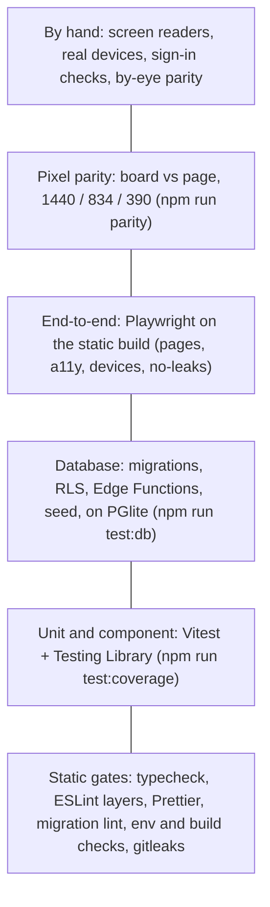
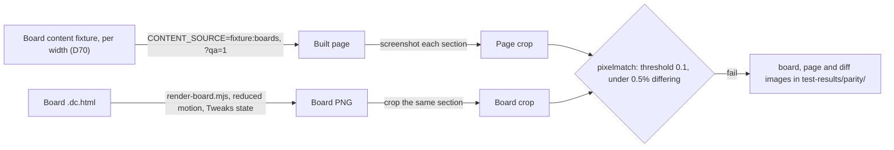

# Testing and QA

The design is final, and the build's job is to match it exactly. So testing here answers two questions. Does the code behave as specified? And does the page look like its board? Behaviour is covered by unit tests (Vitest), database tests on PGlite, and end-to-end tests (Playwright). Looks are covered by a pixel-parity suite, which renders each board and the built page with the same content and compares them section by section. Accessibility, device and reduced-motion sweeps run in Playwright too, and security has its own gates. This page describes each layer, the parity procedure, the budgets, and the results the build has recorded, as of 15 Oct 2026. The site isn't launched yet: the full QA pass is M6 ([`HANDOFF.md`](../../HANDOFF.md)).

## The layers

The bottom layers run on every push and are cheap. The top layers are slower, or need a person.

| Layer | What it covers | Where | Command |
| --- | --- | --- | --- |
| Static gates | Types, lint (including the layer rules), formatting, migrations staying inside `pm`, browser variables, the shipped bundle | [`scripts/`](../../scripts/), [`eslint.config.js`](../../eslint.config.js) | `npm run typecheck`, `npm run lint`, `npm run format:check`, `npm run db:lint` |
| Unit and component | `src/lib` (schemas, defaults, the V0 builder, views, links, rich text, redirects, feeds, the host config), every component and Studio screen, and the motion modules | `tests/unit/`, `src/**/*.test.ts(x)` | `npm test`, `npm run test:coverage` |
| Database | Migrations, the migration runner and lint, RLS and grants, the six `pm-` functions, the V0 seed, Studio's Supabase contract, drafts never leak (data level) | [`supabase/tests/`](../../supabase/tests/) | `npm run test:db` |
| End-to-end | The built site as visitors get it: home, work, case study, states, SEO, smoke. Plus the a11y and device sweeps and the no-leaks build check | [`tests/e2e/`](../../tests/e2e/) | `npm run e2e` |
| Pixel parity | Each section of each page against its board, at three widths | [`tests/parity/`](../../tests/parity/) | `npm run parity` |
| Edge Functions | A Deno type-check of every function | [`supabase/functions/`](../../supabase/functions/) | `deno check` (CI) |

### Unit and component tests

Vitest with Testing Library, configured in [`vitest.config.ts`](../../vitest.config.ts). Coverage has floors, and CI fails under them:

| Path | Lines | Functions | Branches | Statements |
| --- | --- | --- | --- | --- |
| `src/lib/**` | 90 | 90 | 85 | 90 |
| `src/components/**` | 80 | 80 | 70 | 80 |

Some tests worth knowing:

- [`tests/unit/legacy-content.test.ts`](../../tests/unit/legacy-content.test.ts) traces every string in `src/legacy/content.ts` back to the old `App.tsx`, kept at `tests/fixtures/legacy-app.tsx.txt`. So nothing in V0's content was lost or invented ([D5](../handover/09-decisions.md), [D6](../handover/09-decisions.md)).
- [`src/lib/rich-text.test.ts`](../../src/lib/rich-text.test.ts) runs XSS payloads through the allowlist parser.
- [`tests/unit/check-env.test.ts`](../../tests/unit/check-env.test.ts) tests the pre-build security gate.
- [`tests/unit/vercel-config.test.ts`](../../tests/unit/vercel-config.test.ts) checks that each page gets exactly its own CSP hashes and that the build refuses an inline script no header allows ([D83](../handover/09-decisions.md)).
- The motion tests in [`src/motion/`](../../src/motion/): the speed-line path against a snapshot of the board's own function, the frame-rate guard, the tilt maths, and the floater schedulers with fake timers. See [Motion](Motion.md#testing-motion).

### Database tests on PGlite

Pulling Supabase's Docker images failed during the build. So the migrations, RLS and functions are tested on PGlite, which is real Postgres compiled to WebAssembly, with Supabase's parts stubbed the way Supabase defines them ([`supabase/tests/harness.ts`](../../supabase/tests/harness.ts)). The harness:

- creates the `anon`, `authenticated` and `service_role` roles, `auth.users` and `auth.uid()`, the storage tables, Vault, `pg_cron` and `pg_net`;
- plays lumina-photography, with tables in `public`, its admin check and its `portfolio` bucket, so the tests can prove neither site reaches the other;
- grants the API roles everything by default, so the migrations only pass if they revoke and grant explicitly.

| File | What it proves |
| --- | --- |
| [`migrations.test.ts`](../../supabase/tests/migrations.test.ts) | The runner, the checksums and the migration lint; the committed migrations pass the lint |
| [`rls.test.ts`](../../supabase/tests/rls.test.ts) | Every table probed as `anon`, a signed-in stranger, lumina's admin, the owner and the service role. See [Security](Security.md#drafts-never-leak) |
| [`functions.test.ts`](../../supabase/tests/functions.test.ts) | The `pm-` functions end to end against the real migrations, with fakes for Storage, Auth and the network ([`fakes.ts`](../../supabase/tests/fakes.ts)) |
| [`seed.test.ts`](../../supabase/tests/seed.test.ts) | `seed:v0` on an empty schema, and `setup:owner`'s helpers |
| [`studio-contract.test.ts`](../../supabase/tests/studio-contract.test.ts) | Every read and write Studio sends, run as the owner against the real grants ([D55](../handover/09-decisions.md)) |
| [`no-leaks.test.ts`](../../supabase/tests/no-leaks.test.ts) | No marker reaches any view the build makes, or anything `anon` can query |

### End-to-end tests

Playwright, configured in [`playwright.config.ts`](../../playwright.config.ts). It serves the static build with `vite preview`, and the dev server for the component catalogue.

| Project | What it runs |
| --- | --- |
| `laptop` (1440 × 900), `phone` (Pixel 7, 390 × 844) | The page specs on the static build. No-leaks runs on laptop only, because it checks the build and the database, not a layout |
| `a11y` | [`tests/e2e/a11y/`](../../tests/e2e/a11y/): axe on every page at every QA width, keyboard focus, no-JS reading, reduced motion, landmarks and headings, and Studio's screens |
| `devices-chromium`, plus `devices-webkit` and `devices-firefox` in CI | [`tests/e2e/devices/`](../../tests/e2e/devices/): no horizontal scroll at any device size, portrait or landscape, and 44 × 44 touch targets |
| `catalogue-laptop`, `catalogue-phone` | The dev-only component catalogue at `/dev/components` |
| `parity-laptop`, `parity-ipad`, `parity-phone` | Only with `npm run parity` (below) |

Defects QA has filed but not yet fixed are listed in [`tests/e2e/devices/known-defects.ts`](../../tests/e2e/devices/known-defects.ts). A check that hits one runs as `test.fail`, so the suite turns red the moment the defect is fixed and the entry can be deleted. As of 15 Oct 2026 the list is empty.

**Running locally.** The preview is served on port 4310 and the dev server on 4311, away from Vite's defaults. Set `PW_PORT_BASE` to run several worktrees at once, and `PW_REUSE=1` to reuse a server you started yourself. WebKit and Firefox run locally only with `PW_ALL_BROWSERS=1`.

## CI

Every push and pull request runs [`.github/workflows/ci.yml`](../../.github/workflows/ci.yml), with `permissions: contents: read` and actions pinned by commit SHA:

| Job | Steps |
| --- | --- |
| Typecheck, lint, test, build | `typecheck`, `lint`, `format:check`, `test:coverage`, `db:lint`, `test:db`, the functions-lib sync check, `build`, then `npm audit --omit=dev --audit-level=high` |
| End-to-end | Installs Chromium, WebKit and Firefox, builds, then `npm run e2e` |
| Edge Functions type-check | `deno check` on every function |
| Drafts never leak | A local Supabase stack, the leak markers seeded, the functions served, a build from the stack, then `no-leaks.spec.ts`. As of 15 Oct 2026 it's temporarily allowed to fail while a seeding problem is fixed; it's meant to block merges ([Security](Security.md#drafts-never-leak)) |
| Secret scan | gitleaks on the commits in the push or pull request |

Pixel parity doesn't run in CI. It needs three separate builds, and it's run by hand with `npm run parity`.

The checks to run before every commit are in [`HANDOFF.md` › How we work](../../HANDOFF.md#how-we-work).

## Pixel parity

The boards are the reference at 1440, 834 and 390 wide. The design is final ([D3](../handover/09-decisions.md)), so "looks right" isn't enough: the page has to match the board. The procedure is in [08 · Pixel parity](../handover/08-qa.md#pixel-parity).

1. **Render the board.** [`design/tools/render-board.mjs`](../../design/tools/render-board.mjs) renders any board, in any Tweaks state, to static HTML and a full-page PNG, without the canvas runtime. Event handlers are dropped and reduced motion is emulated, so entrances are in their final position.
2. **Render the page with the board's content.** Board copy is illustrative, and V0 shows the current site's content, so a straight comparison would differ everywhere. [`tests/fixtures/board-content.ts`](../../tests/fixtures/board-content.ts) holds the boards' own content as documents. `CONTENT_SOURCE=fixture:boards` feeds it to the same loaders. `?qa=1` freezes everything random or time-based: floaters take their rest slots, dates are fixed, and the carousel starts at 1. The fixture can never reach a public build: [`scripts/check-env.ts`](../../scripts/check-env.ts) fails any Vercel build, preview or production, that sets `CONTENT_SOURCE=fixture:boards`.
3. **Compare.** [`tests/parity/compare.ts`](../../tests/parity/compare.ts) screenshots each section by its selector and compares it with the matching crop of the board using `pixelmatch`. `THRESHOLD` is 0.1 per pixel, and `ALLOWED` is 0.5% of a section's pixels. Live time strings and iframes are masked. A section may go up to 1% only when the diff is glyph antialiasing alone, with a note. Text that wraps on a different word is a real failure: fix the CSS, not the threshold.
4. **Check by eye.** Overlay the two at 50% opacity, or flick between them. Check spacing, line breaks, grid alignment, icon sizes, border colours and the empty and error states. Then check the in-between widths: 360, 430, 768, 1024, 1280 and 1920.

**Decisions that shaped it:**

- **One build per width** ([D70](../handover/09-decisions.md)). The iPad and phone boards condense their copy, so the fixture has a variant per width, chosen by `PM_FIXTURE_WIDTH`. `npm run parity` serves three builds, and text then matches without masking.
- **Accepted differences** ([D60](../handover/09-decisions.md)). Some content conflicts between boards, or parts that only Studio has, are accepted. For example, the case-study facts' "Add in Studio" cells hide on the site, and generated covers stand in for board artwork.
- **Masking illustrative content** ([D75](../handover/09-decisions.md)). Where two boards draw the same illustrative content differently, parity masks it and cites the decision. Layout, spacing and type around it are still compared. Where a block's height follows its copy, its type is compared instead of its pixels.

The specs are [`home.spec.ts`](../../tests/parity/home.spec.ts), [`case-study.spec.ts`](../../tests/parity/case-study.spec.ts), [`work.spec.ts`](../../tests/parity/work.spec.ts) and [`writing.spec.ts`](../../tests/parity/writing.spec.ts).

**Results recorded so far:**

| Date | Result | Source |
| --- | --- | --- |
| 15 Oct 2026 | About 49 of 75 pixel sections pass | [`HANDOFF.md`](../../HANDOFF.md#status) |
| 15 Oct 2026 | About 65 of 80 compared sections pass; most of the rest differ by under 2% | [The story · M2](../story/01-evolution.md#m2--the-public-site-on-local-data-1415-oct) |

Closing the remaining sections is part of M6.

## Motion

Every animation in [04 · Motion](../handover/04-motion.md) has an ID, and each one is checked the same way ([08 · Motion](../handover/08-qa.md#motion)):

1. **Timing.** Duration, delay and easing in DevTools › Animations, or with `getComputedStyle()`, against the spec.
2. **Side by side** with `Motion.dc.html`.
3. **Reduced motion.** With `prefers-reduced-motion: reduce` emulated, each animation does what its "Reduced" line says. [`tests/e2e/a11y/reduced-motion.spec.ts`](../../tests/e2e/a11y/reduced-motion.spec.ts) checks that `<html>` gets `still` and that nothing moves except what's allowed (colour and border changes, and the reading-progress bar).
4. **The owner's switch.** With hero motion switched off, there's no tilt or drift.
5. **Performance.** 10 seconds of pointer movement over the hero at 4× CPU throttling: no long tasks over 50ms.

During M2, a motion audit of every ID found and fixed four gaps: a skills entrance that broke the group highlight, the phone hero entrance replaying on every visit, the tilt's vanishing point, and chapter reveals ([The story · M2](../story/01-evolution.md#m2--the-public-site-on-local-data-1415-oct)). The details are on the [Motion](Motion.md) page.

## Accessibility

The target is WCAG 2.2 AA on every page and Studio screen ([08 · Accessibility](../handover/08-qa.md#accessibility)).

| Check | How |
| --- | --- |
| Automated | `@axe-core/playwright` on every page at every QA width, and on Studio's screens ([`axe.spec.ts`](../../tests/e2e/a11y/axe.spec.ts), [`studio.spec.ts`](../../tests/e2e/a11y/studio.spec.ts)). Reduced motion settles entrances first, so contrast is measured on the final colours. A violation fails CI |
| Keyboard | Every stop is visible, on screen and not hidden behind the sticky pill ([`keyboard.spec.ts`](../../tests/e2e/a11y/keyboard.spec.ts)). By hand: the nav and phone menu, skills highlight, testimonials, work filters, chapter sheet, prototype frame, lightbox, sign-in, drag-and-drop by keyboard, the topic picker and every dialog |
| Without JavaScript | Content is readable with JavaScript off, at laptop and phone width ([`no-js.spec.ts`](../../tests/e2e/a11y/no-js.spec.ts)) |
| Structure | Landmarks, headings, the skip link, and links that open a new tab say so, visibly (↗) and to screen readers ([`structure.spec.ts`](../../tests/e2e/a11y/structure.spec.ts)) |
| Targets | 24 × 24 CSS px everywhere (axe's `target-size`), and 44 × 44 on touch layouts ([`targets.spec.ts`](../../tests/e2e/devices/targets.spec.ts)) |
| Overflow | No horizontal scroll at any device size, in Chromium, WebKit and Firefox ([`overflow.spec.ts`](../../tests/e2e/devices/overflow.spec.ts)) |
| Screen readers | By hand, before launch: VoiceOver on Safari (macOS and iOS) and NVDA on Firefox |
| Zoom | By hand: 200% zoom, and 400% on a 1280px window |

To pass axe, the build made a few changes from the boards: type is never under 12px (11 on phones), and lightbox buttons, testimonial dots and phone-menu footer links got 44px or 24px targets ([`HANDOFF.md`](../../HANDOFF.md#decisions-made-during-the-build)).

**Known exceptions, waiting on the owner:**

- Three reds copied exactly from the live nav and CTA miss AA for small text: Let's Talk `#E8273A` (4.39:1 with white), its hover `#FF4D5E` (3.24:1) and the CTA hover `#E42A3F` (4.47:1). The owner decides whether to keep or adjust them ([Q5](../handover/09-decisions.md#open-questions)). Until then, the exact live values are built and listed as exceptions.
- Let's Talk stays 10px on phones, as the board and the live nav draw it ([D74](../handover/09-decisions.md)).

## Performance

The budgets come from [01 · Performance budget](../handover/01-architecture.md#performance-budget) and [08 · Performance](../handover/08-qa.md#performance):

| Metric | Budget |
| --- | --- |
| Lighthouse performance (mobile) | ≥ 95 |
| Lighthouse accessibility, best practices, SEO | 100 |
| LCP | Under 2.5s on a mid-range phone over 4G |
| CLS | Under 0.1 |
| TBT | Under 150ms |
| INP | Under 200ms |
| Home JavaScript | ≤ 110 kB gzipped, excluding fonts |
| Fonts | ≤ 4 WOFF2 files preloaded |
| Studio code in the public bundle | 0 bytes |

The last one is enforced on every build: [`scripts/check-build.ts`](../../scripts/check-build.ts) fails if a public page loads Studio's code or styles, or if the dev catalogue ships. The hero's motion attaches after hydration, so it can't delay LCP.

08 specifies Lighthouse CI on each pull request's preview deployment. That needs the Vercel project, which is set up at launch, so it isn't in the repository yet. No Lighthouse results are recorded as of 15 Oct 2026.

## Drafts never leak and security checks

These are covered on the [Security](Security.md) page: the data-level and build-level no-leaks tests, the RLS tests, the env and build checks, gitleaks and `npm audit`, and the checks done by hand before launch.

## Browsers and devices

| Browser | Versions |
| --- | --- |
| Chrome, Edge | Latest two |
| Safari, macOS and iOS | Latest two (iOS 17+) |
| Firefox | Latest two |

Before launch, real-device spot checks: an iPhone (Safari), an Android phone (Chrome), and an iPad (Safari) in both orientations. Check touch drift in the hero, the phone menu, the prototype sheet, the code input with autofill from Mail, and Studio's upload sheet.

## Code

- [`vitest.config.ts`](../../vitest.config.ts), [`tests/setup.ts`](../../tests/setup.ts), [`tests/unit/`](../../tests/unit/)
- [`supabase/vitest.config.ts`](../../supabase/vitest.config.ts), [`supabase/tests/`](../../supabase/tests/) ([`harness.ts`](../../supabase/tests/harness.ts), [`fakes.ts`](../../supabase/tests/fakes.ts))
- [`playwright.config.ts`](../../playwright.config.ts), [`tests/e2e/`](../../tests/e2e/), [`tests/e2e/a11y/`](../../tests/e2e/a11y/), [`tests/e2e/devices/`](../../tests/e2e/devices/)
- [`tests/parity/`](../../tests/parity/) ([`compare.ts`](../../tests/parity/compare.ts), [`render-board.ts`](../../tests/parity/render-board.ts)), [`tests/fixtures/board-content.ts`](../../tests/fixtures/board-content.ts), [`tests/fixtures/board-widths.ts`](../../tests/fixtures/board-widths.ts), [`design/tools/render-board.mjs`](../../design/tools/render-board.mjs)
- [`scripts/check-env.ts`](../../scripts/check-env.ts), [`scripts/check-build.ts`](../../scripts/check-build.ts), [`scripts/migration-lint.ts`](../../scripts/migration-lint.ts), [`scripts/seed-leak-markers.ts`](../../scripts/seed-leak-markers.ts)
- [`.github/workflows/ci.yml`](../../.github/workflows/ci.yml)
