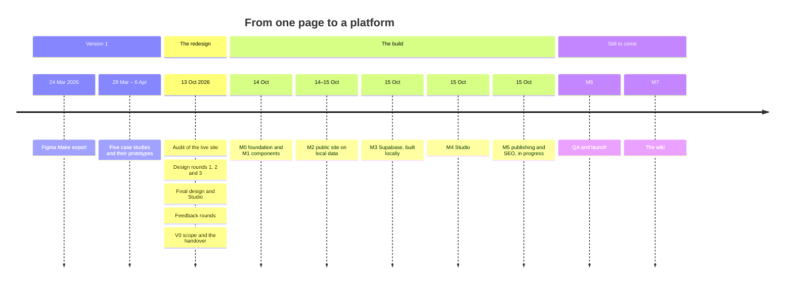
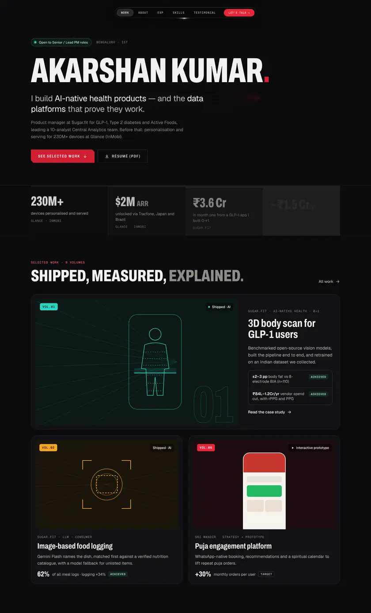
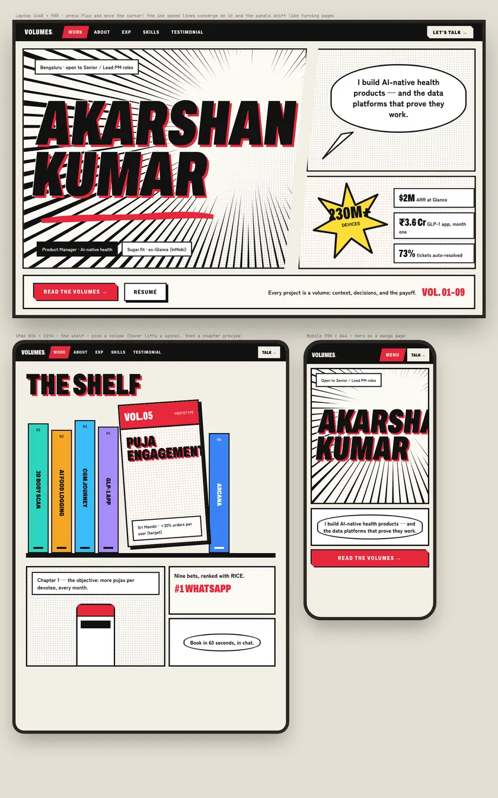
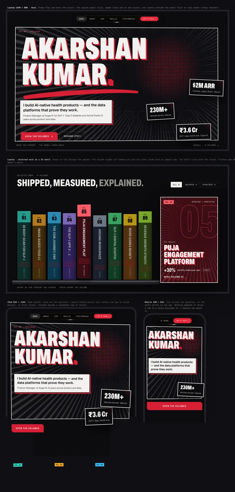

# The story

The portfolio began in March 2026 as a single page exported from Figma Make. It looked distinctive, but every edit was a code change and every number looked the same, whether it was a result or a hope. In October 2026 it was audited, redesigned over three rounds on one canvas, reshaped by the owner's feedback into a small platform, and then built by AI agents working from a detailed handover. This page tells that story in short. The full record, with dates and milestone tables, is [01 · Evolution](../story/01-evolution.md), and the reasoning is in [02 · Decisions](../story/02-decisions.md). Status is as of 15 Oct 2026: the rebuild isn't launched yet, and `main` still serves the original site ([D46](../handover/09-decisions.md)).

## Version 1: a page that worked

The first portfolio was a Vite and React app whose whole site was one component, `App.tsx`, which grew to 4,113 lines. Between late March and early April 2026 it gained five case studies (Arcana Workspace, GLP-1 Digital Scaffold, Sri Mandir, Word Trip and FarmVille 3), with working prototypes for some of them.

It did several things well: a dark, manga-flavoured look, a glass pill nav with a rotating ring, real testimonials and deep case-study content. Its problems were structural:

- every content change was a code change, and 11 commits are titled "Update App.tsx";
- there were no drafts and no preview;
- case studies opened in a modal, with `?open=<id>` as their only link, so they couldn't be shared or indexed one by one;
- targets, projections and measured results looked the same.

## The audit

The redesign started with an audit of the live site, before any design ([`docs/redesign/01-audit.md`](../redesign/01-audit.md)). Beyond the single component, it found 28 UI packages declared but unused, and build output committed to the repository. It also found honesty gaps: the site and the résumé disagreed on several numbers, one RICE table's row didn't match its own inputs, and a "$XXXK" placeholder was live. It named what to keep: the pill nav exactly, the angled-cut button, the prototypes and the testimonials.

## Three design rounds

All the design happened on one canvas, page by page. The boards are mirrored in [`design/`](../../design/README.md).

1. **Three directions.** Volumes (projects as numbered volumes, dark and editorial), Operator (a data-dense dashboard) and Editorial (magazine-like). Volumes won: it carries the owner's love of layered manga storytelling and still reads as professional. The first feedback was to keep the live nav exactly as it is.
2. **Eight bold explorations,** from liquid glass and a cyberpunk HUD to a desktop OS and kinetic type, each at three sizes. Shōnen manga and the mouse-parallax depth field stood out.
3. **Three mixes** of Volumes with ink and depth, plus a motion spec. Ink & Depth won, but only for the hero. The rest of the site kept Round 1's calmer system, so the personality lives in one place and the content stays easy to read ([D3](../handover/09-decisions.md)).

| Round 1 · Volumes | Round 2 · Manga | Round 3 · Ink & Depth |
| --- | --- | --- |
|  |  |  |

## The final design and the platform

The result was more than a page. The public site got a design system (tokens, nine project accents, five result labels, type, grid and components), every page at 1440, 834 and 390, and a motion system with a live demo of every animation. Behind it, the boards drew **Studio**, a CMS for one user: a dashboard, a Website builder where every section can be shown, hidden and reordered, projects with a five-tab editor, Writing, media, Profile & facts, draft preview, and every system state.

## Feedback that changed the product

Each round of the owner's comments on the canvas changed what was being built. A few examples, in order:

- **"How do these sections scale as I add more projects?"** Shelves got a cap, "See all N" and "All work" tiles, and a `/work` list with filters, search and paging.
- **"Can this be made as a word cloud?"** Skills became one word cloud, with sizes the owner sets per skill ([D21](../handover/09-decisions.md)).
- **"Off duty is plain vanilla."** It became a manga page with ink panels and favourites as volume spines ([D22](../handover/09-decisions.md)).
- **"Can we do the CMS auth using email-based OTP?"** Sign-in moved from Google to an email code ([D8](../handover/09-decisions.md)).
- **"Make the repo public."** A security pass followed: no secrets in history, and the owner's address supplied only at setup ([D10](../handover/09-decisions.md)).
- **"I've used up Supabase's free tier with two projects."** The portfolio moved into the photography site's Supabase project, in its own `pm` schema ([D27](../handover/09-decisions.md)).

The full table of fifteen feedback rounds is in [01 · Iterating on feedback](../story/01-evolution.md#iterating-on-feedback-13-oct-2026).

## V0: new design, current content

The first release was scoped as **V0**: the final design with the current site's content, published, so the new site is complete on day one ([D5](../handover/09-decisions.md)). Facts the audit questioned keep their live values and are listed in Studio as "Worth a check", with the résumé's value beside them. Nothing is invented: missing content leaves the field empty, and it hides ([D6](../handover/09-decisions.md)).

The engineering handover ([`docs/handover/`](../handover/README.md)) was written so an AI coding agent could build V0 to the pixel without stopping to ask. It gives the boards as HTML and CSS, an order of precedence for when sources disagree, milestones with a definition of done, and a list of what to ask the owner and what never to ask.

## The build

The rebuild ran from 14 to 15 Oct 2026 on its own branch. Five AI agents worked in parallel, each in its own git worktree: the public site, Studio, security, QA, and a reviewer who merged everything. They coordinated through progress logs and inboxes, so work survived a session ending.

- **M0 · Foundation.** The live site's content was frozen first, in [`src/legacy/content.ts`](../../src/legacy/content.ts), with a test that traces every string back to the old `App.tsx`. Only then was the Figma Make scaffolding removed ([D47](../handover/09-decisions.md)). The shared content core (schemas, defaults and the V0 mapping) was pulled forward, so the site, Studio, the seed and the Edge Functions share one implementation.
- **M1 · Components.** Every component, built into a dev-only catalogue, then unified: one icon set, one keyframes file, one reduced-motion module.
- **M2 · The public site.** Every page at three sizes on local data. Where the boards' details disagreed with the written chapters, the boards won, and each case became a dated decision (for example [D67](../handover/09-decisions.md), [D71](../handover/09-decisions.md)–[D74](../handover/09-decisions.md), [D78](../handover/09-decisions.md) and [D79](../handover/09-decisions.md)). A motion audit found and fixed four gaps. Pixel parity used a fixture of the boards' own copy, with one variant per width ([D70](../handover/09-decisions.md)); by 15 Oct about 65 of 80 compared sections passed.
- **M3 · Supabase.** The schema, row-level security, buckets, six Edge Functions, cron jobs and the seed were all built and tested on PGlite, without touching the shared project. The owner applies them at go-live.
- **M4 · Studio.** Every screen was built. Codes became 8 digits because CAPTCHA protection stays off for now ([D66](../handover/09-decisions.md)), and Studio took fewer dependencies than planned ([D65](../handover/09-decisions.md), [D69](../handover/09-decisions.md), [D80](../handover/09-decisions.md)). The last pass checked the iPad and phone layouts against their boards.
- **M5 · Publishing and SEO.** Metadata, the sitemap, RSS, the copy of published images into the build, redirects, the unlisted-project shell, and the host's routes and headers as Vercel Build Output ([D83](../handover/09-decisions.md)) are built. The owner's go-live steps are left.

How each decision played out is on the [Decisions and trade-offs](Decisions-and-trade-offs.md) page. The milestone tables are in [01 · The build](../story/01-evolution.md#the-build-1415-oct-2026), and the current status in [`HANDOFF.md`](../../HANDOFF.md).

## What's next

M6 is the full QA pass and launch, including the owner's launch checklist ([09](../handover/09-decisions.md#launch-checklist-owner)): exposing the `pm` schema, running the migrations, the email sender, Turnstile, Vercel and the seed. When the branch is merged, `main` becomes the new site. M7 is this wiki, finished once the site is live and stable.
