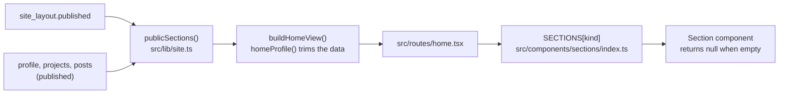
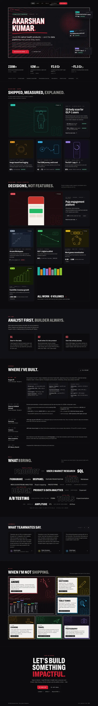

# Widgets

The homepage isn't a fixed page. It's a list of typed sections stored as data, and each section is a widget: one component that reads its settings from the layout and its content from the profile, projects and posts. There are twelve kinds. This page covers each one: its data, its settings, how it renders at 1440, 834 and 390, and when it hides. It ends with the steps to add a new kind. Status is as of 15 Oct 2026: the site isn't launched yet ([D46](../handover/09-decisions.md)), and Studio isn't connected to the real Supabase project until the owner's go-live steps.

## How a section works

The layout is one document, `site_layout`, with a draft and a published copy. Its shape is the `Section` schema in [`src/lib/schemas.ts`](../../src/lib/schemas.ts). The twelve kinds are `SECTION_KINDS`: `hero`, `proof`, `shelf`, `writing`, `about`, `experience`, `skills`, `testimonials`, `offduty`, `contact`, `text` and `footer`.

Every section has:

| Field | What it holds |
| --- | --- |
| `id` | The section's id, which is also its DOM anchor (`#strategy`, `#about`) |
| `kind` | One of `SECTION_KINDS` |
| `visible` | The eye in Studio's outline |
| `nav` | Optional. `{ label }`, max 14 characters. A section with a label is linked in the pill nav, in page order |
| `header` | Optional. `kicker`, `title`, `titleMuted` (the grey second half) and `intro`. Headers live in the layout, not the profile ([D31](../handover/09-decisions.md)) |
| `items` | `{ id, visible }[]`: the section's parts, in order. Depending on the kind, an id names a fixed part (`brush`, `photo`), a profile entry (a role, a skill group) or a project |
| Kind settings | One optional object per kind that needs it: `shelf`, `writing`, `text`, `hero`, `contact` |

The schema also enforces three rules: the hero is always first, the footer is always last, and the hero is always visible. Section ids must be unique.

### From layout to page

- [`publicSections()`](../../src/lib/site.ts) drops hidden sections and hidden items. Through `knownItems()`, it also drops items that point at nothing: a proof stat, role, skill group, testimonial or Off duty entry that isn't in the published profile, or a project that isn't published and listed. A kind whose items are profile or project ids is left out when none survive. Writing is left out with no post marked "Show on my homepage", and a text section with an empty body.
- [`homeProfile()`](../../src/lib/site.ts) then cuts the profile down to what the visible sections show. Hidden parts are left out of the page's data, not only out of its markup. Prerendering writes each loader's return value into the page, so this is the line drafts never cross.
- [`home.tsx`](../../src/routes/home.tsx) renders the sections in order, looking each one up in the `SECTIONS` map. Every component takes `{ section, profile, projects, posts }` ([`types.ts`](../../src/components/sections/types.ts)) and returns `null` when it has nothing to show.
- Studio's Website builder previews the draft with the same map ([`SitePreview.tsx`](../../src/components/studio/preview/SitePreview.tsx)), so the preview and the site can't drift apart.

Why the layout is data: any section can be reordered, hidden or added without a code change. The cost is that the schema needs careful versioning. Every document carries `schemaVersion: 1` ([02 · The layout is data](../story/02-decisions.md#the-layout-is-data)).

### At a glance

| Kind | Content comes from | Settings in the layout | Hides when |
| --- | --- | --- | --- |
| `hero` | `profile`: name, title, positioning, intro, location, availability, hero buttons | `hero.motion`, `hero.floaters` (`items`, `atOnce`) | Never. Its parts hide one by one |
| `proof` | `profile.proof`, `profile.spaces` | Items: the stats, plus `spaces` | No visible stat with a value and no chips |
| `shelf` | Published, listed projects | `shelf.name`, `shelf.rows` (1–3) | No published project on it |
| `writing` | Published posts with "Show on my homepage" | `writing.latest` (2–4), `writing.rss` | No such post. V0 has none ([D19](../handover/09-decisions.md)) |
| `about` | `profile.about`: body, points, photo | Items: `text`, `points`, `photo` | Nothing in any part and no title |
| `experience` | `profile.experience`, `profile.education` | Items: the roles | No visible role and no education |
| `skills` | `profile.skills`: groups and sized skills | Items: the groups | No visible group |
| `testimonials` | `profile.testimonials` | Items: the testimonials | No visible testimonial |
| `offduty` | `profile.offDuty` | Items: the panels | No visible panel |
| `contact` | `profile.contact` | `contact.closing`, `closingAccent`; items: `closing`, `email`, `linkedin`, `github`, `resume` | Nothing to show at all |
| `text` | The layout itself | `text.body` (rich text) | Empty body |
| `footer` | `profile.name`, `profile.footer.credit`, the last site publish | Items: `credit`, `updated` | Can be hidden in Studio |

The V0 layout, in page order, is in [07 · Layout](../handover/07-v0-content.md#layout). The Shipped shelf starts hidden, holding the four SugarFit drafts ([D17](../handover/09-decisions.md)).

## The sections

The exact sizes, spacing, type and colour are on the boards: [`Home`](../../design/boards/Home.dc.html), [`HomeTablet`](../../design/boards/HomeTablet.dc.html) and [`HomeMobile`](../../design/boards/HomeMobile.dc.html). The written rules are in [03 · Home](../handover/03-public-site.md#home). What follows is a summary.

| Laptop (1440) | Phone (390) |
| --- | --- |
|  |  |

The iPad board is previewed in [`HomeTablet.webp`](../../design/previews/HomeTablet.webp).

### Hero

Component: [`Hero.tsx`](../../src/components/sections/Hero.tsx), with [`HeroFloaters.tsx`](../../src/components/sections/HeroFloaters.tsx). It's the Ink & Depth panel, the one place the site's manga personality is turned up ([D3](../handover/09-decisions.md)).

- **Data:** `profile.name` (required), `positioning` (required), `availability`, `location`, `intro` and `heroButtons`. The ghost numeral counts published, listed volumes ("01—05" in V0, [D48](../handover/09-decisions.md)).
- **Items:** `availability`, `location`, `name`, `brush`, `positioning`, `intro` and `buttons`. Each can be switched off; empty ones hide.
- **Settings:** `hero.motion` switches the tilt and speed-line aiming. `hero.floaters.items` lists the projects that float, and `atOnce` sets how many show together (1–3). Only published, listed projects float.
- **1440:** the tilting ink panel, and up to `atOnce` floating previews to the right of the text. The laptop floaters start at 1101px, as the boards say ([D67](../handover/09-decisions.md)).
- **834:** the same panel and drift, with one floater at a time in one of two spots.
- **390:** no floaters and no tilt; drift on touch. Location and intro hide, and the two buttons go full width.
- **Hides:** never. The schema keeps it first and visible; Studio says "The hero always shows. Hide its parts instead."

### Proof strip

Component: [`Proof.tsx`](../../src/components/sections/Proof.tsx). It shows the numbers under the hero.

- **Data:** `profile.proof` (value, unit, label, source) and `profile.spaces`, the "Problem spaces" chips. Proof cells never carry a result label. V0's strip is the live hero's four stats ([D30](../handover/09-decisions.md)).
- **Items:** one per stat, plus `spaces`.
- **834:** the chips show without their label. **390:** the chips row and each cell's source line hide.
- **Hides:** with no visible stat that has a value and no chips. V0's chips start empty ([D32](../handover/09-decisions.md)).

### Shelf

Component: [`ShelfSection.tsx`](../../src/components/sections/ShelfSection.tsx), with the cap logic in [`src/lib/shelf.ts`](../../src/lib/shelf.ts) and volume numbers in [`src/lib/volumes.ts`](../../src/lib/volumes.ts). There can be more than one shelf; V0 has two.

- **Data:** the shelf's published, visible projects, in layout order.
- **Items:** project ids. Drafts keep their place in Studio, but never reach the page.
- **Settings:** `shelf.name` and `shelf.rows`: how many rows of three show under the lead card.
- **The lead card** is the first visible, published project. Nothing stores a separate lead; Studio's star moves a project to the top ([D37](../handover/09-decisions.md)).
- **The cap:** past the rows, the last cell becomes "See all N", and a gap in the last row gets the "All work" tile. The homepage stays curated at 9 or 90 projects; `/work` lists everything.
- **1440:** the lead plus rows of three. **834:** two up. **390:** compact rows.
- **Hides:** with no published project. Studio's outline shows "Nothing live yet".

### Writing

Component: [`WritingSection.tsx`](../../src/components/sections/WritingSection.tsx).

- **Data:** the latest published posts with "Show on my homepage", newest first.
- **Settings:** `writing.latest` (2, 3 or 4) and `writing.rss`, which shows the RSS link.
- **Hides:** until the first such post is published. V0 starts with no posts, so the section is hidden and `/writing` is a 404 ([D19](../handover/09-decisions.md)).

### About

Component: [`About.tsx`](../../src/components/sections/About.tsx).

- **Data:** `profile.about.body` (paragraphs), `about.points` (numbered, title and text) and `about.photo`.
- **Items:** `text`, `points` and `photo`.
- **Layout:** the text sits beside the title on laptop and under it on iPad and phones. Without a photo the text takes the full width.
- **Hides:** with nothing in any part and no title.

### Experience

Component: [`Experience.tsx`](../../src/components/sections/Experience.tsx).

- **Data:** `profile.experience` and, if any, `profile.education`. Highlights marked `hidden` stay out of the HTML; that's how the Wipro "$XXXK" placeholder is kept but not shown ([D18](../handover/09-decisions.md)).
- **Items:** the roles. The first visible role is Featured, the second Standard, the rest Compact.
- **"Full résumé"** links to `contact.resume` and hides without one.
- **1440:** the full timeline. **834:** Featured stacked, Standard as a company row, the rest as accordions. **390:** Featured shows up to four bullets with an "All {company} highlights" link; the rest are accordions. The accordion rotates a plus 45° ([D68](../handover/09-decisions.md)).
- **Hides:** with no visible role and no education.

### Skills

Component: [`Skills.tsx`](../../src/components/sections/Skills.tsx), with the interleaved order in [`src/lib/skills-order.ts`](../../src/lib/skills-order.ts).

- **Data:** `profile.skills`: groups, each with skills and a size (`s`, `m`, `l`, `xl`). V0 starts every skill at M, because which skills look biggest is the owner's call ([D21](../handover/09-decisions.md)).
- **Items:** the groups.
- **Rendering:** one word cloud. Group words are outlined, and hovering, focusing or tapping a group lights up its skills. The markup stays grouped for screen readers.
- **Every width** shows every group and skill. The phone board's shorter list is illustrative ([D15](../handover/09-decisions.md)). Only the hint line changes ("Hover or click…", "Tap a group…").
- **Hides:** with no visible group.

### Testimonials

Component: [`Testimonials.tsx`](../../src/components/sections/Testimonials.tsx).

- **Data:** `profile.testimonials`: quote, name, initials, role, tone (an accent), optional tag and LinkedIn link. The tag isn't rendered, because no board shows it.
- **Items:** the testimonials. Every visible one is in the carousel, with no limit and no separate page ([D14](../handover/09-decisions.md)).
- **1440:** three at a time with previous, next and a "1–3 of 7" counter. **834 and 390:** a snap-scrolling row with dots, and no avatar or LinkedIn link, as on the boards.
- **Hides:** with no visible testimonial.

### Off duty

Component: [`OffDuty.tsx`](../../src/components/sections/OffDuty.tsx). It's a manga page ([D22](../handover/09-decisions.md)).

- **Data:** `profile.offDuty`: label, title, text, optional tag, accent, and art from six presets (Kunai, Pencil, Paddle, Pan, Plane, Camera). The first item's `picks` become the favourites, drawn as volume spines.
- **Items:** the panels.
- **Rendering:** ink panels with caption boxes and tags, in grids for one to six or more items, then the spine shelf. Phones get a rail with decorative dots.
- **Hides:** with no visible panel.

### Contact

Component: [`Contact.tsx`](../../src/components/sections/Contact.tsx).

- **Data:** `profile.contact`: email, LinkedIn, GitHub, the résumé, and the phone number (shown only when `showPhone` is on).
- **Settings:** `contact.closing` and `closingAccent`, the closing line and its red word.
- **Items:** `closing`, `email`, `linkedin`, `github` and `resume`. Each link hides without its value.
- **1440:** "Email me", "Copy email", then the links. **834:** Email me, LinkedIn and GitHub as buttons. **390:** Email me full width, then LinkedIn and GitHub side by side. Copy email and Résumé (PDF) are laptop-only.
- **Hides:** with nothing at all to show. Without an email, the buttons hide.
- "Let's Talk" in the nav scrolls here by default; if Contact is hidden, it opens an email instead ([D34](../handover/09-decisions.md)).

### Text section

Component: [`TextSection.tsx`](../../src/components/sections/TextSection.tsx). It's the one kind the owner can add.

- **Data:** the layout itself: the header and `text.body`, rich text in the post body's 68-character column. There's no board of its own; it uses the post body styles from `WritingPublic`.
- **Hides:** while the body is empty. `publicSections()` also drops it.
- **In Studio:** "Add section" creates "Text section {n}" before Contact ([`newTextSection()`](../../src/lib/defaults.ts), [`addTextSection()`](../../src/lib/studio/website.ts)). Its panel has a Title, a Text field and "Delete section", which offers Undo.

### Footer

Component: [`Footer.tsx`](../../src/components/sections/Footer.tsx), which renders `SiteFooter`.

- **Data:** "© {year} {name} · {credit}" and "Last updated {date}", the date of the last site publish, formatted "13 Oct 2026" in Indian Standard Time.
- **Items:** `credit` and `updated`.
- **834:** "© {year} {name}" and "Updated {date}", with no credit. **390:** one line.
- **Hides:** it can be switched off in Studio, unlike the hero.

## Editing sections in Studio

The Website builder ([`src/components/studio/website/`](../../src/components/studio/website)) is where sections are arranged. Its model is in [`src/lib/studio/website.ts`](../../src/lib/studio/website.ts), and the builder is described for the owner in the [Studio guide](Studio-guide.md#arrange-the-homepage-in-website).

- **The outline** lists the sections in page order, each with a handle, its items, a "live/total" count and an eye. Hero and footer are pinned.
- **The inspector** shows the selected section's panel: "Show on the site", "Link it in the nav" (every kind except hero, proof and footer), the kind's own fields, and "Position".
- **Names, numbers and roles** are edited in Profile & facts, not here, for the hero, proof, experience, testimonials and contact.

## How to add a new section type

A new kind changes what visitors see, so it's a core product decision: agree it with the owner first and record it in [09 · Decisions](../handover/09-decisions.md) ([`CLAUDE.md`](../../CLAUDE.md)). It also needs a board, or an agreed rule that it reuses existing styles, as the text section reuses the post body. Then the code changes are these. The maps marked "full record" are typed `Record<Section["kind"], …>`, so `npm run typecheck` fails until they have the new kind.

1. **The schema.** Add the kind to `SECTION_KINDS` in [`src/lib/schemas.ts`](../../src/lib/schemas.ts). If it has settings, add one optional object for it to `Section`, beside `shelf`, `writing`, `hero` and the rest. If its content lives in the profile, add the field to `Profile` there too. Types follow from the schema in [`src/lib/types.ts`](../../src/lib/types.ts).
2. **The Edge Functions' copy.** Run `node scripts/sync-functions-lib.ts`. It copies `schemas`, `types`, `published`, `rich-text` and `links` into `supabase/functions/_shared/lib/`, and a unit test fails while a copy is out of date ([`scripts/sync-functions-lib.ts`](../../scripts/sync-functions-lib.ts)).
3. **Publishing.** Add the kind to `KIND_LABELS` (full record) in [`supabase/functions/_shared/site.ts`](../../supabase/functions/_shared/site.ts). If its items are profile ids, add a case to `profileIds()` there. If it adds profile content, check what [`publishProfile()`](../../src/lib/published.ts) carries into the published copy.
4. **Defaults.** Add a factory to [`src/lib/defaults.ts`](../../src/lib/defaults.ts), like `newTextSection()`. Add it to `defaultLayout()` only if a blank install should have it.
5. **The public views.** In [`src/lib/site.ts`](../../src/lib/site.ts):
   - in `knownItems()`, return the set of ids its items may point at, if they point at profile entries or projects. Unknown ids are then dropped, and the section hides with none left;
   - in `publicSections()`, add any other "nothing to show" rule, as Writing and Text have;
   - in `homeProfile()`, cut any new profile field down to the visible items, so hidden content never reaches the page's data.
6. **The component.** Add it to [`src/components/sections/`](../../src/components/sections). It takes `SectionProps`, returns `null` when it has nothing to show, sets `id={section.id}`, renders the header with `SectionHeader`, and uses `useSectionReveal` for the scroll reveal. Register it in `SECTIONS` (full record) in [`index.ts`](../../src/components/sections/index.ts). Any motion needs an ID and spec in [04 · Motion](../handover/04-motion.md), with its reduced-motion variant.
7. **Studio.** In [`src/lib/studio/website.ts`](../../src/lib/studio/website.ts):
   - add its name to `KIND_NAME`, any fixed parts to `FIXED_ITEMS`, and an `itemName()` case for items that point at profile entries;
   - check `canNav` and `pinned`.

   In [`Inspector.tsx`](../../src/components/studio/website/Inspector.tsx), add its one-line description to `SUB` and a `case` with its fields. If its content is a profile list, add a form to Profile & facts ([`src/components/studio/profile/`](../../src/components/studio/profile)), as [D38](../handover/09-decisions.md) did for fields with no board editor.
8. **A way to add it.** Today "Add section" only creates text sections (`addTextSection()`). Every other kind exists because the V0 layout has it. A kind that can be added more than once needs its own entry point in the outline, and that's a design decision.
9. **Tests.** Extend [`sections.test.tsx`](../../src/components/sections/sections.test.tsx) (renders, and hides when empty), [`tests/unit/site.test.ts`](../../tests/unit/site.test.ts) (hidden items and drafts never reach the view) and [`src/lib/studio/website.test.ts`](../../src/lib/studio/website.test.ts). Add its board copy to the parity fixture, [`tests/fixtures/board-content.ts`](../../tests/fixtures/board-content.ts), and check it at 1440, 834 and 390 ([08 · QA](../handover/08-qa.md)).

Then run `npm run typecheck`, `npm run lint`, `npm test` and `npm run build`.

## Related

- [Content model](Content-model.md): the profile, layout and project documents in full.
- [Design system](Design-system.md) and [Motion](Motion.md): the components and animations each section uses.
- [03 · Public site](../handover/03-public-site.md) and [06 · Site layout](../handover/06-backend.md#site-layout): the specs.
